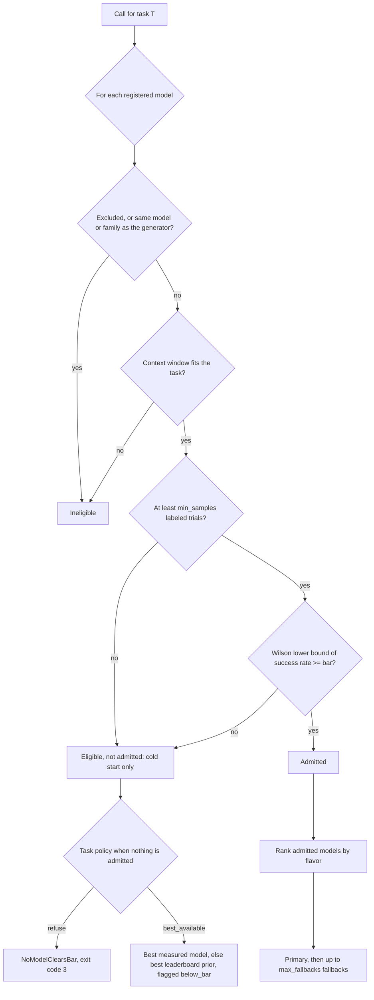

# ai-model-routing

Route every repeated kind of model call (ticket triage, field extraction, code generation, eval and judge calls) to the cheapest model that clears a quality bar you measured on that task, with fallback, monitoring and cost attribution. Or, if your team has decided spend does not matter, route to the best measured model with the exact same machinery.

- Python 3.10+, standard library only, about 2,700 lines you can read in an afternoon
- Works with any OpenAI-compatible endpoint (vendor APIs, gateways, local servers) or your own provider class
- Ships with a fully offline demo, so you can see the whole loop without an API key
- Tested on public data that already holds each model's answers, correctness and cost, so no API key is needed: see [Evidence](#evidence-held-out-results-on-public-data)
- Also decides whether an agent should do one piece of work itself or hand it to a sub-agent on the routed model (`model-routing delegate`), in both flavors

## Why route per task

- Most model spend in a product is a handful of call types repeated thousands of times: classify this ticket, pull these fields, write this test, grade this answer. Each one is a **task**: a repeated call with an **acceptance check** that says whether one output is right
- Send every call to the strongest model and you can pay 40x to 100x more per call than the cheapest tier (see the cost table below). Send them all to the cheapest and quality drops without a single error in the logs
- Public leaderboards do not settle it. They disagree with each other (one model ranks first on abstract reasoning and eighth on professional writing), and none of them is your task
- The number that tells you whether a model can do *your* task is its success rate on *your* acceptance check: agreement with gold labels, exact match on extracted fields, generated tests passing. This library makes that number the gate, per task. Nothing in the routing rules knows about a domain; a task is a name, a bar and the counts you measured

### Judge and eval calls, the first-class case

- In a team that evaluates seriously, judge calls are a large share of model spend: every candidate output, on every test case, on every rubric, gets graded, often more than once
- A cheap judge that is wrong does more damage than a cheap model on any other task, because it silently weakens the evals that every later decision trusts
- We found no public judge benchmark with a row for the current generation of models (see [research/judge-benchmarks.md](research/judge-benchmarks.md)). The nearest public evidence is a router benchmark that publishes each judge model's grade of each answer it graded: [AutoBench judges](#autobench-judges) chooses a judge on it by agreement with the other judges, not with a human label
- A judge must not grade its own family's output, so judge tasks turn on generator isolation (below)

## Two flavors, one pipeline

| | `cost_effective` | `cost_blind` |
|---|---|---|
| Who it is for | Teams paying per token | Teams that have decided token cost is not the constraint (credits, flat-rate contracts, quality-critical work) |
| Among models that clear the bar, pick | the cheapest expected cost per call; ties go to higher measured quality | the highest measured quality |
| Bar, sample minimum, generator isolation | same | same |
| Fallback chain, validation, monitoring | same | same |
| Cost in the log | list price | list price (the router ignores it; you still see it) |

The flavor changes exactly one value: the `routing_cost` used to rank passing candidates (list cost, or 0). Everything else is shared, so switching flavors is a one-word change and the spend report stays honest either way.

## How a model is chosen



The cost of a call is its list price. A model whose stats hold measured token counts for the task is priced at its own mean input and output tokens per call on that task, each rounded up; any other model is priced at the task's `expected_input_tokens` and `expected_output_tokens`. So a model that is cheap per token but writes several times as much as the others can lose the cheapest place. Each path of an inline-or-sub-agent decision is priced at the sizes of the model doing the work. The context-window check always uses the task's expected tokens, because a mean says nothing about the longest call, so set them to the longest calls you expect.

### The quality bar is a confidence bound, not an average

A model is admitted for a task only when the lower end of a two-sided Wilson score interval on its measured success rate against the task's acceptance check is at or above the task's bar, and only after at least `min_samples` trials. At 95% confidence:

| Bar | Successes needed on 50 items | on 100 | on 200 | on 400 |
|---|---|---|---|---|
| 0.75 | 44/50 (88%) | 84/100 (84%) | 163/200 (81.5%) | 317/400 (79.25%) |
| 0.80 | 46/50 (92%) | 88/100 (88%) | 172/200 (86%) | 336/400 (84%) |
| 0.85 | 48/50 (96%) | 92/100 (92%) | 180/200 (90%) | 354/400 (88.5%) |

- A model that succeeds on 90% of 50 items does not clear an 85% bar (its lower bound is 0.786). It might be fine; you have not shown it yet
- More labeled items buy you a cheaper model: the same 90% clears 0.85 at 200 items
- This is deliberately conservative. A model below the bar lowers quality on every call of the task, and a wrong judge also corrupts every decision downstream of it, so the burden of proof is on the cheap model

### Rules that protect quality

- **Generator isolation, for tasks that check another model's output.** When a judge, reviewer or verifier call names the model that produced the output it checks (`generator_model`), the router excludes that model and its family while the task's `independent_of_generator` is on (the default). Self-preference in LLM judges is well documented (see [research/prior-art.md](research/prior-art.md)), so this is on by default. It has no effect when no generator is named, and the non-judge example tasks set `independent_of_generator` to `false` to say so
- **Priors never admit.** Leaderboard scores (`model_routing/data/priors.json`) only order candidates when nothing has been measured, and tell you which models to calibrate first. A leaderboard score is not a success rate on your task
- **Every decision explains itself.** Each candidate carries a reason code (`excluded_model`, `excluded_family`, `generator`, `generator_family`, `context_too_small`, `insufficient_samples`, `below_bar`, `passes`), its measured counts and lower bound, and the decision says whether it rests on measurements or priors (`basis`) and whether it is below the bar

## Quickstart

```bash
git clone https://github.com/jeffma8888/ai-model-routing.git
cd ai-model-routing
python -m venv .venv && . .venv/bin/activate
pip install -e ".[dev]"
pytest -q
model-routing demo --out ./demo-run
```

The demo routes one judge task with fictional `demo/` models and a synthetic 300-item labeled set (seeded, deterministic). It calibrates four judges, selects in both flavors, runs 200 judge calls per flavor with a simulated outage on the primary, then asks in each flavor whether an `atlas-max` parent 60,000 tokens into a session should do one more check itself or hand it to a sub-agent, and runs the hand-off it chose. It writes `calls.jsonl`, `stats.json`, `outcomes.jsonl` (the calibration set as an outcome matrix, used below), and its registry and task as `models.json` and `tasks.json`.

```text
$ model-routing demo --out ./demo-run
model-routing demo (fictional demo/ models, simulated outages)

cost_effective:
  primary:        demo/atlas-mid
  fallbacks:      demo/birch-pro, demo/atlas-max
  calls:          200
  fallback calls: 25
  list-price USD: 0.8650

cost_blind:
  primary:        demo/atlas-max
  fallbacks:      demo/atlas-mid, demo/birch-pro
  calls:          200
  fallback calls: 30
  list-price USD: 3.3794

cost_effective spent 26% of what cost_blind spent

inline or sub-agent, a demo/atlas-max parent at 60,000 context tokens:
  cost_effective: delegate to demo/atlas-mid (delegate_cheaper), inline 0.632000 vs delegate 0.029400 USD
  cost_blind:     inline on demo/atlas-max (inline_as_good), inline 0.632000 vs delegate 0.048600 USD
  hand-off calls: 1, list-price USD 0.0036
log: demo-run/calls.jsonl
```

What happened:

- Calibration on 300 synthetic items measured `atlas-max` 286/300, `atlas-mid` 274/300, `birch-pro` 273/300 and `birch-nano` 218/300. At a 0.85 bar the first three clear it (lower bounds 0.923, 0.876, 0.872) and `birch-nano` does not (0.674)
- `cost_effective` routes to `atlas-mid`, the cheapest admitted judge; `cost_blind` routes to `atlas-max`, the best measured one. Same bar, same fallback logic, about a quarter of the spend
- When the primary hit a simulated outage (about 15% of its calls), the call fell back to the next admitted judge, and every attempt landed in the log
- `atlas-mid` (true accuracy 0.91) edged out `birch-pro` (0.93) by one item on this sample. A gap that small is noise, which is why the bar is a lower bound and why the fallback order should not be read as a quality ranking
- Inline or sub-agent: in `cost_effective` the parent hands the check to `atlas-mid`, because re-reading its 60,000-token context would cost 0.632 USD and the hand-off 0.0294 USD with the bar still held; in `cost_blind` it keeps the check, because its best delegate is `atlas-max` itself. The hand-off ran through `Executor.call_delegated` as one more call in the log, tagged `delegated` and `parent`. That call cost 0.0036 USD on its simulated tokens, where the estimate priced it at the task's expected tokens plus the brief (0.0048 USD); the other 0.0246 USD of the estimate is the parent writing the brief and reading the result in its own calls, which the log does not see ([Inline or sub-agent](#inline-or-sub-agent) explains the arithmetic)

Then slice the log:

```text
$ model-routing report --log demo-run/calls.jsonl --by flavor
flavor          calls  attempts  errors  invalid  fallback_calls  fallback_rate  cost_usd  routing_cost_usd  p50_ms  p95_ms
--------------  -----  --------  ------  -------  --------------  -------------  --------  ----------------  ------  ------
cost_blind      200    230       30      0        30              0.150          3.379358  0.000000          1497.4  2368.0
cost_effective  201    226       25      0        25              0.124          0.868590  0.868590          1429.9  2376.7
```

`cost_blind` logs `routing_cost_usd` as 0 because the router ignored price, but `cost_usd` still shows what the calls cost at list price. `cost_effective` counts 201 calls: its 200 judge calls and the hand-off. The hand-off's tags split it out:

```text
$ model-routing report --log demo-run/calls.jsonl --by tag:delegated
tag:delegated  calls  attempts  errors  invalid  fallback_calls  fallback_rate  cost_usd  routing_cost_usd  p50_ms  p95_ms
-------------  -----  --------  ------  -------  --------------  -------------  --------  ----------------  ------  ------
(none)         400    455       55      0        55              0.138          4.244340  0.864982          1485.2  2376.7
true           1      1         0       0        0               0.000          0.003608  0.003608          1579.4  1579.4
```

### Check the choice on items the router never saw

`model-routing evaluate` takes an outcome matrix (one JSON object per task, item and model, with `correct` and either `cost_usd` or token counts; `DESIGN.md` 12.1), splits each task's items in half by a seeded hash of the item ID, calibrates on one half, routes each flavor (both by default) through the same `Router.select`, and scores the routed model on the other half next to simple baselines. It repeats this over 10 seeds by default. `--flavor` runs only the flavors given, so `--flavor cost_blind` serves a matrix that records no cost (DESIGN 12.4). The demo's `outcomes.jsonl` is a ready input:

```text
$ model-routing evaluate --outcomes demo-run/outcomes.jsonl --bar 0.85
bar 0.85, cost_effective
strategy               success  cost_usd  below_bar_rate  cleared_rate  bar_violation_rate
---------------------  -------  --------  --------------  ------------  ------------------
routed                 0.910    0.9620    0.000           1.000         0.000
oracle                 1.000    0.2063    0.000           -             -
best_on_calibration    0.954    3.0440    0.000           -             -
cheapest               0.732    0.0304    1.000           -             -
model:demo/atlas-max   0.954    3.0440    0.000           -             -
model:demo/atlas-mid   0.916    0.6088    0.000           -             -
model:demo/birch-nano  0.732    0.0304    1.000           -             -
model:demo/birch-pro   0.913    1.2176    0.000           -             -

bar 0.85, cost_blind
strategy               success  cost_usd  below_bar_rate  cleared_rate  bar_violation_rate
---------------------  -------  --------  --------------  ------------  ------------------
routed                 0.954    3.0440    0.000           1.000         0.000
oracle                 1.000    0.2063    0.000           -             -
best_on_calibration    0.954    3.0440    0.000           -             -
cheapest               0.732    0.0304    1.000           -             -
model:demo/atlas-max   0.954    3.0440    0.000           -             -
model:demo/atlas-mid   0.916    0.6088    0.000           -             -
model:demo/birch-nano  0.732    0.0304    1.000           -             -
model:demo/birch-pro   0.913    1.2176    0.000           -             -
```

Reading it:

- `routed` held the 0.85 bar on every held-out half in both flavors (`bar_violation_rate` 0.000 over 10 seeds, about 150 held-out items each). `cost_effective` spent about a third of what `cost_blind` spent (0.96 vs 3.04 USD) for 0.044 less held-out success (0.910 vs 0.954)
- `cost_effective` routed to `atlas-mid` on 7 seeds, `birch-pro` on 2 and `atlas-max` on 1, the split where neither cheaper judge's lower bound cleared the bar on its calibration half. `cost_blind` routed to `atlas-max` every time, which is also `best_on_calibration` here
- `cheapest` (`birch-nano`) is below the bar on every split. `oracle` is right whenever any judge is right and pays the cheapest right judge's price, so it is a bound that per-prompt routing could at most approach, not something task-level routing can reach
- The routed `cost_effective` success (0.910) is below both judges it mostly picks between (0.916 and 0.913). The two halves are complementary, so a judge that drew a lucky calibration half drew an unlucky held-out half, and the router picks the lucky one. That selection effect is why the bar is a lower bound and why `bar_violation_rate` should be read next to the held-out size, never against zero (`DESIGN.md` 12.3)
- `success` and `cost_usd` are means over seeds; `below_bar_rate` is the share of (task, seed) cells under the bar; `cleared_rate` and `bar_violation_rate` apply to `routed` only. `--json` prints the full result without per-cell rows, small enough to commit next to the data it came from

### Inline or sub-agent

An agent that reaches a piece of work, one or more successive calls of a task (`--work-calls`, default 1), can do it itself (inline) or hand it to a fresh sub-agent on the model the router picks. `model-routing delegate` holds both paths to the task's bar and prices what each one adds to the parent's calls: the parent's context (`--context-tokens`), the brief it writes (`--brief-tokens`), the result it reads back (`--result-tokens`), and later parent calls that re-read them (`--carry-turns`, default 0). The demo's output is a ready input. Here an `atlas-max` parent 60,000 tokens into a session reaches one faithfulness check:

```text
$ model-routing delegate demo_faithfulness_judge --parent demo/atlas-max --context-tokens 60000 --brief-tokens 400 --result-tokens 60 --generator demo/cedar-writer --registry demo-run/models.json --tasks demo-run/tasks.json --stats demo-run/stats.json
mode:                delegate
model:               demo/atlas-mid
reason:              delegate_cheaper
below_bar:           false
inline_cost_usd:     0.632000
delegate_cost_usd:   0.029400
parent_quality_lb:   0.923
delegate_quality_lb: 0.876
```

The same check from an `atlas-mid` parent that would fold it into its next reply (`--fold-inline`):

```text
$ model-routing delegate demo_faithfulness_judge --parent demo/atlas-mid --context-tokens 60000 --brief-tokens 400 --result-tokens 60 --fold-inline --generator demo/cedar-writer --registry demo-run/models.json --tasks demo-run/tasks.json --stats demo-run/stats.json
mode:                inline
model:               demo/atlas-mid
reason:              inline_cheaper
below_bar:           false
inline_cost_usd:     0.004000
delegate_cost_usd:   0.009720
parent_quality_lb:   0.876
delegate_quality_lb: 0.876
```

The same folded check when it takes two calls, the second re-reading the first (`--work-calls 2`):

```text
$ model-routing delegate demo_faithfulness_judge --parent demo/atlas-mid --context-tokens 60000 --brief-tokens 400 --result-tokens 60 --fold-inline --work-calls 2 --generator demo/cedar-writer --registry demo-run/models.json --tasks demo-run/tasks.json --stats demo-run/stats.json
mode:                delegate
model:               demo/atlas-mid
reason:              delegate_cheaper
below_bar:           false
inline_cost_usd:     0.130400
delegate_cost_usd:   0.016920
parent_quality_lb:   0.876
delegate_quality_lb: 0.876
```

An `atlas-mid` parent 10,000 tokens into a session, doing the check in a call of its own, when its provider caches the prompt and a cached read costs a tenth of the list input price (`--cached-read-ratio 0.1`):

```text
$ model-routing delegate demo_faithfulness_judge --parent demo/atlas-mid --context-tokens 10000 --brief-tokens 400 --result-tokens 60 --cached-read-ratio 0.1 --generator demo/cedar-writer --registry demo-run/models.json --tasks demo-run/tasks.json --stats demo-run/stats.json
mode:                inline
model:               demo/atlas-mid
reason:              inline_cheaper
below_bar:           false
inline_cost_usd:     0.008400
delegate_cost_usd:   0.009720
parent_quality_lb:   0.876
delegate_quality_lb: 0.876
```

Reading it:

- Inline, `atlas-max` would re-read its 60,000-token context in a call of its own at 10 USD per 1M input tokens: 0.632 USD. Delegating pays for the 400-token brief, one `atlas-mid` call on the brief and the 1,000-token input, and the next parent call re-reading the brief and the 60-token result: 0.0294 USD, about 5% of inline. `atlas-mid` clears the 0.85 bar (lower bound 0.876), so the hand-off keeps the bar
- Folded into the next reply, inline work never re-reads the context, so it costs only the work's own tokens at the parent's price (0.0040 USD). Delegating, even to `atlas-mid` itself, adds the brief and the re-read (0.0097 USD), so the parent keeps the work: `inline_cheaper`
- With two calls, only the second folds into the next reply, so the first re-reads the 60,000-token context in a call of its own: 0.1304 USD inline. Delegated to `atlas-mid` itself, each call re-reads only the brief and the calls before it: 0.0169 USD. Each call re-reads everything before it on its path and nothing is summarised between calls (`DESIGN.md` 13.2)
- A cached read prices the parent's re-read of its context in the inline work at that fraction of its list input price, and nothing else: the work's own tokens, the brief, the result, the delegate and all output stay at list price. At 0.1 the 10,000-token re-read costs 0.002 USD instead of 0.02, so the `atlas-mid` parent keeps the check (0.0084 against 0.0097 USD); without the flag, at list price, it delegates (0.0264 against 0.0097). The `atlas-max` parent above still delegates at 0.1 (0.092 against 0.0294 USD) and even at 0 (0.032), since writing the brief (0.02 USD), the `atlas-mid` call (0.0048) and the next call's re-read of the 460-token brief and result (0.0046) still cost less than `atlas-max` doing the work (0.02) and re-reading its 1,200-token input and output (0.012). Cache writes, cache expiry and discounts on other re-reads are not modelled (`DESIGN.md` 13.2)
- `cost_blind` ignores price, so the first parent stays inline (`inline_as_good`): its best delegate is `atlas-max` itself, and equal-quality ties go inline because a brief can drop detail. A parent below the bar hands off to a delegate that clears it (`parent_below_bar`), whatever inline would cost, in either flavor: a `birch-nano` parent (lower bound 0.674) at 2,000 context tokens goes to `atlas-mid` in `cost_effective` although inline would cost 0.00052 USD against 0.0050 (`cost_blind` sends it to `atlas-max`). At 60,000 tokens the reason is `parent_context_full` instead, because the work no longer fits its 32,000-token window and that check comes first
- Inline is blocked outright when the task excludes the parent's family, when the parent is the generator or in its family on an `independent_of_generator` task, or when the work does not fit the parent's context. `--json` prints the full decision, including the delegate's route (`DESIGN.md` 13)

On public data, [Delegation on AutoBench](#delegation-on-autobench) scores this decision on held-out questions for each of 20 models as the parent.

## Calibrate your own task

1. **Define the task** in a tasks file. `model_routing/data/example_tasks.json` ships three judge tasks and four from other domains (`support_ticket_triage`, `invoice_field_extraction`, `unit_test_codegen`, `tool_calling_support_agent`):

   ```json
   {"tasks": [{
     "name": "faithfulness_judge",
     "bar": 0.85,
     "min_samples": 50,
     "independent_of_generator": true,
     "expected_input_tokens": 3000,
     "expected_output_tokens": 150,
     "on_no_model": "refuse",
     "max_fallbacks": 2,
     "prior_category": "professional_writing"
   }]}
   ```

2. **Run each candidate model over a labeled set for the task** and write one JSON line per item. Either give the output and the label (compared with `==`), or say whether the output passed the task's acceptance check:

   ```json
   {"task": "faithfulness_judge", "model": "anthropic/claude-haiku-5.5", "prediction": "unfaithful", "gold": "unfaithful"}
   {"task": "unit_test_codegen", "model": "openai/gpt-6-luna", "correct": false}
   {"task": "support_ticket_triage", "model": "openai/gpt-6-luna", "correct": true, "input_tokens": 1240, "output_tokens": 35}
   ```

   For `unit_test_codegen`, `correct` means the generated tests ran and passed; for an extraction task it might mean every field matched exactly. For `tool_calling_support_agent` a line is one whole conversation: `correct` means the checks on its end state passed, and its token counts are the sums over the conversation's model calls. The library only counts. A line may also record what the call read and wrote as `input_tokens` and `output_tokens` (both or neither); once a model has them on a task, the router prices it there at its own mean tokens per call instead of the task's expected tokens.

3. **Fold the results into the stats file** (counts and token totals accumulate across runs; a row with token counts also gets `input_tokens`, `output_tokens` and `token_trials`, the number of calls they were summed over):

   ```bash
   model-routing calibrate --results results.jsonl --stats stats.json
   ```

4. **Ask for a route.** For a task that checks another model's output, name that model so its family is excluded; other tasks need no `--generator`:

   ```bash
   model-routing select faithfulness_judge --flavor cost_effective --generator openai/gpt-6.1-sol --stats stats.json
   model-routing select faithfulness_judge --flavor cost_blind --generator openai/gpt-6.1-sol --stats stats.json --json
   model-routing select support_ticket_triage --flavor cost_effective --stats stats.json
   ```

   Exit codes: 0 routed, 2 bad input, 3 no model clears the bar (for a `refuse` task).

## Use it in code

```python
from model_routing import (
    DATA_DIR, Executor, Monitor, OpenAICompatibleProvider, Priors, Registry,
    Router, Stats, json_validator, load_tasks, report,
)

router = Router(
    Registry.load(DATA_DIR / "models.json"),
    load_tasks(DATA_DIR / "example_tasks.json"),
    Stats.load("stats.json"),
    Priors.load(DATA_DIR / "priors.json"),
)

provider = OpenAICompatibleProvider(
    "https://your-gateway.example/v1",
    api_key_env="GATEWAY_API_KEY",
    model_map={"anthropic/claude-haiku-5.5": "claude-haiku-5-5"},  # your gateway's IDs
)
monitor = Monitor("calls.jsonl")
executor = Executor(router, provider, monitor=monitor)

result = executor.call(
    "faithfulness_judge",
    messages=[{"role": "user", "content": "..."}],
    flavor="cost_effective",
    generator_model="openai/gpt-6.1-sol",
    tags={"team": "search-quality", "experiment": "exp-42"},
    validate=json_validator("verdict", "reason"),
)
print(result.model, result.text)
```

- For a task that checks nothing, leave out `generator_model`: `executor.call("invoice_field_extraction", messages=..., flavor="cost_blind")`
- The executor tries the primary, then each fallback in order
- It falls back on a `ProviderError` (timeout, rate limit, 5xx, unparseable response) or when `validate` rejects the output; any other exception is a bug and propagates
- Every attempt, including the failed ones, is logged; if all of them fail it raises `AllModelsFailed` with the attempts attached

To act on an [inline or sub-agent](#inline-or-sub-agent) decision, run the hand-off with `call_delegated`. It sends the brief to the route the decision was made with, falls back and validates as `call` does, and tags every attempt `delegated` and `parent`:

```python
decision = router.decide_delegation(
    "faithfulness_judge", "openai/gpt-6.1-sol", "cost_effective",
    context_tokens=60_000, brief_tokens=400, result_tokens=60,
    generator_model="openai/gpt-6.1-sol",
)
if decision.mode == "delegate":
    result = executor.call_delegated(
        decision, messages=[{"role": "user", "content": "..."}],
        tags={"team": "search-quality"},
    )
```

- Here the parent wrote the answer being checked, so on this `independent_of_generator` task (with stats that admit a judge from another family) inline is blocked (`parent_not_independent`) and the check goes to a judge from another family
- An inline decision raises `ValueError`, because the parent does that work in its own call; so does a caller tag named `delegated` or `parent`
- `model-routing report --log calls.jsonl --by tag:delegated` splits the spend between hand-offs (group `true`) and other calls (group `(none)`). The parent's share of a hand-off (writing the brief, reading the result) is spent in the parent's own calls, not in these records

## Monitoring and cost attribution

Each attempt is one JSON line with the task, flavor, model, family, attempt index, outcome, latency, tokens, list-price `cost_usd`, `routing_cost_usd` (0 in `cost_blind`), `below_bar`, `basis` and your tags. Roll it up any way you need:

```bash
model-routing report --log calls.jsonl --by model
model-routing report --log calls.jsonl --by flavor
model-routing report --log calls.jsonl --by tag:experiment --json
```

```python
for row in report(monitor.records, by="tag:team"):
    print(row["group"], row["calls"], row["fallback_rate"], row["cost_usd"], row["p95_latency_ms"])
```

- Costs and token counts are summed per attempt, so a failed attempt that still burned tokens is charged to the model that burned them
- Call counts, failures and the fallback rate are attributed by each call's final attempt
- Latency percentiles are nearest-rank over successful attempts

## Evidence: held-out results on public data

Each dataset here already holds every model's answer to every item, a label for whether that answer was good enough (right or wrong on RouterBench, a Delta-Hit from a judge committee's scores on AutoBench, agreement with the other judges' grades for a judge model's grade in AutoBench judges, whether an agent's conversation passed the run's program checks on tau2-bench, and whether a model's first sample passed the problem's test cases on LiveCodeBench) and the cost of each call (of each whole conversation on tau2-bench) or the token counts to estimate it at list prices (LiveCodeBench records neither, so it is `cost_blind` evidence only), so the router is tested offline with no API key: for each task and seed, calibrate on one half of the items, route at a bar, and score the routed model on the other half, next to fixed baselines (`model-routing evaluate`, `DESIGN.md` 12). The test suite rebuilds every number in these tables from that dataset's committed results file, so they cannot drift from it. On GitHub, the `evidence` workflow ([.github/workflows/evidence.yml](.github/workflows/evidence.yml)) reruns the regenerate commands of the AutoBench, AutoBench judges, tau2-bench, LiveCodeBench and delegation subsections, downloading the pinned files, and fails if `evidence/autobench-2026/results.json`, `evidence/autobench-judges/results.json`, `evidence/tau2-bench/results.json`, `evidence/livecodebench/results.json`, `evidence/delegation/results.json`, `evidence/delegation/variants.json`, `evidence/tau2-bench-delegation/results.json` or `evidence/tau2-bench-delegation/pooled.json` changes by a byte; RouterBench is left out of it, since its source is a 99,567,659-byte pickle that needs pandas and its evaluate step takes about 70 seconds.

Results at a glance, each number from the committed results of the subsection it links:

- [RouterBench](#routerbench): at bar 0.6, `cost_effective` routing reaches held-out success 0.735 at 0.341 of the cost of the best single model, `openai/gpt-4-1106-preview`; no routed row at any bar reaches that model's held-out success
- [AutoBench](#autobench): no routed row beats always calling `openai/gpt-5.6-luna` on held-out success and cost together (0.872 at 0.3092 USD)
- [AutoBench judges](#autobench-judges): choosing a judge, scored by agreement with the other judges and not a human label, at bar 0.6, `cost_effective` routing reaches held-out success 0.816 at 0.518 of the cost of the best single judge, `tencent/hy3`; no routed row at any bar reaches that judge's held-out success
- [tau2-bench](#tau2-bench): on trial 0, no routed row beats any of the 4 single agents on held-out success and cost together, and at bar 0.3 `cost_effective` routing costs 9.1340 USD against 3.6044 for always calling the cheapest agent, `openai/gpt-4.1-mini-2025-04-14`, for no more held-out success
- [LiveCodeBench](#livecodebench): the dataset records no cost, so only `cost_blind` routing is run; it reaches held-out success 0.902 at every bar, below the 0.909 of always calling the best single model, `openai/o4-mini-high`
- [Delegation on AutoBench](#delegation-on-autobench): at bar 0.8, with the brief assumed to carry the whole question and inline work in a parent call of its own, the `cost_effective` decision delegates on every seed for each of the 20 parents, so it scores and costs the same as always delegating; its mean held-out success over the parents is 0.855 against 0.670 for always inline, and it costs more than always inline at 8,000 context tokens but less at 64,000 and 200,000
- [Delegation on tau2-bench](#delegation-on-tau2-bench): on trial 0, the `cost_effective` decision delegates on every seed for each of the 3 parents at every bar and point; at bar 0.3 and 8,000 context tokens, with inline work in a parent call of its own, its mean cost over the parents is 19.8422 USD against 67.1856 for always inline, for less held-out success

### RouterBench

- Dataset: [withmartian/routerbench](https://huggingface.co/datasets/withmartian/routerbench) on Hugging Face, pinned at revision [`7840214`](https://huggingface.co/datasets/withmartian/routerbench/tree/784021482c3f320c6619ed4b3bb3b41a21424fcb), file `routerbench_0shot.pkl`, checked by size and sha256 before it is loaded
- Licence: the [RouterBench code](https://github.com/withmartian/routerbench) is MIT licensed; the dataset card states no licence for the data. This repo commits no part of the dataset, only numbers derived from it
- What was run: 11 models, 65 evals (57 of them MMLU subjects), 28,281 prompts, 50 seeds; each eval is one task, split in half per seed and routed at bars 0.6 to 0.9 in both flavors
- Full results with per-eval rows: [RESULTS.md](evidence/routerbench/RESULTS.md) and [results.json](evidence/routerbench/results.json); source, safety checks and what the converter drops: [evidence/routerbench/README.md](evidence/routerbench/README.md)

Held-out success is the share of held-out prompts answered correctly over all evals, and cost is the recorded cost of answering them, both averaged over the seeds. The two ratios divide that cost by the cost of the best single model and of the cheapest model in the baseline table. Cleared rate is the share of (eval, seed) cells where some model cleared the bar on the calibration half; bar-violation rate is the share of cleared cells whose held-out success fell below the bar.

| Bar | Flavor | Held-out success | Cost (USD) | Cost / best single model | Cost / cheapest model | Cleared rate | Bar-violation rate |
|---|---|---|---|---|---|---|---|
| 0.6 | `cost_effective` | 0.735 | 8.9478 | 0.341 | 19.2 | 0.804 | 0.013 |
| 0.6 | `cost_blind` | 0.819 | 25.2675 | 0.963 | 54.2 | 0.804 | 0.004 |
| 0.7 | `cost_effective` | 0.761 | 11.7482 | 0.448 | 25.2 | 0.616 | 0.032 |
| 0.7 | `cost_blind` | 0.819 | 25.2675 | 0.963 | 54.2 | 0.616 | 0.010 |
| 0.8 | `cost_effective` | 0.808 | 23.2560 | 0.886 | 49.9 | 0.371 | 0.031 |
| 0.8 | `cost_blind` | 0.819 | 25.2675 | 0.963 | 54.2 | 0.371 | 0.016 |
| 0.9 | `cost_effective` | 0.819 | 24.9963 | 0.953 | 53.6 | 0.111 | 0.022 |
| 0.9 | `cost_blind` | 0.819 | 25.2675 | 0.963 | 54.2 | 0.111 | 0.022 |

| Baseline | Held-out success | Cost (USD) |
|---|---|---|
| Per-prompt oracle: on each prompt, the cheapest model that got it right, or the cheapest model, counted wrong, when none did | 0.959 | 1.9634 |
| Best single model (`openai/gpt-4-1106-preview`) | 0.821 | 26.2358 |
| Best model on the calibration half, per eval | 0.819 | 25.0029 |
| Cheapest model on the calibration half, per eval | 0.276 | 0.4662 |

Reading it:

- `cost_effective` buys the cheapest model that clears the bar on each eval, not the best answer. At the lower bars it gives up held-out success for a large cut in cost; as the bar rises, fewer evals clear it, the router falls back to the best available model on the rest, and its cost approaches that of the best single model
- `cost_blind` routes each eval to the model with the highest lower bound, and at every bar it reaches held-out success 0.819 at 25.2675 USD against 0.819 at 25.0029 USD for the best model on the calibration half: the same success to three decimals at 1.1% more cost
- The bar-violation rate is a resampling estimate for this matrix, to be read next to the nominal one-sided 0.025 of a 95% Wilson bound on one model, never as a guarantee (`DESIGN.md` 12.3, "Reading the numbers")
- The per-prompt oracle is a hindsight bound (0.959 held-out success at 1.9634 USD, against at most 0.819 for a routed row). Routing per task gets nowhere near it

Limits:

- The models date from 2023, and the costs are the ones the dataset recorded at that time's prices, not today's list prices
- Routing here is per task (one eval), not per prompt
- Most evals are MMLU subjects (count above), so the overall rows mostly measure MMLU
- By default the converter drops graded evals (scores other than 0 and 1, such as `grade-school-math`) and evals with fewer than 100 prompts, keeping 65 of the 86; RESULTS.md has a sensitivity run that keeps the graded ones at a stated pass score

Regenerate (about 70 seconds for the evaluate step on one laptop core; the dataset downloads into a cache folder outside the repo):

```bash
python -m pip install -e ".[evidence]"
python evidence/routerbench/convert.py --out routerbench-matrix.jsonl
model-routing evaluate --outcomes routerbench-matrix.jsonl --bar 0.6 0.7 0.8 0.9 --seeds 50 --json > routerbench-evaluate.json
python evidence/routerbench/results.py --evaluate routerbench-evaluate.json --out evidence/routerbench/results.json
python evidence/routerbench/results.py --table evidence/routerbench/results.json
```

### AutoBench

- Dataset: [AutoBench/router-benchmark-2026-10](https://huggingface.co/datasets/AutoBench/router-benchmark-2026-10) on Hugging Face, pinned at revision [`4375518`](https://huggingface.co/datasets/AutoBench/router-benchmark-2026-10/tree/43755180be7d8097068982d7a3f37fc04cd15379); the four files the converter reads are checked by size and sha256 before they are read, with the dataset's own `SHA256SUMS` as a second check
- Licence: [CC-BY-4.0](https://creativecommons.org/licenses/by/4.0/), as the dataset card states. Attribution: Autobench, Autobench Router Benchmark 2026; the citation the card asks for is in the evidence README. This repo commits no part of the dataset, only numbers derived from it
- What was run: 20 models, 203 of the 252 questions in one pooled task (`--task-by all`), 50 seeds; the task is split in half per seed and routed at bars 0.6 to 0.9 in both flavors. A success is the dataset's own Delta-Hit at the converter's default width, the dataset's `delta_signal` of 0.2007: an answer whose judge score is at least the mean of the three best pool scores on that question minus the width
- Full results, with how many seeds were routed to each model and two sensitivity runs: [RESULTS.md](evidence/autobench-2026/RESULTS.md) and [results.json](evidence/autobench-2026/results.json); source, pinned files and what the converter drops: [evidence/autobench-2026/README.md](evidence/autobench-2026/README.md)

Held-out success is the share of held-out questions with a Delta-Hit, and cost is the billed cost of answering them, both averaged over the seeds; the ratios and rates read as in the RouterBench table. With one task, the cleared rate is the share of seeds where some model cleared the bar on the calibration half, and a `-` means that no seed cleared, so there is no bar-violation rate.

| Bar | Flavor | Held-out success | Cost (USD) | Cost / best single model | Cost / cheapest model | Cleared rate | Bar-violation rate |
|---|---|---|---|---|---|---|---|
| 0.6 | `cost_effective` | 0.720 | 0.1976 | 0.036 | 10.3 | 1.000 | 0.000 |
| 0.6 | `cost_blind` | 0.857 | 3.6917 | 0.664 | 193.2 | 1.000 | 0.000 |
| 0.7 | `cost_effective` | 0.854 | 0.3110 | 0.056 | 16.3 | 1.000 | 0.020 |
| 0.7 | `cost_blind` | 0.857 | 3.6917 | 0.664 | 193.2 | 1.000 | 0.000 |
| 0.8 | `cost_effective` | 0.855 | 2.9694 | 0.534 | 155.4 | 0.660 | 0.030 |
| 0.8 | `cost_blind` | 0.857 | 3.6917 | 0.664 | 193.2 | 0.660 | 0.000 |
| 0.9 | `cost_effective` | 0.858 | 3.6535 | 0.657 | 191.1 | 0.000 | - |
| 0.9 | `cost_blind` | 0.857 | 3.6917 | 0.664 | 193.2 | 0.000 | - |

| Baseline | Held-out success | Cost (USD) |
|---|---|---|
| Per-question oracle: on each question, the cheapest model with a Delta-Hit on it (some model has one on every question) | 1.000 | 0.0836 |
| Best single model (`openai/gpt-5.6-sol`) | 0.882 | 5.5616 |
| The model the dataset card's headline names (`openai/gpt-5.6-luna`) | 0.872 | 0.3092 |
| Best model on the calibration half | 0.858 | 3.6535 |
| Cheapest model on the calibration half | 0.453 | 0.0191 |

Reading it:

- The dataset card's headline, at the pinned revision: "no commercial pass beats always calling GPT-5.6 Luna on quality and cost together". On the same matrix no routed row beats it on both counts: always calling `openai/gpt-5.6-luna` reaches held-out success 0.872 at 0.3092 USD, and every routed row in the table has lower held-out success or a higher cost. RESULTS.md shows how close `cost_effective` at bar 0.7 comes, and why
- The bar-violation rate reads as in the RouterBench table, with one task: each rate counts seeds, not evals
- The per-question oracle is a hindsight bound. Routing one pooled task gets nowhere near it

Limits:

- The models are 2026 models, and the costs are the billed USD per call in the matrix frozen on 2026-08-29; vendor prices have moved since
- A Delta-Hit is relative, not an absolute acceptance check: it means "rated about as well as the best three answers in this pool on this question", by judges that are themselves models from the same pool, so these are model judgments, not gold labels
- Routing here is one pooled task, not per domain or per question: a domain has 12 to 33 questions, so its calibration half cannot reach the default `min_samples` of 30. RESULTS.md has a per-domain sensitivity run at a lower `--min-samples`
- The converter drops the 49 questions with an unscored pool cell (107 cells) rather than scoring them as misses, and the 388 rows for 13 models outside the 20-model pool

Regenerate (the evaluate step takes under a second; the dataset downloads into a cache folder outside the repo):

```bash
python -m pip install -e .
python evidence/autobench-2026/convert.py --out autobench-matrix.jsonl --task-by all
model-routing evaluate --outcomes autobench-matrix.jsonl --bar 0.6 0.7 0.8 0.9 --seeds 50 --json > autobench-evaluate.json
python evidence/routerbench/results.py --evaluate autobench-evaluate.json --out evidence/autobench-2026/results.json
python evidence/routerbench/results.py --table evidence/autobench-2026/results.json
```

### AutoBench judges

- Dataset: the same [AutoBench/router-benchmark-2026-10](https://huggingface.co/datasets/AutoBench/router-benchmark-2026-10) files, pinned at revision [`4375518`](https://huggingface.co/datasets/AutoBench/router-benchmark-2026-10/tree/43755180be7d8097068982d7a3f37fc04cd15379), read for the grade each judge model gave each answer (`judges_json` in `matrix.csv`)
- Licence: [CC-BY-4.0](https://creativecommons.org/licenses/by/4.0/), as the dataset card states. Attribution: Autobench, Autobench Router Benchmark 2026. This repo commits no part of the dataset, only numbers derived from it
- What was run: 756 graded answers in one pooled task, 5 candidate judges, 50 seeds; the answers are split in half per seed and routed at bars 0.6 to 0.9 in both flavors. A success is a judge's grade within 0.5 of the mean of the other judges' grades on that answer, leaving out the judge itself and the model that wrote the answer
- Full results, with how many seeds were routed to each judge and two sensitivity runs: [RESULTS.md](evidence/autobench-judges/RESULTS.md) and [results.json](evidence/autobench-judges/results.json); how the grades become a judge outcome matrix, every assumption with its option, and what is dropped: [the judge section of the evidence README](evidence/autobench-2026/README.md#judge-evidence-one-item-per-graded-answer)

Held-out success is the share of held-out answers on which the routed judge agrees with the committee, and cost is the list-price estimate of judging them, both averaged over the seeds. The two ratios divide that cost by the cost of the best single judge and of the cheapest judge on the calibration half in the baseline table; the cleared and bar-violation rates read as in the AutoBench table, with one task, and a `-` means that no seed cleared.

| Bar | Flavor | Held-out success | Cost (USD) | Cost / best single judge | Cost / cheapest judge | Cleared rate | Bar-violation rate |
|---|---|---|---|---|---|---|---|
| 0.6 | `cost_effective` | 0.816 | 0.0617 | 0.518 | 1.0 | 1.000 | 0.000 |
| 0.6 | `cost_blind` | 0.831 | 0.1146 | 0.962 | 1.9 | 1.000 | 0.000 |
| 0.7 | `cost_effective` | 0.816 | 0.0617 | 0.518 | 1.0 | 1.000 | 0.000 |
| 0.7 | `cost_blind` | 0.831 | 0.1146 | 0.962 | 1.9 | 1.000 | 0.000 |
| 0.8 | `cost_effective` | 0.831 | 0.1135 | 0.953 | 1.8 | 0.560 | 0.071 |
| 0.8 | `cost_blind` | 0.831 | 0.1146 | 0.962 | 1.9 | 0.560 | 0.036 |
| 0.9 | `cost_effective` | 0.831 | 0.1146 | 0.962 | 1.9 | 0.000 | - |
| 0.9 | `cost_blind` | 0.831 | 0.1146 | 0.962 | 1.9 | 0.000 | - |

| Baseline | Held-out success | Cost (USD) |
|---|---|---|
| Per-answer oracle: on each answer, the cheapest judge that agrees with the committee, or the cheapest judge, counted wrong, when none does | 0.957 | 0.0832 |
| Best single judge (`tencent/hy3`) | 0.835 | 0.1192 |
| Best judge on the calibration half | 0.831 | 0.1146 |
| Cheapest judge on the calibration half | 0.816 | 0.0617 |

Reading it:

- At bars 0.6 and 0.7 every seed clears and `cost_effective` routes all 50 seeds to `deepseek/deepseek-v4-flash-0731`, the cheapest candidate: held-out success 0.816 at 0.518 of the cost of the best single judge, `tencent/hy3` (0.835 at 0.1192 USD)
- There is one task, so each rate counts seeds: `cost_effective` at bar 0.8, 0.071, is 2 of the 28 seeds that cleared; `cost_blind` at bar 0.8, 0.036, is 1 of the 28 seeds that cleared. Read them next to a nominal one-sided 0.025 for a 95% Wilson bound on one judge, as a resampling estimate for this matrix and never as a guarantee (DESIGN 12.3)
- The oracle, 0.957 at 0.0832 USD, takes on each held-out answer the cheapest candidate that agrees with the committee, or, where none agrees (0.043 of the held-out answers), the cheapest candidate on that answer, counted wrong: a hindsight bound, next to 0.835 for the best single judge
- The two costliest candidates agree with the committee least: `meta/muse-glimmer-30b` (0.599 at 0.3234 USD) and `openai/gpt-5.6-luna` (0.642 at 0.2105 USD), so a higher price did not buy more agreement. `openai/gpt-5.6-luna` is the answer model of the dataset card's headline, which no commercial router beat on quality and cost together ([AutoBench](#autobench))

Limits:

- The label is agreement with the other judges, which are models, not a human gold label: a judge that always grades as the committee does scores 1.0 whether or not the committee is right
- Each cost is an estimate at the pool's list prices, never a billed cost: a judge call is assumed to read the question, the visible answer and a 400-token rubric and to write a 200-token grade
- The 5 candidates are the pool judges whose set keeps the most answers, chosen for that and not for quality or price. 756 of the 4,933 scored answers are kept: the converter drops the 1,252 answered by a candidate, since no model grades its own answer, and the 2,925 that some candidate did not grade, so every candidate grades every item
- Answers to the same question are separate items, so a seed's split can put answers to one question in both halves

Regenerate (the dataset downloads into a cache folder outside the repo; the sensitivity commands are in RESULTS.md):

```bash
python -m pip install -e .
python evidence/autobench-2026/judges.py --out autobench-judges.jsonl --registry autobench-models.json
model-routing evaluate --outcomes autobench-judges.jsonl --registry autobench-models.json --bar 0.6 0.7 0.8 0.9 --seeds 50 --json > autobench-judges-evaluate.json
python evidence/routerbench/results.py --evaluate autobench-judges-evaluate.json --out evidence/autobench-judges/results.json
python evidence/routerbench/results.py --table evidence/autobench-judges/results.json
```

### tau2-bench

- Dataset: the paper results of [sierra-research/tau2-bench](https://github.com/sierra-research/tau2-bench) on GitHub, pinned at revision [`033bf08`](https://github.com/sierra-research/tau2-bench/tree/033bf082f48e4a3c6a1256208e93cf2ce9c3bb6f), folder `data/tau2/results/final`; the 12 default run files the converter reads are checked by size and sha256 before they are read
- Licence: MIT, as the repo's LICENSE file states, with the line "Copyright (c) 2025 Sierra Research". This repo commits no part of the dataset, only numbers derived from it
- What was run: 4 agents, one routing task per domain (airline 50 tasks, retail 114, telecom 114), trial 0 of the 4 trials, 50 seeds; each domain is split in half per seed and routed at bars 0.3 to 0.8 in both flavors. The bars were chosen after a first run at 0.6 to 0.9, where 0.8 and 0.9 cleared no cell. Each task is a customer-service conversation between an agent model and a simulated user; a success is a conversation that passed the run's own program checks (`reward_info.reward` of 1), and the cost is the agent's recorded cost of that conversation (`agent_cost`; the simulated user's `user_cost` is never counted)
- Full results, with how many seeds were routed to each agent in each domain and the pooled and trial 1 to 3 sensitivity runs: [RESULTS.md](evidence/tau2-bench/RESULTS.md) and [results.json](evidence/tau2-bench/results.json); source, the 12 pinned files and what the converter reads: [evidence/tau2-bench/README.md](evidence/tau2-bench/README.md)

Held-out success is the share of held-out tasks whose conversation passed the program checks, pooled over the three domains, and cost is the recorded agent cost of those conversations, both averaged over the seeds. The two ratios divide that cost by the cost of always calling the best single agent and by the cost of the last baseline row, the cheapest agent on the calibration half, per domain, one value for both flavors. The cleared rate is the share of the 150 (domain, seed) cells where some agent cleared the bar on the calibration half, and a `-` means that no cell cleared, so there is no bar-violation rate.

| Bar | Flavor | Held-out success | Cost (USD) | Cost / best single agent | Cost / cheapest agent | Cleared rate | Bar-violation rate |
|---|---|---|---|---|---|---|---|
| 0.3 | `cost_effective` | 0.547 | 9.1340 | 0.144 | 2.5 | 0.667 | 0.000 |
| 0.3 | `cost_blind` | 0.589 | 40.3751 | 0.639 | 11.2 | 0.667 | 0.000 |
| 0.4 | `cost_effective` | 0.544 | 15.6738 | 0.248 | 4.3 | 0.400 | 0.033 |
| 0.4 | `cost_blind` | 0.589 | 40.3751 | 0.639 | 11.2 | 0.400 | 0.033 |
| 0.5 | `cost_effective` | 0.545 | 16.4831 | 0.261 | 4.6 | 0.333 | 0.000 |
| 0.5 | `cost_blind` | 0.589 | 40.3751 | 0.639 | 11.2 | 0.333 | 0.000 |
| 0.6 | `cost_effective` | 0.559 | 24.2031 | 0.383 | 6.7 | 0.327 | 0.061 |
| 0.6 | `cost_blind` | 0.589 | 40.3751 | 0.639 | 11.2 | 0.327 | 0.000 |
| 0.7 | `cost_effective` | 0.578 | 30.7979 | 0.487 | 8.5 | 0.080 | 0.083 |
| 0.7 | `cost_blind` | 0.589 | 40.3751 | 0.639 | 11.2 | 0.080 | 0.000 |
| 0.8 | `cost_effective` | 0.578 | 31.0962 | 0.492 | 8.6 | 0.000 | - |
| 0.8 | `cost_blind` | 0.589 | 40.3751 | 0.639 | 11.2 | 0.000 | - |

| Baseline | Held-out success | Cost (USD) |
|---|---|---|
| Per-item oracle: on each task, the cheapest agent that succeeded on it, or the cheapest agent, counted wrong, when none did | 0.801 | 7.6369 |
| Always `anthropic/claude-3-7-sonnet-20250219` (best single agent) | 0.612 | 63.2133 |
| Always `openai/gpt-4.1-2025-04-14` | 0.562 | 11.3983 |
| Always `openai/gpt-4.1-mini-2025-04-14` (cheapest single agent) | 0.548 | 3.6044 |
| Always `openai/o4-mini-2025-04-16` | 0.571 | 10.2499 |
| Best agent on the calibration half, per domain | 0.578 | 31.0962 |
| Cheapest agent on the calibration half, per domain | 0.548 | 3.6044 |

No routed row beats any of the 4 single agents on both counts: against each of them, every routed row in the table has lower held-out success or a higher cost.

Reading it:

- `cost_effective`: At bar 0.3 a model clears on 100 of the 150 (domain, seed) cells, and the router spends 0.144 of the best single agent's cost for a held-out success of 0.547, against 0.612 for that agent (`anthropic/claude-3-7-sonnet-20250219`). Always calling the cheapest agent, `openai/gpt-4.1-mini-2025-04-14`, reaches 0.548 at 3.6044 USD, so at bar 0.3 the router pays 2.5 times as much for no more held-out success
- Where routing per domain works: On retail at bars 0.3 and 0.4 `cost_effective` routes all 50 seeds to `openai/gpt-4.1-mini-2025-04-14`, for a held-out success of 0.692 at 0.7711 USD, against `cost_blind`'s 0.795 at 18.1069 USD there. The cost at the lowest bars comes from the other two domains: on airline a model clears on 10 of the 50 seeds at bar 0.3 and on none from bar 0.5, and on a cell where no agent clears, the router takes the best agent available on the calibration half, whatever its cost (`DESIGN.md` 12.3)
- `cost_blind` reaches 0.589 at 0.639 of the best single agent's cost at every bar, against `best_on_calibration`'s 0.578 at 0.492
- Bar violations: 0.033 at bar 0.4 is 2 of the 60 cells that cleared, 0.061 at bar 0.6 is 3 of the 49 cells that cleared, and 0.083 at bar 0.7 is 1 of the 12 cells that cleared. Read them next to a nominal one-sided 0.025 for the 0.95 Wilson bound on one agent, as resampling estimates for this matrix, never as a guarantee (`DESIGN.md` 12.3)
- The per-item oracle reaches 0.801 at 7.6369 USD, while the highest routed success of either flavor at any bar is 0.589: a hindsight bound, since routing per domain cannot pick an agent per task

Limits:

- The 4 agents date from 2025, and the costs are those the runs recorded at the prices of their time, not today's list prices
- The airline and retail tasks are the June 2025 task sets, which the folder's README says differ from the current base tasks ("airline: 29 tasks differ, retail: 114")
- A model, `openai/gpt-4.1-2025-04-14`, plays the user in every conversation, so a reward is the agent's success with that simulated user, and a failed conversation can be the simulator's fault
- Routing here is per domain, not per task, and the airline calibration half holds 16 to 35 tasks over the 50 seeds, under `min_samples` 30 on 40 of them, so on those seeds no agent can clear a bar on airline; RESULTS.md has a run that pools all 278 tasks into one task
- One trial of the 4 is used. The sentence under the tables holds on trials 1 and 3 but not on trial 2, where the `cost_blind` rows beat always calling the strongest agent by a gap in held-out success too small to be evidence of better success ([RESULTS.md](evidence/tau2-bench/RESULTS.md#sensitivity))

Regenerate (the converter downloads the 12 pinned files, about 296 MB, into a cache folder outside the repo; the evaluate step takes well under a second; the sensitivity commands are in RESULTS.md):

```bash
python -m pip install -e .
python evidence/tau2-bench/convert.py --out tau2-matrix.jsonl
model-routing evaluate --outcomes tau2-matrix.jsonl --bar 0.3 0.4 0.5 0.6 0.7 0.8 --seeds 50 --json > tau2-evaluate.json
python evidence/routerbench/results.py --evaluate tau2-evaluate.json --out evidence/tau2-bench/results.json
python evidence/routerbench/results.py --table evidence/tau2-bench/results.json
```

### LiveCodeBench

- Dataset: the public submissions of [LiveCodeBench/submissions](https://github.com/LiveCodeBench/submissions) on GitHub (archived), pinned at revision [`6ca212e`](https://github.com/LiveCodeBench/submissions/tree/6ca212e9c2039373f6e5069d37ffa9db66e23736); the 67 files the converter reads are checked by size and sha256 before they are read
- Licence: MIT, as the repo's LICENSE file states, with the line "Copyright (c) 2025 LiveCodeBench". This repo commits no part of the dataset, only numbers derived from it
- What was run: 67 models, one routing task, `code_generation`, of 713 problems, 50 seeds; the problems are split in half per seed and routed at bars 0.1 to 0.9, `cost_blind` only. Each problem is a dated contest problem, and a success is the model's first sample passing the problem's test cases (`graded_list[0]`). The submissions record no cost, no token counts and no list price, so `cost_effective` is not run: with every cost 0 its routing sorts reduce to `cost_blind`'s (DESIGN 5.3), so its rows would only repeat the `cost_blind` rows
- Full results, with every one of the 67 single models: [RESULTS.md](evidence/livecodebench/RESULTS.md) and [results.json](evidence/livecodebench/results.json); source, the 67 pinned files, the 6 dropped ones and the model ID rule: [evidence/livecodebench/README.md](evidence/livecodebench/README.md)

Held-out success is the share of held-out problems the routed model's first sample solved, averaged over the 50 seeds. Every cost in the results file is 0, so the tables have no cost column. The cleared rate is the share of the 50 seeds on which some model cleared the bar on the calibration half, and the bar-violation rate is the share of cleared seeds whose held-out success fell below the bar.

| Bar | Flavor | Held-out success | Cleared rate | Bar-violation rate |
|---|---|---|---|---|
| 0.1 | `cost_blind` | 0.902 | 1.000 | 0.000 |
| 0.2 | `cost_blind` | 0.902 | 1.000 | 0.000 |
| 0.3 | `cost_blind` | 0.902 | 1.000 | 0.000 |
| 0.4 | `cost_blind` | 0.902 | 1.000 | 0.000 |
| 0.5 | `cost_blind` | 0.902 | 1.000 | 0.000 |
| 0.6 | `cost_blind` | 0.902 | 1.000 | 0.000 |
| 0.7 | `cost_blind` | 0.902 | 1.000 | 0.000 |
| 0.8 | `cost_blind` | 0.902 | 1.000 | 0.000 |
| 0.9 | `cost_blind` | 0.902 | 0.180 | 1.000 |

| Baseline | Held-out success |
|---|---|
| Per-item oracle: on each problem, a model whose first sample solved it, or a model counted wrong when none did | 0.972 |
| Always `openai/o4-mini-high` (best single model) | 0.909 |
| Always `deepseek/deepseek-r1-0528` | 0.904 |
| Best model on the calibration half | 0.902 |

The table leaves out one baseline: with every cost 0, the `cheapest` baseline is the model with the lowest ID, `agentica/deepcoder-14b-preview` (`DESIGN.md` 12.3 breaks a cost tie by model ID), so it is no cost baseline: its 0.766 is that model's success.

Reading it:

- `cost_blind` reaches a held-out success of 0.902 at every bar, the same as `best_on_calibration`: with no cost the router takes the model with the highest Wilson lower bound on the calibration half, and with the same number of calibration problems for every model that is the model with the highest calibration success, so the two pick the same model on every seed. It routes 29 of the 50 seeds to `openai/o4-mini-high` and 21 to `deepseek/deepseek-r1-0528`, at every bar
- Against single models: always calling `openai/o4-mini-high` reaches 0.909 and always calling `deepseek/deepseek-r1-0528` 0.904; the other 65 of the 67 single models reach less than the routed 0.902. Choosing on half of the problems gives up a little held-out success to the best model in hindsight, which no router knows in advance
- The bar holds where the best models clear it with room: at bars 0.1 to 0.8 a model clears on every one of the 50 seeds and no cleared seed falls below the bar on held-out
- Bar violations: 1.000 at bar 0.9 is 9 of the 9 seeds that cleared, against 13 of the 41 seeds that did not clear, and a nominal one-sided 0.025 for the 0.95 Wilson bound. The split cuts one pool of 713 problems in two, so a model's rate on all of them is the mean of its two halves weighted by size, and a calibration half that comes out above it leaves the held-out half below it. On the 9 seeds that cleared bar 0.9 the router took `openai/o4-mini-high`, whose rate on all 713 problems is 0.913: its calibration-half rate was 0.932 to 0.946 and its held-out rate 0.878 to 0.895. Read the rates as resampling estimates for this pool, never as a guarantee (`DESIGN.md` 12.3)
- The per-item oracle reaches 0.972, against the routed 0.902: on many problems some model passes where the routed one fails, and routing per task cannot pick per problem

Limits:

- The models date from 2023 to 2025 and the 713 problems from 2023-05-07 to 2024-10-05, so many problems predate a model's training data: the contamination LiveCodeBench dates its problems to expose. A later model's rate on old problems can overstate what it does on new ones
- A label is the test cases passing for the first sample at the run's own sampling settings, and the runs do not share them: they drew 1, 4 or 10 samples per problem
- The problems come from LeetCode, AtCoder and Codeforces, so nothing of them is kept but the question id and the contest date
- With no cost, this matrix says which model clears a bar, never what it costs
- Routing here is one task, so the router picks one model for all 713 problems, and those are the problems every one of the 67 kept files holds (`DESIGN.md` 12.16)

Regenerate (the converter downloads the 67 pinned files, about 1.23 GB, into a cache folder outside the repo; the evaluate step took about 5.5 seconds on one laptop):

```bash
python -m pip install -e .
python evidence/livecodebench/convert.py --out livecodebench-matrix.jsonl
model-routing evaluate --outcomes livecodebench-matrix.jsonl --bar 0.1 0.2 0.3 0.4 0.5 0.6 0.7 0.8 0.9 --seeds 50 --flavor cost_blind --json > livecodebench-evaluate.json
python evidence/routerbench/results.py --evaluate livecodebench-evaluate.json --out evidence/livecodebench/results.json
python evidence/routerbench/results.py --table evidence/livecodebench/results.json
```

### Delegation on AutoBench

The same [AutoBench matrix](https://huggingface.co/datasets/AutoBench/router-benchmark-2026-10) at revision [4375518](https://huggingface.co/datasets/AutoBench/router-benchmark-2026-10/tree/43755180be7d8097068982d7a3f37fc04cd15379) (licence CC-BY-4.0), with each answer's token counts and the pool's list prices, scores the [inline or sub-agent](#inline-or-sub-agent) decision on held-out questions for every one of the 20 pool models as the parent, next to always working inline and always delegating ([RESULTS.md](evidence/delegation/RESULTS.md), [results.json](evidence/delegation/results.json), `DESIGN.md` 13.9 and 13.10). tau2-bench, which the routing evidence above also reads, records each item as a conversation of 2 to 100 model calls, which the harness prices on the item's own calls only from rows that list each call's tokens; its converter's `--calls` writes such rows, and the delegation results on them are in [evidence/tau2-bench-delegation/RESULTS.md](evidence/tau2-bench-delegation/RESULTS.md) ([research/delegation-datasets.md](research/delegation-datasets.md)). No public dataset we found records a real hand-off together with a success label for the parent's task and the same work done inline ([research/hand-off-data.md](research/hand-off-data.md)), so the parent's context and the hand-off sizes are a stated grid: 8,000, 64,000 and 200,000 context tokens with inline work in a parent call of its own (`inline_separate_call` True), and 8,000 with the work folded into the parent's next call (`inline_separate_call` False), each with a brief of 500 tokens, a 500-token result and one later parent call. Real sub-agent runs make more model calls than the grid's one, or two at variant point 0 below, and variant point 2 below takes their median (`work_calls`): in the public TRAIL traces (licence MIT), the top agent hands work to a sub-agent 60 times in 47 of 117 GAIA traces, and each of those runs makes 3 to 31 model calls (median 15), observed usage only, since TRAIL has no success label and no run of a task without its sub-agent ([evidence/trail/RESULTS.md](evidence/trail/RESULTS.md), `DESIGN.md` 13.11). Each cost is a list-price estimate, and the delegate is credited with its recorded answer as if the brief carried the whole question, so a lossy brief is not measured. The decision prices each model at its own mean input and output tokens per answer on the calibration half; the median sizes of all the half's answers are used only for the context-window checks. Means over the 20 parents (`dec_` the decision, `inl_` always inline, `del_` always delegating; cost in USD, the mean over the 50 seeds of a held-out half's list-price cost; `delegated` the share of seeds the decision hands off; `separate` whether inline work takes a parent call of its own (`True`) or folds into the next call (`False`)):

```text
$ python evidence/delegation/results.py --table evidence/delegation/results.json
bar  flavor          context  separate  dec_success  dec_cost  inl_success  inl_cost  del_success  del_cost  delegated
---  --------------  -------  --------  -----------  --------  -----------  --------  -----------  --------  ---------
0.7  cost_effective  8000     True      0.869        0.6282    0.670        1.6931    0.869        0.6282    1.000
0.7  cost_effective  64000    True      0.869        0.6282    0.670        6.1849    0.869        0.6282    1.000
0.7  cost_effective  200000   True      0.869        0.6282    0.670        17.0936   0.869        0.6282    1.000
0.7  cost_effective  8000     False     0.867        0.6237    0.670        0.8602    0.869        0.6282    0.936
0.7  cost_blind      8000     True      0.857        2.5582    0.670        1.6931    0.857        2.4768    0.944
0.7  cost_blind      64000    True      0.857        3.0624    0.670        6.1849    0.857        2.4768    0.944
0.7  cost_blind      200000   True      0.857        4.2869    0.670        17.0936   0.857        2.4768    0.944
0.7  cost_blind      8000     False     0.857        2.4601    0.670        0.8602    0.857        2.4768    0.944
0.8  cost_effective  8000     True      0.855        2.1372    0.670        1.6931    0.855        2.1372    1.000
0.8  cost_effective  64000    True      0.855        2.1372    0.670        6.1849    0.855        2.1372    1.000
0.8  cost_effective  200000   True      0.855        2.1372    0.670        17.0936   0.855        2.1372    1.000
0.8  cost_effective  8000     False     0.856        2.1215    0.670        0.8602    0.855        2.1372    0.947
0.8  cost_blind      8000     True      0.857        2.5582    0.670        1.6931    0.857        2.4768    0.944
0.8  cost_blind      64000    True      0.857        3.0624    0.670        6.1849    0.857        2.4768    0.944
0.8  cost_blind      200000   True      0.857        4.2869    0.670        17.0936   0.857        2.4768    0.944
0.8  cost_blind      8000     False     0.857        2.4601    0.670        0.8602    0.857        2.4768    0.944
```

- At bar 0.8, at the three points where inline work takes a parent call of its own, `cost_effective` delegates on every seed for every parent, so it scores and costs the same as always delegating: a mean held-out success over the 20 parents of 0.855 at each of them, against 0.670 for always inline
- At bar 0.8, with inline work in a parent call of its own, the `cost_effective` decision costs more than always inline at 8,000 context tokens (2.1372 against 1.6931 USD) and far less at 200,000 (2.1372 against 17.0936), where that call re-reads the whole context
- With the work folded into the parent's next call (`inline_separate_call` False) at 8,000 context tokens, `cost_effective` keeps some work inline: its mean delegated share over the 20 parents is 0.936 at bar 0.7, where 3 mix inline and delegated seeds and `openai/gpt-5.6-luna` never delegates, and 0.947 at bar 0.8, where 4 mix inline and delegated seeds. It costs less than always delegating at both bars: 0.6237 against 0.6282 USD at bar 0.7 (held-out success 0.867 against 0.869) and 2.1215 against 2.1372 at bar 0.8 (0.856 against 0.855), while always inline costs 0.8602 USD at 0.670
- A lossy brief is not measured, but the break-even table in [RESULTS.md](evidence/delegation/RESULTS.md) puts a number on it: at bar 0.8 and 64,000 context tokens, it may lower the delegated held-out success by a mean of 0.186 over the 20 parents before the `cost_effective` decision does no better than always inline, and the minimum is -0.027, with `openai/gpt-5.6-sol` as the parent, one of the 3 that already score higher inline than the delegate does with a lossless brief

Variant point 0, in a second file, [variants.json](evidence/delegation/variants.json) (the [Variant points](evidence/delegation/RESULTS.md#variant-points) part of RESULTS.md, `DESIGN.md` 13.10), is point 3 (the folded rows of the table above, shown at 8,000 context tokens) at 64,000 context tokens with the work in two calls (`work_calls` 2, the `calls` column) instead of one. With one folded call no cost reads the context, so point 3 stands for every context size that leaves every parent room, 64,000 among them, and the two compare at equal context and differ only in the number of calls. Each answer is still scored by its one recorded label, so whether the two calls succeed together is not measured. Variant point 1 is point 2 (200,000 context tokens, inline work in a parent call of its own) with the parent's reads of that context at 0.1 of its list input price (`cached_read_ratio` 0.1, the `cached` column), as with prompt caching. 0.1 is an assumption, since the pool records no cached price; the ratio moves neither the context-window checks nor the delegate's choice, so only always inline's cost and, through it, the decision can change. Variant point 2 is variant point 0 with the work in 15 calls (`work_calls` 15) instead of two, the median of the TRAIL runs above ([evidence/trail/RESULTS.md](evidence/trail/RESULTS.md)); at 64,000 context tokens they still fit every context window. It is a cost sensitivity at an observed size, never a measured hand-off: TRAIL's runs are another agent on other work, whether the 15 calls succeed together is not measured, and the bar is held per call:

```text
$ python evidence/delegation/results.py --table evidence/delegation/variants.json
bar  flavor          context  separate  calls  cached  dec_success  dec_cost  inl_success  inl_cost  del_success  del_cost  delegated
---  --------------  -------  --------  -----  ------  -----------  --------  -----------  --------  -----------  --------  ---------
0.7  cost_effective  64000    False     2      1.0     0.869        1.0019    0.670        7.0451    0.869        1.0019    1.000
0.7  cost_effective  200000   True      1      0.1     0.869        0.6282    0.670        2.6556    0.869        0.6282    1.000
0.7  cost_effective  64000    False     15     1.0     0.872        10.9182   0.670        104.8497  0.872        10.9182   1.000
0.7  cost_blind      64000    False     2      1.0     0.857        5.6883    0.670        7.0451    0.857        5.1050    0.944
0.7  cost_blind      200000   True      1      0.1     0.857        2.6663    0.670        2.6556    0.857        2.4768    0.944
0.7  cost_blind      64000    False     15     1.0     0.857        89.8038   0.670        104.8497  0.857        81.3945   0.944
0.8  cost_effective  64000    False     2      1.0     0.855        4.3560    0.670        7.0451    0.855        4.3560    1.000
0.8  cost_effective  200000   True      1      0.1     0.855        2.1372    0.670        2.6556    0.855        2.1372    1.000
0.8  cost_effective  64000    False     15     1.0     0.855        68.9694   0.670        104.8497  0.855        68.9694   1.000
0.8  cost_blind      64000    False     2      1.0     0.857        5.6883    0.670        7.0451    0.857        5.1050    0.944
0.8  cost_blind      200000   True      1      0.1     0.857        2.6663    0.670        2.6556    0.857        2.4768    0.944
0.8  cost_blind      64000    False     15     1.0     0.857        89.8038   0.670        104.8497  0.857        81.3945   0.944
```

- With the work in two folded calls at 64,000 context tokens (variant point 0) instead of one (point 3, which stands for every context size with room in every parent's window), `cost_effective` delegates on every seed for every parent at both bars: its mean delegated share over the 20 parents is 1.000 at bar 0.7 and at bar 0.8, against 0.936 and 0.947 at point 3. Mean costs in USD, variant point 0 against point 3: at bar 0.7 the decision 1.0019 against 0.6237, always inline 7.0451 against 0.8602, always delegating 1.0019 against 0.6282; at bar 0.8 the decision 4.3560 against 2.1215, always inline 7.0451 against 0.8602, always delegating 4.3560 against 2.1372. On the inline path the second call re-reads the 64,000-token context; on the delegate path each call reads the brief in its place
- With the parent's reads of its 200,000-token context at 0.1 of the list input price (variant point 1, an assumed ratio) instead of at the list price (point 2), `cost_effective` still delegates on every seed for every parent at both bars: its mean delegated share over the 20 parents is 1.000 at bar 0.7 and 1.000 at bar 0.8, against 1.000 and 1.000 at point 2. Mean costs in USD, variant point 1 against point 2: at bar 0.7 the decision 0.6282 against 0.6282, always inline 2.6556 against 17.0936, always delegating 0.6282 against 0.6282; at bar 0.8 the decision 2.1372 against 2.1372, always inline 2.6556 against 17.0936, always delegating 2.1372 against 2.1372. The cached reads cut always inline's cost to 16% of point 2's, and it stays above the decision's at both bars
- With the work in 15 folded calls at 64,000 context tokens (variant point 2, the median size of TRAIL's sub-agent runs) instead of 2 (variant point 0), `cost_effective` still delegates on every seed for every parent at both bars: its mean delegated share over the 20 parents is 1.000 at bar 0.7 and 1.000 at bar 0.8, against 1.000 and 1.000 at variant point 0. Its mean held-out success is 0.872 against 0.869 at bar 0.7 and 0.855 against 0.855 at bar 0.8: a delegate's input over its calls grows with the square of their number and its output only in step with it, so more calls can change which delegate that clears the bar costs least (`DESIGN.md` 13.3). Mean costs in USD, variant point 2 against variant point 0: at bar 0.7 the decision 10.9182 against 1.0019, always inline 104.8497 against 7.0451, always delegating 10.9182 against 1.0019; at bar 0.8 the decision 68.9694 against 4.3560, always inline 104.8497 against 7.0451, always delegating 68.9694 against 4.3560. On the inline path 14 of the 15 calls re-read the 64,000-token context, so always inline costs 14.9 times as much as at variant point 0, and it stays above the decision's at both bars

Regenerate (a few seconds after the download):

```bash
python -m pip install -e .
python evidence/autobench-2026/convert.py --out autobench-tokens.jsonl --task-by all --tokens --registry autobench-pool.json
python evidence/delegation/results.py --matrix autobench-tokens.jsonl --registry autobench-pool.json --out evidence/delegation/results.json
python evidence/delegation/results.py --table evidence/delegation/results.json
python evidence/delegation/results.py --table evidence/delegation/results.json --bar 0.8 --point 1
python evidence/delegation/results.py --matrix autobench-tokens.jsonl --registry autobench-pool.json --grid variants --out evidence/delegation/variants.json
python evidence/delegation/results.py --table evidence/delegation/variants.json
```

### Delegation on tau2-bench

The [tau2-bench](https://github.com/sierra-research/tau2-bench) paper results at revision [033bf08](https://github.com/sierra-research/tau2-bench/tree/033bf082f48e4a3c6a1256208e93cf2ce9c3bb6f) (licence MIT, "Copyright (c) 2025 Sierra Research"), the runs the [tau2-bench](#tau2-bench) routing results above read, score the [inline or sub-agent](#inline-or-sub-agent) decision on held-out conversations, next to always working inline and always delegating ([RESULTS.md](evidence/tau2-bench-delegation/RESULTS.md), [results.json](evidence/tau2-bench-delegation/results.json), `DESIGN.md` 13.9 and 13.12). Each item is one agent conversation at trial 0, one task per domain (airline 50, retail 114 and telecom 114 conversations), with each of the 3 agents (`anthropic/claude-3-7-sonnet-20250219`, `openai/gpt-4.1-2025-04-14` and `openai/gpt-4.1-mini-2025-04-14`) as the parent, over 50 seeds. The rows come from the tau2-bench converter run with `--calls` ([evidence/tau2-bench/README.md](evidence/tau2-bench/README.md)): one row per agent and conversation, with its success label and each of its agent calls' new input and output tokens, so each path is priced on the calls of the model doing the work. The agents' list prices and context windows are in [registry.json](evidence/tau2-bench-delegation/registry.json), with the vendor pages and checks behind them in [research/delegation-datasets.md](research/delegation-datasets.md), so every cost is a list-price estimate, never a billed cost. The grid is the four base points of [Delegation on AutoBench](#delegation-on-autobench): 8,000, 64,000 and 200,000 context tokens with inline work in parent calls of its own, and 8,000 with the work folded into the parent's next call, each with a brief of 500 tokens, a 500-token result and one later parent call. Means over the 3 parents, columns as in [Delegation on AutoBench](#delegation-on-autobench):

```text
$ python evidence/delegation/results.py --table evidence/tau2-bench-delegation/results.json
bar  flavor          context  separate  dec_success  dec_cost  inl_success  inl_cost  del_success  del_cost  delegated
---  --------------  -------  --------  -----------  --------  -----------  --------  -----------  --------  ---------
0.3  cost_effective  8000     True      0.550        19.8422   0.574        67.1856   0.550        19.8422   1.000
0.3  cost_effective  64000    True      0.550        19.8422   0.574        276.8994  0.550        19.8422   1.000
0.3  cost_effective  200000   True      0.550        19.8422   0.574        786.2041  0.550        19.8422   1.000
0.3  cost_effective  8000     False     0.550        19.8422   0.574        62.8021   0.550        19.8422   1.000
0.3  cost_blind      8000     True      0.589        62.3515   0.574        67.1856   0.591        48.9710   0.616
0.3  cost_blind      64000    True      0.589        161.3417  0.574        276.8994  0.591        48.9710   0.616
0.3  cost_blind      200000   True      0.589        114.3397  0.574        786.2041  0.591        48.9710   0.822
0.3  cost_blind      8000     False     0.589        60.2068   0.574        62.8021   0.591        48.9710   0.616
0.4  cost_effective  8000     True      0.548        26.9990   0.574        67.1856   0.548        26.9990   1.000
0.4  cost_effective  64000    True      0.548        26.9990   0.574        276.8994  0.548        26.9990   1.000
0.4  cost_effective  200000   True      0.548        26.9990   0.574        786.2041  0.548        26.9990   1.000
0.4  cost_effective  8000     False     0.548        26.9990   0.574        62.8021   0.548        26.9990   1.000
0.4  cost_blind      8000     True      0.589        62.3515   0.574        67.1856   0.591        48.9710   0.616
0.4  cost_blind      64000    True      0.589        161.3417  0.574        276.8994  0.591        48.9710   0.616
0.4  cost_blind      200000   True      0.589        114.3397  0.574        786.2041  0.591        48.9710   0.822
0.4  cost_blind      8000     False     0.589        60.2068   0.574        62.8021   0.591        48.9710   0.616
0.5  cost_effective  8000     True      0.550        28.2685   0.574        67.1856   0.550        28.2685   1.000
0.5  cost_effective  64000    True      0.550        28.2685   0.574        276.8994  0.550        28.2685   1.000
0.5  cost_effective  200000   True      0.550        28.2685   0.574        786.2041  0.550        28.2685   1.000
0.5  cost_effective  8000     False     0.550        28.2685   0.574        62.8021   0.550        28.2685   1.000
0.5  cost_blind      8000     True      0.589        62.3515   0.574        67.1856   0.591        48.9710   0.616
0.5  cost_blind      64000    True      0.589        161.3417  0.574        276.8994  0.591        48.9710   0.616
0.5  cost_blind      200000   True      0.589        114.3397  0.574        786.2041  0.591        48.9710   0.822
0.5  cost_blind      8000     False     0.589        60.2068   0.574        62.8021   0.591        48.9710   0.616
0.6  cost_effective  8000     True      0.570        38.1436   0.574        67.1856   0.570        38.1436   1.000
0.6  cost_effective  64000    True      0.570        38.1436   0.574        276.8994  0.570        38.1436   1.000
0.6  cost_effective  200000   True      0.570        38.1436   0.574        786.2041  0.570        38.1436   1.000
0.6  cost_effective  8000     False     0.570        38.1436   0.574        62.8021   0.570        38.1436   1.000
0.6  cost_blind      8000     True      0.589        62.3515   0.574        67.1856   0.591        48.9710   0.616
0.6  cost_blind      64000    True      0.589        161.3417  0.574        276.8994  0.591        48.9710   0.616
0.6  cost_blind      200000   True      0.589        114.3397  0.574        786.2041  0.591        48.9710   0.822
0.6  cost_blind      8000     False     0.589        60.2068   0.574        62.8021   0.591        48.9710   0.616
0.7  cost_effective  8000     True      0.586        43.4666   0.574        67.1856   0.586        43.4666   1.000
0.7  cost_effective  64000    True      0.586        43.4666   0.574        276.8994  0.586        43.4666   1.000
0.7  cost_effective  200000   True      0.586        43.4666   0.574        786.2041  0.586        43.4666   1.000
0.7  cost_effective  8000     False     0.586        43.4666   0.574        62.8021   0.586        43.4666   1.000
0.7  cost_blind      8000     True      0.589        62.3515   0.574        67.1856   0.591        48.9710   0.616
0.7  cost_blind      64000    True      0.589        161.3417  0.574        276.8994  0.591        48.9710   0.616
0.7  cost_blind      200000   True      0.589        114.3397  0.574        786.2041  0.591        48.9710   0.822
0.7  cost_blind      8000     False     0.589        60.2068   0.574        62.8021   0.591        48.9710   0.616
0.8  cost_effective  8000     True      0.586        43.7120   0.574        67.1856   0.586        43.7120   1.000
0.8  cost_effective  64000    True      0.586        43.7120   0.574        276.8994  0.586        43.7120   1.000
0.8  cost_effective  200000   True      0.586        43.7120   0.574        786.2041  0.586        43.7120   1.000
0.8  cost_effective  8000     False     0.586        43.7120   0.574        62.8021   0.586        43.7120   1.000
0.8  cost_blind      8000     True      0.589        62.3515   0.574        67.1856   0.591        48.9710   0.616
0.8  cost_blind      64000    True      0.589        161.3417  0.574        276.8994  0.591        48.9710   0.616
0.8  cost_blind      200000   True      0.589        114.3397  0.574        786.2041  0.591        48.9710   0.822
0.8  cost_blind      8000     False     0.589        60.2068   0.574        62.8021   0.591        48.9710   0.616
```

One row per (flavor, parent) at bar 0.3 and point 0:

```text
$ python evidence/delegation/results.py --table evidence/tau2-bench-delegation/results.json --bar 0.3 --point 0
flavor          parent                                delegated  dec_success  dec_cost  inl_success  inl_cost  del_success  del_cost
--------------  ------------------------------------  ---------  -----------  --------  -----------  --------  -----------  --------
cost_effective  anthropic/claude-3-7-sonnet-20250219  1.000      0.550        20.6437   0.612        124.3004  0.550        20.6437
cost_effective  openai/gpt-4.1-2025-04-14             1.000      0.550        19.8837   0.562        59.6628   0.550        19.8837
cost_effective  openai/gpt-4.1-mini-2025-04-14        1.000      0.550        18.9993   0.548        17.5937   0.550        18.9993
cost_blind      anthropic/claude-3-7-sonnet-20250219  0.380      0.591        86.8263   0.612        124.3004  0.591        49.7725
cost_blind      openai/gpt-4.1-2025-04-14             0.673      0.588        51.0936   0.562        59.6628   0.591        49.0125
cost_blind      openai/gpt-4.1-mini-2025-04-14        0.793      0.590        49.1346   0.548        17.5937   0.591        48.1281
```

- In `cost_effective` the decision delegates on every seed for every parent at every bar and point (`delegate_rate` 1.0 on all 72 decision rows).
- At bar 0.3 and point 0 (8,000 context tokens), averaged over the 3 parents, the `cost_effective` decision costs 19.8422 USD on a held-out half against 67.1856 for always inline (3.39 times as much), with held-out success 0.550 against 0.574.
- At that bar and point the `cost_effective` decision costs more than always inline for `openai/gpt-4.1-mini-2025-04-14` (18.9993 against 17.5937).
- Of the 10,800 `cost_effective` cells, 6,941 `none_clear`, 2,301 `delegate_cheaper`, 900 `parent_context_full` and 658 `parent_below_bar`. `none_clear` is 13.5 row 7: no agent clears the bar, so the calibration bounds decide, not cost. No cell is `inline_cheaper`
- Airline has 50 conversations, so at the default `min_samples` of 30 its calibration half is under 30 on 40 of the 50 seeds: no agent clears a bar there on those seeds, and every airline cell of them is 13.5 row 7 (`none_clear`) unless 13.4 blocks inline
- At point 2, C = 200,000 alone fills the assumed 200,000-token window of `anthropic/claude-3-7-sonnet-20250219`, so inline is blocked (`parent_context_full`) on all 1,800 of that parent's point 2 cells and on no other cell. The block follows from the assumed window
- A second run pools the three domains into one task (the converter's `--task-by all`: the same 834 rows as one task of 278 conversations) and writes [pooled.json](evidence/tau2-bench-delegation/pooled.json) with the same script, registry, bars, points and seeds. Its calibration half holds 114 to 158 conversations over the 50 seeds, over `min_samples` on every seed, but a pooled bound mixes three kinds of job that the per-domain tasks keep apart, so the pooled run is a sensitivity of this reading, not its main result
- Pooled, the `cost_effective` decision again delegates on every seed for every parent at every bar and point; at bar 0.3 and point 0, averaged over the 3 parents, it costs 10.0668 USD on a held-out half against 19.8422 per domain, with held-out success 0.548 against 0.550. Always inline has the same held-out success and cost in both runs, since the split reads only the seed and the item ID (`DESIGN.md` 12.2).
- The cost comparison (`DESIGN.md` 13.5 row 3: both paths clear the bar, so their costs are compared) is reached on 2,301 of the 10,800 `cost_effective` cells per domain (21.3%) and on 1,232 of the 3,600 pooled (34.2%); no cell of either run is `inline_cheaper`.

Limits, as RESULTS.md states them:

- The lossless brief of `DESIGN.md` 13.9: the delegate is credited with its own whole conversation, as if a brief of B tokens carried what it needs, and the parent with its own as if C more tokens of context did not change it
- List price over-states the recorded costs of `openai/gpt-4.1-2025-04-14` 2.25 times and of `openai/gpt-4.1-mini-2025-04-14` 2.35 times (prompt caching, inferred from those costs in the research note) and those of `anthropic/claude-3-7-sonnet-20250219` 1.0 times, so every cost is a list-price estimate, and the gap between the two vendors' agents is about a factor of two wider than recorded
- Each conversation is read at trial 0 only. At trials 1 and 2 the converter also leaves out `openai/gpt-4.1-mini-2025-04-14`, so a trial sensitivity would compare 2 agents there; it is not run
- The agents are 2025 snapshots: the model pages list the two GPT-4.1 snapshots as Deprecated and o4-mini as Shut down, and Claude 3.7 Sonnet was retired on the Claude API on February 19, 2026. These prices only reprice their recorded runs
- The limits of `DESIGN.md` 13.8: each conversation's success is its one recorded reward, and the bar is held per call, not for a conversation's calls together

Regenerate (a few seconds after the download):

```bash
python -m pip install -e .
python evidence/tau2-bench/convert.py --out tau2-calls.jsonl --calls
python evidence/tau2-bench-delegation/results.py --matrix tau2-calls.jsonl --registry evidence/tau2-bench-delegation/registry.json --out evidence/tau2-bench-delegation/results.json
python evidence/delegation/results.py --table evidence/tau2-bench-delegation/results.json
python evidence/delegation/results.py --table evidence/tau2-bench-delegation/results.json --bar 0.3 --point 0
```

The pooled run:

```bash
python evidence/tau2-bench/convert.py --out tau2-calls-all.jsonl --calls --task-by all
python evidence/tau2-bench-delegation/results.py --matrix tau2-calls-all.jsonl --registry evidence/tau2-bench-delegation/registry.json --out evidence/tau2-bench-delegation/pooled.json
python evidence/delegation/results.py --table evidence/tau2-bench-delegation/pooled.json
```

## What the public evidence says (October 2026)

Expected list cost per call for the `faithfulness_judge` example task (3,000 input and 150 output tokens), from `model_routing/data/models.json` (vendor list prices, 2026-10-29):

| Model | USD per call | USD per 10,000 calls |
|---|---|---|
| anthropic/claude-haiku-5.5 | 0.000375 | 3.75 |
| openai/gpt-6-luna | 0.000375 | 3.75 |
| openai/gpt-5.6-luna | 0.000780 | 7.80 |
| xai/grok-4.7 | 0.006900 | 69.00 |
| anthropic/claude-sonnet-5.5, openai/gpt-6.1-sol, openai/gpt-6-sol | 0.007500 | 75.00 |
| openai/gpt-5.6-terra | 0.007800 | 78.00 |
| anthropic/claude-opus-5.5, openai/gpt-5.6-sol | 0.015000 | 150.00 |
| anthropic/claude-fable-5.1, openai/gpt-6-astra | 0.037500 | 375.00 |

### Default capability table

What ships in `model_routing/data/`: vendor list prices and context windows from `models.json` (2026-10-29), and the three public leaderboards in `priors.json` that order candidates at cold start. Ranks are within each leaderboard; "not listed" means the model has no row there. None of these columns can admit a model for a task; only your calibration counts can.


| Model | Family | USD per 1M in / out | Context | Terminal-Bench 4.0 (`code`) | GDPval-AA Elo (`professional_writing`) | ARC-AGI-3 (`abstract_reasoning`) |
|---|---|---|---|---|---|---|
| anthropic/claude-opus-5.5 | anthropic | 4 / 20 | 1M | 65.15 (#1 of 12) | 1866 (#1 of 12) | not listed |
| anthropic/claude-sonnet-5.5 | anthropic | 2 / 10 | 1M | 64.14 (#2 of 12) | 1838 (#2 of 12) | 24.3 (#3 of 10) |
| anthropic/claude-haiku-5.5 | anthropic | 0.1 / 0.5 | 1M | 36.36 (#8 of 12) | 1628 (#5 of 12) | 0.5 (#8 of 10) |
| anthropic/claude-fable-5.1 | anthropic | 10 / 50 | 1M | 58.08 (#4 of 12) | 1764 (#3 of 12) | not listed |
| openai/gpt-6.1-sol | openai | 2 / 10 | 1.05M | 55.05 (#5 of 12) | 1608 (#7 of 12) | 52.7 (#2 of 10) |
| openai/gpt-6-sol | openai | 2 / 10 | 1.05M | 44.44 (#6 of 12) | 1517 (#9 of 12) | 4.6 (#5 of 10) |
| openai/gpt-6-astra | openai | 10 / 50 | 1.05M | 59.6 (#3 of 12) | 1584 (#8 of 12) | 62.7 (#1 of 10) |
| openai/gpt-6-luna | openai | 0.1 / 0.5 | 1.05M | 13.64 (#11 of 12) | 1445 (#12 of 12) | 0.1 (#10 of 10) |
| openai/gpt-5.6-terra | openai | 2 / 12 | 1.05M | 22.73 (#10 of 12) | 1462 (#11 of 12) | 0.8 (#7 of 10) |
| openai/gpt-5.6-sol | openai | 4 / 20 | 1.05M | 37.88 (#7 of 12) | 1618 (#6 of 12) | 7.8 (#4 of 10) |
| openai/gpt-5.6-luna | openai | 0.2 / 1.2 | 1.05M | 11.62 (#12 of 12) | 1469 (#10 of 12) | 0.2 (#9 of 10) |
| xai/grok-4.7 | xai | 2 / 6 | 500K | 28.79 (#9 of 12) | 1722 (#4 of 12) | 1.8 (#6 of 10) |

Sources: [Terminal-Bench 4.0 on Vals](https://www.vals.ai/benchmarks/terminal-bench-4) (2026-10-27, one harness for every model), [GDPval-AA](https://artificialanalysis.ai/evaluations/gdpval-aa) (2026-10-28), [ARC-AGI-3 via BenchLM](https://benchlm.ai/benchmarks/arcagi3) (2026-10-29). Each price row in `models.json` cites its vendor page.


Pricing notes (the router uses the listed price linearly; see Limitations):


- claude-haiku-5.5: short-prompt tier, prompts up to 100K tokens; longer prompts cost 0.50 in and 2.50 out

- gpt-6-astra: prompts over 272K input tokens are billed at 2x input and 1.5x output

- gpt-5.6-sol: promotional price, stated through at least 2026-11-21; its `models.json` row sets `price_valid_until`, so `select` and `delegate` print a warning on stderr from 2026-11-22 until the row is refreshed

- grok-4.7: price for context up to 200K tokens; higher beyond that

What this does and does not tell you:

- The spread in cost is large (100x between the cheapest and most expensive judge), so measuring whether the cheap tier clears your bar pays for itself quickly
- Rankings flip by category: gpt-6-astra is first on ARC-AGI-3 and eighth of twelve on GDPval-AA. There is no single best model, for judging or anything else
- Some gaps are too small to act on: on Terminal-Bench 4.0, Opus 5.5 and Sonnet 5.5 are about one point apart, and one leaderboard cannot tell them apart. That is why priors may order candidates but never admit them
- None of these are judge benchmarks. The judge results in this repo, [AutoBench judges](#autobench-judges), measure agreement with other model judges, not with experts. Public judge evidence for current models is thin, and what exists argues for measuring rather than trusting: frontier judges still miss deliberately planted errors at maximum reasoning effort, a rubric judge in one study passed its own failed outputs up to about 20x more often than other models' failures, and rubric edits that raised judge-to-judge agreement left agreement with experts flat. Details and sources: [research/judge-benchmarks.md](research/judge-benchmarks.md)

## Prior art, and what is actually new here

Routing on cost and quality, fallbacks and spend attribution are standard. FrugalGPT and RouteLLM route per prompt, gateways such as LiteLLM, Portkey and OpenRouter handle fallback and per-tag spend, and excluding the generator from judging follows directly from the self-preference literature. What this library adds is small and specific:

- **A per-task admission rule.** A candidate must clear the task's bar on success rate with a Wilson lower bound over at least `min_samples` labeled trials before it can be chosen, and leaderboard numbers can only order candidates, never admit them. The surveyed routers optimize an expected tradeoff or a per-prompt prediction; none of the ones opened gate on a conservative bound with a minimum sample count per task
- **Repeated task types as the unit, in any domain,** with judge and eval calls (and generator isolation) as the first-class case, rather than individual end-user prompts
- **Two flavors on one pipeline,** so a team that chooses quality over cost still sees what it spends

Full survey with sources and dates: [research/prior-art.md](research/prior-art.md).

## Limitations and non-goals (v1)

- Routes per task, not per prompt. No difficulty prediction or confidence-based cascade
- The success rate is measured as is. Position and verbosity bias in a judge's calibration set flow into the measured rate; the library does not debias the judge
- No online drift detection. Re-calibrate from audited samples on a schedule, and when a provider ships a new model version
- No budgets, alerts, async execution or streaming. The OpenAI-compatible adapter covers gateways; there are no native vendor SDK adapters
- Prices are a dated snapshot. Refresh `models.json` yourself, and check that the model your gateway actually serves matches the ID you calibrated. A row whose vendor states an end date for the price can carry it as `price_valid_until` (`YYYY-MM-DD`, the last valid day); after that day `select` and `delegate` print one `warning:` line per such model on stderr, and stdout does not change
- The inline-or-delegate cost is a list-price approximation. Work of several calls is costed (`--work-calls`) as if each call re-read everything before it on its path, with nothing summarised between calls. Prompt caching is costed only as one ratio of the list input price on the parent's re-reads of its context in inline work (`--cached-read-ratio`, default 1.0, the list price); cache writes, cache expiry, discounts on other re-reads and the wall-clock gain of running sub-agents side by side are not modelled, and the bar is held per call, not for the calls together (`DESIGN.md` 13.2 and 13.8). The committed evidence has two multi-call points, variant points 0 and 2 in [variants.json](evidence/delegation/variants.json): two and 15 folded calls at 64,000 context tokens, and one cached point, variant point 1 in the same file: point 2's 200,000 context tokens with the parent's reads of them at an assumed 0.1 of the list input price
- The delegation evidence reads two datasets: the AutoBench 2026 matrix, and tau2-bench ([evidence/tau2-bench-delegation/RESULTS.md](evidence/tau2-bench-delegation/RESULTS.md)), whose items are conversations of 2 to 100 model calls. The `DESIGN.md` 13.9 harness prices such an item on its own calls only from rows that list each call's input and output tokens (`call_input_tokens`, `call_output_tokens`), which the tau2-bench converter writes with `--calls`; fed a conversation's summed counts instead, it would mis-price both paths, by amounts that grow with the number of calls. Its list prices also leave out the prompt-cache discount that the recorded costs of the three OpenAI agents imply on about three quarters of their prompt tokens ([research/delegation-datasets.md](research/delegation-datasets.md))
- When neither path clears the bar, a task whose `on_no_model` is `best_available` still decides (`DESIGN.md` 13.5 row 7, reason `none_clear`, `below_bar` true), by the calibration bounds and not by cost, while the default, `refuse`, raises `NoModelClearsBar`. On the committed tau2-bench delegation runs row 7 decides most `cost_effective` cells, and the path it takes has a held-out success below the bar on most of them; [research/no-path-clears.md](research/no-path-clears.md) measures it on both delegation datasets and recommends keeping the rule
- Cost is linear at the listed price. Tiered and promotional pricing (long-prompt tiers, promotional rates; see the notes under the capability table) is not modelled, so long-context tasks on those models are under-costed

## Layout

```
model_routing/
  __init__.py   the public names (__all__) and DATA_DIR
  __main__.py   python -m model_routing runs the CLI
  registry.py   models, list prices, context windows
  tasks.py      task definitions (bar, min_samples, isolation, fallbacks)
  stats.py      Wilson lower bound, calibration counts and token totals
  priors.py     leaderboard priors (order only, never admit)
  router.py     the routing rules and both flavors
  providers.py  provider protocol, fake provider, OpenAI-compatible HTTP provider
  executor.py   fallback execution and output validation
  monitor.py    JSONL attempt log and cost reports
  demo.py       offline end-to-end demo
  evaluate.py   offline evaluation on an outcome matrix, held-out split, baselines
  delegation.py inline or sub-agent for one piece of work, in both flavors
  delegation_eval.py  offline evidence for that choice on an outcome matrix with token counts
  cli.py        model-routing select | calibrate | report | demo | evaluate | delegate
  data/         models.json, priors.json, example_tasks.json
research/       public evidence behind the defaults
evidence/       public datasets turned into outcome matrices, with committed results
                (RouterBench: evidence/routerbench/RESULTS.md)
                (AutoBench 2026: evidence/autobench-2026/RESULTS.md)
                (tau2-bench: evidence/tau2-bench/RESULTS.md)
                (LiveCodeBench: evidence/livecodebench/RESULTS.md)
                (delegation on AutoBench: evidence/delegation/RESULTS.md)
                (TRAIL sub-agent sizes: evidence/trail/RESULTS.md)
                (delegation on tau2-bench: evidence/tau2-bench-delegation/RESULTS.md)
DESIGN.md       the spec the tests were written from
```

## Development

- Tests come first. The suite was written from `DESIGN.md` by a separate model before any implementation existed (in `git log`, the test commit comes before the implementation commit), and each review-driven change since then landed as a spec clause plus failing tests before the fix (see `DESIGN.md` section 15)
- Run `pytest -q`. CI runs the suite and the demo on Python 3.10 to 3.13

## License

MIT
