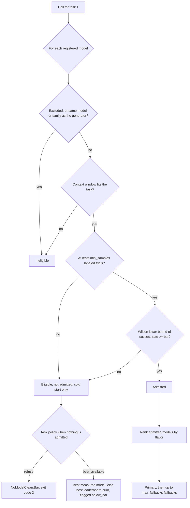

# ai-model-routing

Route every repeated kind of model call (ticket triage, field extraction, code generation, eval and judge calls) to the cheapest model that clears a quality bar you measured on that task, with fallback, monitoring and cost attribution. Or, if your team has decided spend does not matter, route to the best measured model with the exact same machinery.

- Python 3.10+, standard library only, about 2,400 lines you can read in an afternoon
- Works with any OpenAI-compatible endpoint (vendor APIs, gateways, local servers) or your own provider class
- Ships with a fully offline demo, so you can see the whole loop without an API key
- Tested on public data that already holds each model's answers, correctness and cost, so no API key is needed: see [Evidence](#evidence-held-out-results-on-public-data)
- Also decides whether an agent should do one piece of work itself or hand it to a sub-agent on the routed model (`model-routing delegate`), in both flavors

## Why route per task

- Most model spend in a product is a handful of call types repeated thousands of times: classify this ticket, pull these fields, write this test, grade this answer. Each one is a **task**: a repeated call with an **acceptance check** that says whether one output is right
- Send every call to the strongest model and you can pay 40x to 100x more per call than the cheapest tier (see the cost table below). Send them all to the cheapest and quality drops without a single error in the logs
- Public leaderboards do not settle it. They disagree with each other (one model ranks first on abstract reasoning and eighth on professional writing), and none of them is your task
- The number that tells you whether a model can do *your* task is its success rate on *your* acceptance check: agreement with gold labels, exact match on extracted fields, generated tests passing. This library makes that number the gate, per task. Nothing in the routing rules knows about a domain; a task is a name, a bar and the counts you measured

### Judge and eval calls, the first-class case

- In a team that evaluates seriously, judge calls are a large share of model spend: every candidate output, on every test case, on every rubric, gets graded, often more than once
- A cheap judge that is wrong does more damage than a cheap model on any other task, because it silently weakens the evals that every later decision trusts
- We found no public judge benchmark with a row for the current generation of models (see [research/judge-benchmarks.md](research/judge-benchmarks.md))
- A judge must not grade its own family's output, so judge tasks turn on generator isolation (below)

## Two flavors, one pipeline

| | `cost_effective` | `cost_blind` |
|---|---|---|
| Who it is for | Teams paying per token | Teams that have decided token cost is not the constraint (credits, flat-rate contracts, quality-critical work) |
| Among models that clear the bar, pick | the cheapest expected cost per call; ties go to higher measured quality | the highest measured quality |
| Bar, sample minimum, generator isolation | same | same |
| Fallback chain, validation, monitoring | same | same |
| Cost in the log | list price | list price (the router ignores it; you still see it) |

The flavor changes exactly one value: the `routing_cost` used to rank passing candidates (list cost, or 0). Everything else is shared, so switching flavors is a one-word change and the spend report stays honest either way.

## How a model is chosen



### The quality bar is a confidence bound, not an average

A model is admitted for a task only when the lower end of a two-sided Wilson score interval on its measured success rate against the task's acceptance check is at or above the task's bar, and only after at least `min_samples` trials. At 95% confidence:

| Bar | Successes needed on 50 items | on 100 | on 200 | on 400 |
|---|---|---|---|---|
| 0.75 | 44/50 (88%) | 84/100 (84%) | 163/200 (81.5%) | 317/400 (79.25%) |
| 0.80 | 46/50 (92%) | 88/100 (88%) | 172/200 (86%) | 336/400 (84%) |
| 0.85 | 48/50 (96%) | 92/100 (92%) | 180/200 (90%) | 354/400 (88.5%) |

- A model that succeeds on 90% of 50 items does not clear an 85% bar (its lower bound is 0.786). It might be fine; you have not shown it yet
- More labeled items buy you a cheaper model: the same 90% clears 0.85 at 200 items
- This is deliberately conservative. A model below the bar lowers quality on every call of the task, and a wrong judge also corrupts every decision downstream of it, so the burden of proof is on the cheap model

### Rules that protect quality

- **Generator isolation, for tasks that check another model's output.** When a judge, reviewer or verifier call names the model that produced the output it checks (`generator_model`), the router excludes that model and its family while the task's `independent_of_generator` is on (the default). Self-preference in LLM judges is well documented (see [research/prior-art.md](research/prior-art.md)), so this is on by default. It has no effect when no generator is named, and the non-judge example tasks set `independent_of_generator` to `false` to say so
- **Priors never admit.** Leaderboard scores (`model_routing/data/priors.json`) only order candidates when nothing has been measured, and tell you which models to calibrate first. A leaderboard score is not a success rate on your task
- **Every decision explains itself.** Each candidate carries a reason code (`excluded_model`, `excluded_family`, `generator`, `generator_family`, `context_too_small`, `insufficient_samples`, `below_bar`, `passes`), its measured counts and lower bound, and the decision says whether it rests on measurements or priors (`basis`) and whether it is below the bar

## Quickstart

```bash
git clone https://github.com/jeffma8888/ai-model-routing.git
cd ai-model-routing
python -m venv .venv && . .venv/bin/activate
pip install -e ".[dev]"
pytest -q
model-routing demo --out ./demo-run
```

The demo routes one judge task with fictional `demo/` models and a synthetic 300-item labeled set (seeded, deterministic). It calibrates four judges, selects in both flavors, runs 200 judge calls per flavor with a simulated outage on the primary, then asks in each flavor whether an `atlas-max` parent 60,000 tokens into a session should do one more check itself or hand it to a sub-agent, and runs the hand-off it chose. It writes `calls.jsonl`, `stats.json`, `outcomes.jsonl` (the calibration set as an outcome matrix, used below), and its registry and task as `models.json` and `tasks.json`.

```text
$ model-routing demo --out ./demo-run
model-routing demo (fictional demo/ models, simulated outages)

cost_effective:
  primary:        demo/atlas-mid
  fallbacks:      demo/birch-pro, demo/atlas-max
  calls:          200
  fallback calls: 25
  list-price USD: 0.8650

cost_blind:
  primary:        demo/atlas-max
  fallbacks:      demo/atlas-mid, demo/birch-pro
  calls:          200
  fallback calls: 30
  list-price USD: 3.3794

cost_effective spent 26% of what cost_blind spent

inline or sub-agent, a demo/atlas-max parent at 60,000 context tokens:
  cost_effective: delegate to demo/atlas-mid (delegate_cheaper), inline 0.632000 vs delegate 0.029400 USD
  cost_blind:     inline on demo/atlas-max (inline_as_good), inline 0.632000 vs delegate 0.048600 USD
  hand-off calls: 1, list-price USD 0.0036
log: demo-run/calls.jsonl
```

What happened:

- Calibration on 300 synthetic items measured `atlas-max` 286/300, `atlas-mid` 274/300, `birch-pro` 273/300 and `birch-nano` 218/300. At a 0.85 bar the first three clear it (lower bounds 0.923, 0.876, 0.872) and `birch-nano` does not (0.674)
- `cost_effective` routes to `atlas-mid`, the cheapest admitted judge; `cost_blind` routes to `atlas-max`, the best measured one. Same bar, same fallback logic, about a quarter of the spend
- When the primary hit a simulated outage (about 15% of its calls), the call fell back to the next admitted judge, and every attempt landed in the log
- `atlas-mid` (true accuracy 0.91) edged out `birch-pro` (0.93) by one item on this sample. A gap that small is noise, which is why the bar is a lower bound and why the fallback order should not be read as a quality ranking
- Inline or sub-agent: in `cost_effective` the parent hands the check to `atlas-mid`, because re-reading its 60,000-token context would cost 0.632 USD and the hand-off 0.0294 USD with the bar still held; in `cost_blind` it keeps the check, because its best delegate is `atlas-max` itself. The hand-off ran through `Executor.call_delegated` as one more call in the log, tagged `delegated` and `parent`. That call cost 0.0036 USD on its simulated tokens, where the estimate priced it at the task's expected tokens plus the brief (0.0048 USD); the other 0.0246 USD of the estimate is the parent writing the brief and reading the result in its own calls, which the log does not see ([Inline or sub-agent](#inline-or-sub-agent) explains the arithmetic)

Then slice the log:

```text
$ model-routing report --log demo-run/calls.jsonl --by flavor
flavor          calls  attempts  errors  invalid  fallback_calls  fallback_rate  cost_usd  routing_cost_usd  p50_ms  p95_ms
--------------  -----  --------  ------  -------  --------------  -------------  --------  ----------------  ------  ------
cost_blind      200    230       30      0        30              0.150          3.379358  0.000000          1497.4  2368.0
cost_effective  201    226       25      0        25              0.124          0.868590  0.868590          1429.9  2376.7
```

`cost_blind` logs `routing_cost_usd` as 0 because the router ignored price, but `cost_usd` still shows what the calls cost at list price. `cost_effective` counts 201 calls: its 200 judge calls and the hand-off. The hand-off's tags split it out:

```text
$ model-routing report --log demo-run/calls.jsonl --by tag:delegated
tag:delegated  calls  attempts  errors  invalid  fallback_calls  fallback_rate  cost_usd  routing_cost_usd  p50_ms  p95_ms
-------------  -----  --------  ------  -------  --------------  -------------  --------  ----------------  ------  ------
(none)         400    455       55      0        55              0.138          4.244340  0.864982          1485.2  2376.7
true           1      1         0       0        0               0.000          0.003608  0.003608          1579.4  1579.4
```

### Check the choice on items the router never saw

`model-routing evaluate` takes an outcome matrix (one JSON object per task, item and model, with `correct` and either `cost_usd` or token counts; `DESIGN.md` 12.1), splits each task's items in half by a seeded hash of the item ID, calibrates on one half, routes both flavors through the same `Router.select`, and scores the routed model on the other half next to simple baselines. It repeats this over 10 seeds by default. The demo's `outcomes.jsonl` is a ready input:

```text
$ model-routing evaluate --outcomes demo-run/outcomes.jsonl --bar 0.85
bar 0.85, cost_effective
strategy               success  cost_usd  below_bar_rate  cleared_rate  bar_violation_rate
---------------------  -------  --------  --------------  ------------  ------------------
routed                 0.910    0.9620    0.000           1.000         0.000
oracle                 1.000    0.2063    0.000           -             -
best_on_calibration    0.954    3.0440    0.000           -             -
cheapest               0.732    0.0304    1.000           -             -
model:demo/atlas-max   0.954    3.0440    0.000           -             -
model:demo/atlas-mid   0.916    0.6088    0.000           -             -
model:demo/birch-nano  0.732    0.0304    1.000           -             -
model:demo/birch-pro   0.913    1.2176    0.000           -             -

bar 0.85, cost_blind
strategy               success  cost_usd  below_bar_rate  cleared_rate  bar_violation_rate
---------------------  -------  --------  --------------  ------------  ------------------
routed                 0.954    3.0440    0.000           1.000         0.000
oracle                 1.000    0.2063    0.000           -             -
best_on_calibration    0.954    3.0440    0.000           -             -
cheapest               0.732    0.0304    1.000           -             -
model:demo/atlas-max   0.954    3.0440    0.000           -             -
model:demo/atlas-mid   0.916    0.6088    0.000           -             -
model:demo/birch-nano  0.732    0.0304    1.000           -             -
model:demo/birch-pro   0.913    1.2176    0.000           -             -
```

Reading it:

- `routed` held the 0.85 bar on every held-out half in both flavors (`bar_violation_rate` 0.000 over 10 seeds, about 150 held-out items each). `cost_effective` spent about a third of what `cost_blind` spent (0.96 vs 3.04 USD) for 0.044 less held-out success (0.910 vs 0.954)
- `cost_effective` routed to `atlas-mid` on 7 seeds, `birch-pro` on 2 and `atlas-max` on 1, the split where neither cheaper judge's lower bound cleared the bar on its calibration half. `cost_blind` routed to `atlas-max` every time, which is also `best_on_calibration` here
- `cheapest` (`birch-nano`) is below the bar on every split. `oracle` is right whenever any judge is right and pays the cheapest right judge's price, so it is a bound that per-prompt routing could at most approach, not something task-level routing can reach
- The routed `cost_effective` success (0.910) is below both judges it mostly picks between (0.916 and 0.913). The two halves are complementary, so a judge that drew a lucky calibration half drew an unlucky held-out half, and the router picks the lucky one. That selection effect is why the bar is a lower bound and why `bar_violation_rate` should be read next to the held-out size, never against zero (`DESIGN.md` 12.3)
- `success` and `cost_usd` are means over seeds; `below_bar_rate` is the share of (task, seed) cells under the bar; `cleared_rate` and `bar_violation_rate` apply to `routed` only. `--json` prints the full result without per-cell rows, small enough to commit next to the data it came from

### Inline or sub-agent

An agent that reaches one call of a task can do it itself (inline) or hand it to a fresh sub-agent on the model the router picks. `model-routing delegate` holds both paths to the task's bar and prices what each one adds to the parent's calls: the parent's context (`--context-tokens`), the brief it writes (`--brief-tokens`), the result it reads back (`--result-tokens`), and later parent calls that re-read them (`--carry-turns`, default 0). The demo's output is a ready input. Here an `atlas-max` parent 60,000 tokens into a session reaches one faithfulness check:

```text
$ model-routing delegate demo_faithfulness_judge --parent demo/atlas-max --context-tokens 60000 --brief-tokens 400 --result-tokens 60 --generator demo/cedar-writer --registry demo-run/models.json --tasks demo-run/tasks.json --stats demo-run/stats.json
mode:                delegate
model:               demo/atlas-mid
reason:              delegate_cheaper
below_bar:           false
inline_cost_usd:     0.632000
delegate_cost_usd:   0.029400
parent_quality_lb:   0.923
delegate_quality_lb: 0.876
```

The same check from an `atlas-mid` parent that would fold it into its next reply (`--fold-inline`):

```text
$ model-routing delegate demo_faithfulness_judge --parent demo/atlas-mid --context-tokens 60000 --brief-tokens 400 --result-tokens 60 --fold-inline --generator demo/cedar-writer --registry demo-run/models.json --tasks demo-run/tasks.json --stats demo-run/stats.json
mode:                inline
model:               demo/atlas-mid
reason:              inline_cheaper
below_bar:           false
inline_cost_usd:     0.004000
delegate_cost_usd:   0.009720
parent_quality_lb:   0.876
delegate_quality_lb: 0.876
```

Reading it:

- Inline, `atlas-max` would re-read its 60,000-token context in a call of its own at 10 USD per 1M input tokens: 0.632 USD. Delegating pays for the 400-token brief, one `atlas-mid` call on the brief and the 1,000-token input, and the next parent call re-reading the brief and the 60-token result: 0.0294 USD, about 5% of inline. `atlas-mid` clears the 0.85 bar (lower bound 0.876), so the hand-off keeps the bar
- Folded into the next reply, inline work never re-reads the context, so it costs only the work's own tokens at the parent's price (0.0040 USD). Delegating, even to `atlas-mid` itself, adds the brief and the re-read (0.0097 USD), so the parent keeps the work: `inline_cheaper`
- `cost_blind` ignores price, so the first parent stays inline (`inline_as_good`): its best delegate is `atlas-max` itself, and equal-quality ties go inline because a brief can drop detail. A parent below the bar hands off to a delegate that clears it (`parent_below_bar`), whatever inline would cost, in either flavor: a `birch-nano` parent (lower bound 0.674) at 2,000 context tokens goes to `atlas-mid` in `cost_effective` although inline would cost 0.00052 USD against 0.0050 (`cost_blind` sends it to `atlas-max`). At 60,000 tokens the reason is `parent_context_full` instead, because the work no longer fits its 32,000-token window and that check comes first
- Inline is blocked outright when the task excludes the parent's family, when the parent is the generator or in its family on an `independent_of_generator` task, or when the work does not fit the parent's context. `--json` prints the full decision, including the delegate's route (`DESIGN.md` 13)

On public data, [Delegation on AutoBench](#delegation-on-autobench) scores this decision on held-out questions for each of 20 models as the parent.

## Calibrate your own task

1. **Define the task** in a tasks file. `model_routing/data/example_tasks.json` ships three judge tasks and three from other domains (`support_ticket_triage`, `invoice_field_extraction`, `unit_test_codegen`):

   ```json
   {"tasks": [{
     "name": "faithfulness_judge",
     "bar": 0.85,
     "min_samples": 50,
     "independent_of_generator": true,
     "expected_input_tokens": 3000,
     "expected_output_tokens": 150,
     "on_no_model": "refuse",
     "max_fallbacks": 2,
     "prior_category": "professional_writing"
   }]}
   ```

2. **Run each candidate model over a labeled set for the task** and write one JSON line per item. Either give the output and the label (compared with `==`), or say whether the output passed the task's acceptance check:

   ```json
   {"task": "faithfulness_judge", "model": "anthropic/claude-haiku-5.5", "prediction": "unfaithful", "gold": "unfaithful"}
   {"task": "unit_test_codegen", "model": "openai/gpt-6-luna", "correct": false}
   ```

   For `unit_test_codegen`, `correct` means the generated tests ran and passed; for an extraction task it might mean every field matched exactly. The library only counts.

3. **Fold the results into the stats file** (counts accumulate across runs):

   ```bash
   model-routing calibrate --results results.jsonl --stats stats.json
   ```

4. **Ask for a route.** For a task that checks another model's output, name that model so its family is excluded; other tasks need no `--generator`:

   ```bash
   model-routing select faithfulness_judge --flavor cost_effective --generator openai/gpt-6.1-sol --stats stats.json
   model-routing select faithfulness_judge --flavor cost_blind --generator openai/gpt-6.1-sol --stats stats.json --json
   model-routing select support_ticket_triage --flavor cost_effective --stats stats.json
   ```

   Exit codes: 0 routed, 2 bad input, 3 no model clears the bar (for a `refuse` task).

## Use it in code

```python
from model_routing import (
    DATA_DIR, Executor, Monitor, OpenAICompatibleProvider, Priors, Registry,
    Router, Stats, json_validator, load_tasks, report,
)

router = Router(
    Registry.load(DATA_DIR / "models.json"),
    load_tasks(DATA_DIR / "example_tasks.json"),
    Stats.load("stats.json"),
    Priors.load(DATA_DIR / "priors.json"),
)

provider = OpenAICompatibleProvider(
    "https://your-gateway.example/v1",
    api_key_env="GATEWAY_API_KEY",
    model_map={"anthropic/claude-haiku-5.5": "claude-haiku-5-5"},  # your gateway's IDs
)
monitor = Monitor("calls.jsonl")
executor = Executor(router, provider, monitor=monitor)

result = executor.call(
    "faithfulness_judge",
    messages=[{"role": "user", "content": "..."}],
    flavor="cost_effective",
    generator_model="openai/gpt-6.1-sol",
    tags={"team": "search-quality", "experiment": "exp-42"},
    validate=json_validator("verdict", "reason"),
)
print(result.model, result.text)
```

- For a task that checks nothing, leave out `generator_model`: `executor.call("invoice_field_extraction", messages=..., flavor="cost_blind")`
- The executor tries the primary, then each fallback in order
- It falls back on a `ProviderError` (timeout, rate limit, 5xx, unparseable response) or when `validate` rejects the output; any other exception is a bug and propagates
- Every attempt, including the failed ones, is logged; if all of them fail it raises `AllModelsFailed` with the attempts attached

To act on an [inline or sub-agent](#inline-or-sub-agent) decision, run the hand-off with `call_delegated`. It sends the brief to the route the decision was made with, falls back and validates as `call` does, and tags every attempt `delegated` and `parent`:

```python
decision = router.decide_delegation(
    "faithfulness_judge", "openai/gpt-6.1-sol", "cost_effective",
    context_tokens=60_000, brief_tokens=400, result_tokens=60,
    generator_model="openai/gpt-6.1-sol",
)
if decision.mode == "delegate":
    result = executor.call_delegated(
        decision, messages=[{"role": "user", "content": "..."}],
        tags={"team": "search-quality"},
    )
```

- Here the parent wrote the answer being checked, so on this `independent_of_generator` task (with stats that admit a judge from another family) inline is blocked (`parent_not_independent`) and the check goes to a judge from another family
- An inline decision raises `ValueError`, because the parent does that work in its own call; so does a caller tag named `delegated` or `parent`
- `model-routing report --log calls.jsonl --by tag:delegated` splits the spend between hand-offs (group `true`) and other calls (group `(none)`). The parent's share of a hand-off (writing the brief, reading the result) is spent in the parent's own calls, not in these records

## Monitoring and cost attribution

Each attempt is one JSON line with the task, flavor, model, family, attempt index, outcome, latency, tokens, list-price `cost_usd`, `routing_cost_usd` (0 in `cost_blind`), `below_bar`, `basis` and your tags. Roll it up any way you need:

```bash
model-routing report --log calls.jsonl --by model
model-routing report --log calls.jsonl --by flavor
model-routing report --log calls.jsonl --by tag:experiment --json
```

```python
for row in report(monitor.records, by="tag:team"):
    print(row["group"], row["calls"], row["fallback_rate"], row["cost_usd"], row["p95_latency_ms"])
```

- Costs and token counts are summed per attempt, so a failed attempt that still burned tokens is charged to the model that burned them
- Call counts, failures and the fallback rate are attributed by each call's final attempt
- Latency percentiles are nearest-rank over successful attempts

## Evidence: held-out results on public data

Each dataset here already holds every model's answer to every item, a label for whether that answer was good enough (right or wrong on RouterBench, a Delta-Hit from a judge committee's scores on AutoBench) and the cost of each call, so the router is tested offline with no API key: for each task and seed, calibrate on one half of the items, route at a bar, and score the routed model on the other half, next to fixed baselines (`model-routing evaluate`, `DESIGN.md` 12). The test suite rebuilds every number in these tables from that dataset's committed results file, so they cannot drift from it.

### RouterBench

- Dataset: [withmartian/routerbench](https://huggingface.co/datasets/withmartian/routerbench) on Hugging Face, pinned at revision [`7840214`](https://huggingface.co/datasets/withmartian/routerbench/tree/784021482c3f320c6619ed4b3bb3b41a21424fcb), file `routerbench_0shot.pkl`, checked by size and sha256 before it is loaded
- Licence: the [RouterBench code](https://github.com/withmartian/routerbench) is MIT licensed; the dataset card states no licence for the data. This repo commits no part of the dataset, only numbers derived from it
- What was run: 11 models, 65 evals (57 of them MMLU subjects), 28,281 prompts, 50 seeds; each eval is one task, split in half per seed and routed at bars 0.6 to 0.9 in both flavors
- Full results with per-eval rows: [RESULTS.md](evidence/routerbench/RESULTS.md) and [results.json](evidence/routerbench/results.json); source, safety checks and what the converter drops: [evidence/routerbench/README.md](evidence/routerbench/README.md)

Held-out success is the share of held-out prompts answered correctly over all evals, and cost is the recorded cost of answering them, both averaged over the seeds. The two ratios divide that cost by the cost of the best single model and of the cheapest model in the baseline table. Cleared rate is the share of (eval, seed) cells where some model cleared the bar on the calibration half; bar-violation rate is the share of cleared cells whose held-out success fell below the bar.

| Bar | Flavor | Held-out success | Cost (USD) | Cost / best single model | Cost / cheapest model | Cleared rate | Bar-violation rate |
|---|---|---|---|---|---|---|---|
| 0.6 | `cost_effective` | 0.735 | 8.9478 | 0.341 | 19.2 | 0.804 | 0.013 |
| 0.6 | `cost_blind` | 0.819 | 25.2675 | 0.963 | 54.2 | 0.804 | 0.004 |
| 0.7 | `cost_effective` | 0.761 | 11.7482 | 0.448 | 25.2 | 0.616 | 0.032 |
| 0.7 | `cost_blind` | 0.819 | 25.2675 | 0.963 | 54.2 | 0.616 | 0.010 |
| 0.8 | `cost_effective` | 0.808 | 23.2560 | 0.886 | 49.9 | 0.371 | 0.031 |
| 0.8 | `cost_blind` | 0.819 | 25.2675 | 0.963 | 54.2 | 0.371 | 0.016 |
| 0.9 | `cost_effective` | 0.819 | 24.9963 | 0.953 | 53.6 | 0.111 | 0.022 |
| 0.9 | `cost_blind` | 0.819 | 25.2675 | 0.963 | 54.2 | 0.111 | 0.022 |

| Baseline | Held-out success | Cost (USD) |
|---|---|---|
| Per-prompt oracle: on each prompt, the cheapest model that got it right, or the cheapest model, counted wrong, when none did | 0.959 | 1.9634 |
| Best single model (`openai/gpt-4-1106-preview`) | 0.821 | 26.2358 |
| Best model on the calibration half, per eval | 0.819 | 25.0029 |
| Cheapest model on the calibration half, per eval | 0.276 | 0.4662 |

Reading it:

- `cost_effective` buys the cheapest model that clears the bar on each eval, not the best answer. At the lower bars it gives up held-out success for a large cut in cost; as the bar rises, fewer evals clear it, the router falls back to the best available model on the rest, and its cost approaches that of the best single model
- `cost_blind` routes each eval to the model with the highest lower bound, and at every bar it reaches held-out success 0.819 at 25.2675 USD against 0.819 at 25.0029 USD for the best model on the calibration half: the same success to three decimals at 1.1% more cost
- The bar-violation rate is a resampling estimate for this matrix, to be read next to the nominal one-sided 0.025 of a 95% Wilson bound on one model, never as a guarantee (`DESIGN.md` 12.3, "Reading the numbers")
- The per-prompt oracle is a hindsight bound (0.959 held-out success at 1.9634 USD, against at most 0.819 for a routed row). Routing per task gets nowhere near it

Limits:

- The models date from 2023, and the costs are the ones the dataset recorded at that time's prices, not today's list prices
- Routing here is per task (one eval), not per prompt
- Most evals are MMLU subjects (count above), so the overall rows mostly measure MMLU
- By default the converter drops graded evals (scores other than 0 and 1, such as `grade-school-math`) and evals with fewer than 100 prompts, keeping 65 of the 86; RESULTS.md has a sensitivity run that keeps the graded ones at a stated pass score

Regenerate (about 70 seconds for the evaluate step on one laptop core; the dataset downloads into a cache folder outside the repo):

```bash
python -m pip install -e ".[evidence]"
python evidence/routerbench/convert.py --out routerbench-matrix.jsonl
model-routing evaluate --outcomes routerbench-matrix.jsonl --bar 0.6 0.7 0.8 0.9 --seeds 50 --json > routerbench-evaluate.json
python evidence/routerbench/results.py --evaluate routerbench-evaluate.json --out evidence/routerbench/results.json
python evidence/routerbench/results.py --table evidence/routerbench/results.json
```

### AutoBench

- Dataset: [AutoBench/router-benchmark-2026-10](https://huggingface.co/datasets/AutoBench/router-benchmark-2026-10) on Hugging Face, pinned at revision [`4375518`](https://huggingface.co/datasets/AutoBench/router-benchmark-2026-10/tree/43755180be7d8097068982d7a3f37fc04cd15379); the four files the converter reads are checked by size and sha256 before they are read, with the dataset's own `SHA256SUMS` as a second check
- Licence: [CC-BY-4.0](https://creativecommons.org/licenses/by/4.0/), as the dataset card states. Attribution: Autobench, Autobench Router Benchmark 2026; the citation the card asks for is in the evidence README. This repo commits no part of the dataset, only numbers derived from it
- What was run: 20 models, 203 of the 252 questions in one pooled task (`--task-by all`), 50 seeds; the task is split in half per seed and routed at bars 0.6 to 0.9 in both flavors. A success is the dataset's own Delta-Hit at the converter's default width, the dataset's `delta_signal` of 0.2007: an answer whose judge score is at least the mean of the three best pool scores on that question minus the width
- Full results, with how many seeds were routed to each model and two sensitivity runs: [RESULTS.md](evidence/autobench-2026/RESULTS.md) and [results.json](evidence/autobench-2026/results.json); source, pinned files and what the converter drops: [evidence/autobench-2026/README.md](evidence/autobench-2026/README.md)

Held-out success is the share of held-out questions with a Delta-Hit, and cost is the billed cost of answering them, both averaged over the seeds; the ratios and rates read as in the RouterBench table. With one task, the cleared rate is the share of seeds where some model cleared the bar on the calibration half, and a `-` means that no seed cleared, so there is no bar-violation rate.

| Bar | Flavor | Held-out success | Cost (USD) | Cost / best single model | Cost / cheapest model | Cleared rate | Bar-violation rate |
|---|---|---|---|---|---|---|---|
| 0.6 | `cost_effective` | 0.720 | 0.1976 | 0.036 | 10.3 | 1.000 | 0.000 |
| 0.6 | `cost_blind` | 0.857 | 3.6917 | 0.664 | 193.2 | 1.000 | 0.000 |
| 0.7 | `cost_effective` | 0.854 | 0.3110 | 0.056 | 16.3 | 1.000 | 0.020 |
| 0.7 | `cost_blind` | 0.857 | 3.6917 | 0.664 | 193.2 | 1.000 | 0.000 |
| 0.8 | `cost_effective` | 0.855 | 2.9694 | 0.534 | 155.4 | 0.660 | 0.030 |
| 0.8 | `cost_blind` | 0.857 | 3.6917 | 0.664 | 193.2 | 0.660 | 0.000 |
| 0.9 | `cost_effective` | 0.858 | 3.6535 | 0.657 | 191.1 | 0.000 | - |
| 0.9 | `cost_blind` | 0.857 | 3.6917 | 0.664 | 193.2 | 0.000 | - |

| Baseline | Held-out success | Cost (USD) |
|---|---|---|
| Per-question oracle: on each question, the cheapest model with a Delta-Hit on it (some model has one on every question) | 1.000 | 0.0836 |
| Best single model (`openai/gpt-5.6-sol`) | 0.882 | 5.5616 |
| The model the dataset card's headline names (`openai/gpt-5.6-luna`) | 0.872 | 0.3092 |
| Best model on the calibration half | 0.858 | 3.6535 |
| Cheapest model on the calibration half | 0.453 | 0.0191 |

Reading it:

- The dataset card's headline, at the pinned revision: "no commercial pass beats always calling GPT-5.6 Luna on quality and cost together". On the same matrix no routed row beats it on both counts: always calling `openai/gpt-5.6-luna` reaches held-out success 0.872 at 0.3092 USD, and every routed row in the table has lower held-out success or a higher cost. RESULTS.md shows how close `cost_effective` at bar 0.7 comes, and why
- The bar-violation rate reads as in the RouterBench table, with one task: each rate counts seeds, not evals
- The per-question oracle is a hindsight bound. Routing one pooled task gets nowhere near it

Limits:

- The models are 2026 models, and the costs are the billed USD per call in the matrix frozen on 2026-08-29; vendor prices have moved since
- A Delta-Hit is relative, not an absolute acceptance check: it means "rated about as well as the best three answers in this pool on this question", by judges that are themselves models from the same pool, so these are model judgments, not gold labels
- Routing here is one pooled task, not per domain or per question: a domain has 12 to 33 questions, so its calibration half cannot reach the default `min_samples` of 30. RESULTS.md has a per-domain sensitivity run at a lower `--min-samples`
- The converter drops the 49 questions with an unscored pool cell (107 cells) rather than scoring them as misses, and the 388 rows for 13 models outside the 20-model pool

Regenerate (the evaluate step takes under a second; the dataset downloads into a cache folder outside the repo):

```bash
python -m pip install -e .
python evidence/autobench-2026/convert.py --out autobench-matrix.jsonl --task-by all
model-routing evaluate --outcomes autobench-matrix.jsonl --bar 0.6 0.7 0.8 0.9 --seeds 50 --json > autobench-evaluate.json
python evidence/routerbench/results.py --evaluate autobench-evaluate.json --out evidence/autobench-2026/results.json
python evidence/routerbench/results.py --table evidence/autobench-2026/results.json
```

### Delegation on AutoBench

The same [AutoBench matrix](https://huggingface.co/datasets/AutoBench/router-benchmark-2026-10) at revision [4375518](https://huggingface.co/datasets/AutoBench/router-benchmark-2026-10/tree/43755180be7d8097068982d7a3f37fc04cd15379) (licence CC-BY-4.0), with each answer's token counts and the pool's list prices, scores the [inline or sub-agent](#inline-or-sub-agent) decision on held-out questions for every one of the 20 pool models as the parent, next to always working inline and always delegating ([RESULTS.md](evidence/delegation/RESULTS.md), [results.json](evidence/delegation/results.json), `DESIGN.md` 13.9 and 13.10). No public dataset records a real hand-off, so the parent's context and the hand-off sizes are a stated grid: 8,000, 64,000 and 200,000 context tokens, a brief of 500 tokens, a 500-token result, one later parent call, and inline work in a parent call of its own (`inline_separate_call` True). Each cost is a list-price estimate, and the delegate is credited with its recorded answer as if the brief carried the whole question, so a lossy brief is not measured. Means over the 20 parents (`dec_` the decision, `inl_` always inline, `del_` always delegating; cost in USD, the mean over the 50 seeds of a held-out half's list-price cost; `delegated` the share of seeds the decision hands off):

```text
$ python evidence/delegation/results.py --table evidence/delegation/results.json
bar  flavor          context  dec_success  dec_cost  inl_success  inl_cost  del_success  del_cost  delegated
---  --------------  -------  -----------  --------  -----------  --------  -----------  --------  ---------
0.7  cost_effective  8000     0.872        0.6268    0.670        1.6931    0.872        0.6268    1.000
0.7  cost_effective  64000    0.872        0.6268    0.670        6.1849    0.872        0.6268    1.000
0.7  cost_effective  200000   0.872        0.6268    0.670        17.0936   0.872        0.6268    1.000
0.7  cost_blind      8000     0.857        2.5582    0.670        1.6931    0.857        2.4768    0.944
0.7  cost_blind      64000    0.857        3.0624    0.670        6.1849    0.857        2.4768    0.944
0.7  cost_blind      200000   0.857        4.2869    0.670        17.0936   0.857        2.4768    0.944
0.8  cost_effective  8000     0.856        2.1659    0.670        1.6931    0.855        2.1372    0.981
0.8  cost_effective  64000    0.856        2.3442    0.670        6.1849    0.855        2.1372    0.981
0.8  cost_effective  200000   0.856        2.7772    0.670        17.0936   0.855        2.1372    0.981
0.8  cost_blind      8000     0.857        2.5582    0.670        1.6931    0.857        2.4768    0.944
0.8  cost_blind      64000    0.857        3.0624    0.670        6.1849    0.857        2.4768    0.944
0.8  cost_blind      200000   0.857        4.2869    0.670        17.0936   0.857        2.4768    0.944
```

- At bar 0.8, the `cost_effective` decision's mean held-out success over the 20 parents is 0.856 at every point, against 0.670 for always inline and 0.855 for always delegating; 15 of the 20 parents delegate on every seed
- At bar 0.8 the `cost_effective` decision costs more than always inline at 8,000 context tokens (2.1659 against 1.6931 USD) and far less at 200,000 (2.7772 against 17.0936), where the parent's own call for the work re-reads the whole context

Regenerate (a few seconds after the download):

```bash
python -m pip install -e .
python evidence/autobench-2026/convert.py --out autobench-tokens.jsonl --task-by all --tokens --registry autobench-pool.json
python evidence/delegation/results.py --matrix autobench-tokens.jsonl --registry autobench-pool.json --out evidence/delegation/results.json
python evidence/delegation/results.py --table evidence/delegation/results.json
python evidence/delegation/results.py --table evidence/delegation/results.json --bar 0.8 --point 1
```

## What the public evidence says (October 2026)

Expected list cost per call for the `faithfulness_judge` example task (3,000 input and 150 output tokens), from `model_routing/data/models.json` (vendor list prices, 2026-10-29):

| Model | USD per call | USD per 10,000 calls |
|---|---|---|
| anthropic/claude-haiku-5.5 | 0.000375 | 3.75 |
| openai/gpt-6-luna | 0.000375 | 3.75 |
| openai/gpt-5.6-luna | 0.000780 | 7.80 |
| xai/grok-4.7 | 0.006900 | 69.00 |
| anthropic/claude-sonnet-5.5, openai/gpt-6.1-sol, openai/gpt-6-sol | 0.007500 | 75.00 |
| openai/gpt-5.6-terra | 0.007800 | 78.00 |
| anthropic/claude-opus-5.5, openai/gpt-5.6-sol | 0.015000 | 150.00 |
| anthropic/claude-fable-5.1, openai/gpt-6-astra | 0.037500 | 375.00 |

### Default capability table

What ships in `model_routing/data/`: vendor list prices and context windows from `models.json` (2026-10-29), and the three public leaderboards in `priors.json` that order candidates at cold start. Ranks are within each leaderboard; "not listed" means the model has no row there. None of these columns can admit a model for a task; only your calibration counts can.


| Model | Family | USD per 1M in / out | Context | Terminal-Bench 4.0 (`code`) | GDPval-AA Elo (`professional_writing`) | ARC-AGI-3 (`abstract_reasoning`) |
|---|---|---|---|---|---|---|
| anthropic/claude-opus-5.5 | anthropic | 4 / 20 | 1M | 65.15 (#1 of 12) | 1866 (#1 of 12) | not listed |
| anthropic/claude-sonnet-5.5 | anthropic | 2 / 10 | 1M | 64.14 (#2 of 12) | 1838 (#2 of 12) | 24.3 (#3 of 10) |
| anthropic/claude-haiku-5.5 | anthropic | 0.1 / 0.5 | 1M | 36.36 (#8 of 12) | 1628 (#5 of 12) | 0.5 (#8 of 10) |
| anthropic/claude-fable-5.1 | anthropic | 10 / 50 | 1M | 58.08 (#4 of 12) | 1764 (#3 of 12) | not listed |
| openai/gpt-6.1-sol | openai | 2 / 10 | 1.05M | 55.05 (#5 of 12) | 1608 (#7 of 12) | 52.7 (#2 of 10) |
| openai/gpt-6-sol | openai | 2 / 10 | 1.05M | 44.44 (#6 of 12) | 1517 (#9 of 12) | 4.6 (#5 of 10) |
| openai/gpt-6-astra | openai | 10 / 50 | 1.05M | 59.6 (#3 of 12) | 1584 (#8 of 12) | 62.7 (#1 of 10) |
| openai/gpt-6-luna | openai | 0.1 / 0.5 | 1.05M | 13.64 (#11 of 12) | 1445 (#12 of 12) | 0.1 (#10 of 10) |
| openai/gpt-5.6-terra | openai | 2 / 12 | 1.05M | 22.73 (#10 of 12) | 1462 (#11 of 12) | 0.8 (#7 of 10) |
| openai/gpt-5.6-sol | openai | 4 / 20 | 1.05M | 37.88 (#7 of 12) | 1618 (#6 of 12) | 7.8 (#4 of 10) |
| openai/gpt-5.6-luna | openai | 0.2 / 1.2 | 1.05M | 11.62 (#12 of 12) | 1469 (#10 of 12) | 0.2 (#9 of 10) |
| xai/grok-4.7 | xai | 2 / 6 | 500K | 28.79 (#9 of 12) | 1722 (#4 of 12) | 1.8 (#6 of 10) |

Sources: [Terminal-Bench 4.0 on Vals](https://www.vals.ai/benchmarks/terminal-bench-4) (2026-10-27, one harness for every model), [GDPval-AA](https://artificialanalysis.ai/evaluations/gdpval-aa) (2026-10-28), [ARC-AGI-3 via BenchLM](https://benchlm.ai/benchmarks/arcagi3) (2026-10-29). Each price row in `models.json` cites its vendor page.


Pricing notes (the router uses the listed price linearly; see Limitations):


- claude-haiku-5.5: short-prompt tier, prompts up to 100K tokens; longer prompts cost 0.50 in and 2.50 out

- gpt-6-astra: prompts over 272K input tokens are billed at 2x input and 1.5x output

- gpt-5.6-sol: promotional price, stated through at least 2026-11-21; its `models.json` row sets `price_valid_until`, so `select` and `delegate` print a warning on stderr from 2026-11-22 until the row is refreshed

- grok-4.7: price for context up to 200K tokens; higher beyond that

What this does and does not tell you:

- The spread in cost is large (100x between the cheapest and most expensive judge), so measuring whether the cheap tier clears your bar pays for itself quickly
- Rankings flip by category: gpt-6-astra is first on ARC-AGI-3 and eighth of twelve on GDPval-AA. There is no single best model, for judging or anything else
- Some gaps are too small to act on: on Terminal-Bench 4.0, Opus 5.5 and Sonnet 5.5 are about one point apart, and one leaderboard cannot tell them apart. That is why priors may order candidates but never admit them
- None of these are judge benchmarks. Public judge evidence for current models is thin, and what exists argues for measuring rather than trusting: frontier judges still miss deliberately planted errors at maximum reasoning effort, a rubric judge in one study passed its own failed outputs up to about 20x more often than other models' failures, and rubric edits that raised judge-to-judge agreement left agreement with experts flat. Details and sources: [research/judge-benchmarks.md](research/judge-benchmarks.md)

## Prior art, and what is actually new here

Routing on cost and quality, fallbacks and spend attribution are standard. FrugalGPT and RouteLLM route per prompt, gateways such as LiteLLM, Portkey and OpenRouter handle fallback and per-tag spend, and excluding the generator from judging follows directly from the self-preference literature. What this library adds is small and specific:

- **A per-task admission rule.** A candidate must clear the task's bar on success rate with a Wilson lower bound over at least `min_samples` labeled trials before it can be chosen, and leaderboard numbers can only order candidates, never admit them. The surveyed routers optimize an expected tradeoff or a per-prompt prediction; none of the ones opened gate on a conservative bound with a minimum sample count per task
- **Repeated task types as the unit, in any domain,** with judge and eval calls (and generator isolation) as the first-class case, rather than individual end-user prompts
- **Two flavors on one pipeline,** so a team that chooses quality over cost still sees what it spends

Full survey with sources and dates: [research/prior-art.md](research/prior-art.md).

## Limitations and non-goals (v1)

- Routes per task, not per prompt. No difficulty prediction or confidence-based cascade
- The success rate is measured as is. Position and verbosity bias in a judge's calibration set flow into the measured rate; the library does not debias the judge
- No online drift detection. Re-calibrate from audited samples on a schedule, and when a provider ships a new model version
- No budgets, alerts, async execution or streaming. The OpenAI-compatible adapter covers gateways; there are no native vendor SDK adapters
- Prices are a dated snapshot. Refresh `models.json` yourself, and check that the model your gateway actually serves matches the ID you calibrated. A row whose vendor states an end date for the price can carry it as `price_valid_until` (`YYYY-MM-DD`, the last valid day); after that day `select` and `delegate` print one `warning:` line per such model on stderr, and stdout does not change
- The inline-or-delegate cost is a list-price approximation for one call per path: work that takes several calls, prompt-caching discounts and the wall-clock gain of running sub-agents side by side are not modelled (`DESIGN.md` 13.2 and 13.8)
- Cost is linear at the listed price. Tiered and promotional pricing (long-prompt tiers, promotional rates; see the notes under the capability table) is not modelled, so long-context tasks on those models are under-costed

## Layout

```
model_routing/
  __init__.py   the public names (__all__) and DATA_DIR
  __main__.py   python -m model_routing runs the CLI
  registry.py   models, list prices, context windows
  tasks.py      task definitions (bar, min_samples, isolation, fallbacks)
  stats.py      Wilson lower bound, calibration counts
  priors.py     leaderboard priors (order only, never admit)
  router.py     the routing rules and both flavors
  providers.py  provider protocol, fake provider, OpenAI-compatible HTTP provider
  executor.py   fallback execution and output validation
  monitor.py    JSONL attempt log and cost reports
  demo.py       offline end-to-end demo
  evaluate.py   offline evaluation on an outcome matrix, held-out split, baselines
  delegation.py inline or sub-agent for one piece of work, in both flavors
  delegation_eval.py  offline evidence for that choice on an outcome matrix with token counts
  cli.py        model-routing select | calibrate | report | demo | evaluate | delegate
  data/         models.json, priors.json, example_tasks.json
research/       public evidence behind the defaults
evidence/       public datasets turned into outcome matrices, with committed results
                (RouterBench: evidence/routerbench/RESULTS.md)
                (AutoBench 2026: evidence/autobench-2026/RESULTS.md)
                (delegation on AutoBench: evidence/delegation/RESULTS.md)
DESIGN.md       the spec the tests were written from
```

## Development

- Tests come first. The suite was written from `DESIGN.md` by a separate model before any implementation existed (in `git log`, the test commit comes before the implementation commit), and each review-driven change since then landed as a spec clause plus failing tests before the fix (see `DESIGN.md` section 15)
- Run `pytest -q`. CI runs the suite and the demo on Python 3.10 to 3.13

## License

MIT
