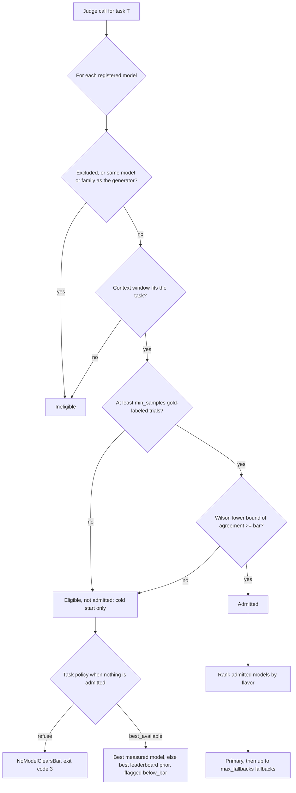

# ai-model-routing

Route every eval and judge call to the cheapest model that clears a measured quality bar, with fallback, monitoring and cost attribution. Or, if your team has decided spend does not matter, route to the best measured model with the exact same machinery.

- Python 3.10+, standard library only, about 1,400 lines you can read in an afternoon
- Works with any OpenAI-compatible endpoint (vendor APIs, gateways, local servers) or your own provider class
- Ships with a fully offline demo, so you can see the whole loop without an API key

## Why judge calls need their own router

- In a team that evaluates seriously, judge calls are a large share of model spend: every candidate output, on every test case, on every rubric, gets graded, often more than once
- Send every judge call to the strongest model and you can pay 40x to 100x more per call than the cheapest tier (see the cost table below)
- Send them all to the cheapest model and you silently weaken the evals that every later decision trusts
- Public leaderboards do not settle it. We found no public judge benchmark with a row for the current generation of models (see [research/judge-benchmarks.md](research/judge-benchmarks.md)), and general leaderboards disagree with each other: one model ranks first on abstract reasoning and eighth on professional writing
- The only number that tells you whether a model can judge *your* task is its agreement with *your* gold labels. This library makes that number the gate

## Two flavors, one pipeline

| | `cost_effective` | `cost_blind` |
|---|---|---|
| Who it is for | Teams paying per token | Teams that have decided token cost is not the constraint (credits, flat-rate contracts, quality-critical evals) |
| Among models that clear the bar, pick | the cheapest expected cost per call; ties go to higher measured quality | the highest measured quality |
| Bar, sample minimum, generator isolation | same | same |
| Fallback chain, validation, monitoring | same | same |
| Cost in the log | list price | list price (the router ignores it; you still see it) |

The flavor changes exactly one value: the `routing_cost` used to rank passing candidates (list cost, or 0). Everything else is shared, so switching flavors is a one-word change and the spend report stays honest either way.

## How a model is chosen



### The quality bar is a confidence bound, not an average

A model is admitted for a task only when the lower end of a two-sided Wilson score interval on its measured agreement with gold labels is at or above the task's bar, and only after at least `min_samples` trials. At 95% confidence:

| Bar | Agreement needed on 50 items | on 100 | on 200 | on 400 |
|---|---|---|---|---|
| 0.75 | 44/50 (88%) | 84/100 (84%) | 163/200 (81.5%) | 317/400 (79.25%) |
| 0.80 | 46/50 (92%) | 88/100 (88%) | 172/200 (86%) | 336/400 (84%) |
| 0.85 | 48/50 (96%) | 92/100 (92%) | 180/200 (90%) | 354/400 (88.5%) |

- A judge that agrees 90% of the time on 50 items does not clear an 85% bar (its lower bound is 0.786). It might be fine; you have not shown it yet
- More labels buy you a cheaper judge: the same 90% agreement clears 0.85 at 200 items
- This is deliberately conservative. A wrong judge corrupts every decision downstream of it, so the burden of proof is on the cheap model

### Rules that protect the eval

- **Generator isolation.** By default a judge may not share a model or a family with the model that produced the output it grades. Self-preference in LLM judges is well documented (see [research/prior-art.md](research/prior-art.md)), so this is on unless a task turns it off
- **Priors never admit.** Leaderboard scores (`model_routing/data/priors.json`) only order candidates when nothing has been measured, and tell you which models to calibrate first. A leaderboard score is not an agreement rate on your task
- **Every decision explains itself.** Each candidate carries a reason code (`excluded_model`, `excluded_family`, `generator`, `generator_family`, `context_too_small`, `insufficient_samples`, `below_bar`, `passes`), its measured counts and lower bound, and the decision says whether it rests on measurements or priors (`basis`) and whether it is below the bar

## Quickstart

```bash
git clone https://github.com/jeffma8888/ai-model-routing.git
cd ai-model-routing
python -m venv .venv && . .venv/bin/activate
pip install -e ".[dev]"
pytest -q
model-routing demo --out ./demo-run
```

The demo uses fictional `demo/` models and a synthetic 300-item labeled set (seeded, deterministic). It calibrates four judges, selects in both flavors, runs 200 judge calls per flavor with a simulated outage on the primary, and writes `calls.jsonl` and `stats.json`.

```text
$ model-routing demo --out ./demo-run
model-routing demo (fictional demo/ models, simulated outages)

cost_effective:
  primary:        demo/atlas-mid
  fallbacks:      demo/birch-pro, demo/atlas-max
  calls:          200
  fallback calls: 25
  list-price USD: 0.8650

cost_blind:
  primary:        demo/atlas-max
  fallbacks:      demo/atlas-mid, demo/birch-pro
  calls:          200
  fallback calls: 30
  list-price USD: 3.3794

cost_effective spent 26% of what cost_blind spent
log: demo-run/calls.jsonl
```

What happened:

- Calibration on 300 synthetic items measured `atlas-max` 286/300, `atlas-mid` 274/300, `birch-pro` 273/300 and `birch-nano` 218/300. At a 0.85 bar the first three clear it (lower bounds 0.923, 0.876, 0.872) and `birch-nano` does not (0.674)
- `cost_effective` routes to `atlas-mid`, the cheapest admitted judge; `cost_blind` routes to `atlas-max`, the best measured one. Same bar, same fallback logic, about a quarter of the spend
- When the primary hit a simulated outage (about 15% of its calls), the call fell back to the next admitted judge, and every attempt landed in the log
- `atlas-mid` (true accuracy 0.91) edged out `birch-pro` (0.93) by one item on this sample. A gap that small is noise, which is why the bar is a lower bound and why the fallback order should not be read as a quality ranking

Then slice the log:

```text
$ model-routing report --log demo-run/calls.jsonl --by flavor
flavor          calls  attempts  errors  invalid  fallback_calls  fallback_rate  cost_usd  routing_cost_usd  p50_ms  p95_ms
cost_blind      200    230       30      0        30              0.150          3.379358  0.000000          1497.4  2368.0
cost_effective  200    225       25      0        25              0.125          0.864982  0.864982          1425.5  2376.7
```

`cost_blind` logs `routing_cost_usd` as 0 because the router ignored price, but `cost_usd` still shows what the calls cost at list price.

## Calibrate your own task

1. **Define the task** in a tasks file (see `model_routing/data/example_tasks.json`):

   ```json
   {"tasks": [{
     "name": "faithfulness_judge",
     "bar": 0.85,
     "min_samples": 50,
     "independent_of_generator": true,
     "expected_input_tokens": 3000,
     "expected_output_tokens": 150,
     "on_no_model": "refuse",
     "max_fallbacks": 2,
     "prior_category": "professional_writing"
   }]}
   ```

2. **Run each candidate judge over a gold-labeled set** and write one JSON line per item. Either give the verdict and the label, or say whether it was correct:

   ```json
   {"task": "faithfulness_judge", "model": "anthropic/claude-haiku-5.5", "prediction": "unfaithful", "gold": "unfaithful"}
   {"task": "faithfulness_judge", "model": "openai/gpt-6-luna", "correct": false}
   ```

3. **Fold the results into the stats file** (counts accumulate across runs):

   ```bash
   model-routing calibrate --results results.jsonl --stats stats.json
   ```

4. **Ask for a route**, naming the model that generated the outputs so its family is excluded:

   ```bash
   model-routing select faithfulness_judge --flavor cost_effective --generator openai/gpt-6.1-sol --stats stats.json
   model-routing select faithfulness_judge --flavor cost_blind --generator openai/gpt-6.1-sol --stats stats.json --json
   ```

   Exit codes: 0 routed, 2 bad input, 3 no model clears the bar (for a `refuse` task).

## Use it in code

```python
from model_routing import (
    DATA_DIR, Executor, Monitor, OpenAICompatibleProvider, Priors, Registry,
    Router, Stats, json_validator, load_tasks, report,
)

router = Router(
    Registry.load(DATA_DIR / "models.json"),
    load_tasks(DATA_DIR / "example_tasks.json"),
    Stats.load("stats.json"),
    Priors.load(DATA_DIR / "priors.json"),
)

provider = OpenAICompatibleProvider(
    "https://your-gateway.example/v1",
    api_key_env="GATEWAY_API_KEY",
    model_map={"anthropic/claude-haiku-5.5": "claude-haiku-5-5"},  # your gateway's IDs
)
monitor = Monitor("calls.jsonl")
executor = Executor(router, provider, monitor=monitor)

result = executor.call(
    "faithfulness_judge",
    messages=[{"role": "user", "content": "..."}],
    flavor="cost_effective",
    generator_model="openai/gpt-6.1-sol",
    tags={"team": "search-quality", "experiment": "exp-42"},
    validate=json_validator("verdict", "reason"),
)
print(result.model, result.text)
```

- The executor tries the primary, then each fallback in order
- It falls back on a `ProviderError` (timeout, rate limit, 5xx, unparseable response) or when `validate` rejects the output; any other exception is a bug and propagates
- Every attempt, including the failed ones, is logged; if all of them fail it raises `AllModelsFailed` with the attempts attached

## Monitoring and cost attribution

Each attempt is one JSON line with the task, flavor, model, family, attempt index, outcome, latency, tokens, list-price `cost_usd`, `routing_cost_usd` (0 in `cost_blind`), `below_bar`, `basis` and your tags. Roll it up any way you need:

```bash
model-routing report --log calls.jsonl --by model
model-routing report --log calls.jsonl --by flavor
model-routing report --log calls.jsonl --by tag:experiment --json
```

```python
for row in report(monitor.records, by="tag:team"):
    print(row["group"], row["calls"], row["fallback_rate"], row["cost_usd"], row["p95_latency_ms"])
```

- Costs and token counts are summed per attempt, so a failed attempt that still burned tokens is charged to the model that burned them
- Call counts, failures and the fallback rate are attributed by each call's final attempt
- Latency percentiles are nearest-rank over successful attempts

## What the public evidence says (October 2026)

Expected list cost per call for the `faithfulness_judge` example task (3,000 input and 150 output tokens), from `model_routing/data/models.json` (vendor list prices, 2026-10-29):

| Model | USD per call | USD per 10,000 calls |
|---|---|---|
| anthropic/claude-haiku-5.5 | 0.000375 | 3.75 |
| openai/gpt-6-luna | 0.000375 | 3.75 |
| openai/gpt-5.6-luna | 0.000780 | 7.80 |
| xai/grok-4.7 | 0.006900 | 69.00 |
| anthropic/claude-sonnet-5.5, openai/gpt-6.1-sol, openai/gpt-6-sol | 0.007500 | 75.00 |
| openai/gpt-5.6-terra | 0.007800 | 78.00 |
| anthropic/claude-opus-5.5, openai/gpt-5.6-sol | 0.015000 | 150.00 |
| anthropic/claude-fable-5.1, openai/gpt-6-astra | 0.037500 | 375.00 |

### Default capability table

What ships in `model_routing/data/`: vendor list prices and context windows from `models.json` (2026-10-29), and the three public leaderboards in `priors.json` that order candidates at cold start. Ranks are within each leaderboard; "not listed" means the model has no row there. None of these columns can admit a model for a task; only your calibration counts can.


| Model | Family | USD per 1M in / out | Context | Terminal-Bench 4.0 (`code`) | GDPval-AA Elo (`professional_writing`) | ARC-AGI-3 (`abstract_reasoning`) |
|---|---|---|---|---|---|---|
| anthropic/claude-opus-5.5 | anthropic | 4 / 20 | 1M | 65.15 (#1 of 12) | 1866 (#1 of 12) | not listed |
| anthropic/claude-sonnet-5.5 | anthropic | 2 / 10 | 1M | 64.14 (#2 of 12) | 1838 (#2 of 12) | 24.3 (#3 of 10) |
| anthropic/claude-haiku-5.5 | anthropic | 0.1 / 0.5 | 1M | 36.36 (#8 of 12) | 1628 (#5 of 12) | 0.5 (#8 of 10) |
| anthropic/claude-fable-5.1 | anthropic | 10 / 50 | 1M | 58.08 (#4 of 12) | 1764 (#3 of 12) | not listed |
| openai/gpt-6.1-sol | openai | 2 / 10 | 1.05M | 55.05 (#5 of 12) | 1608 (#7 of 12) | 52.7 (#2 of 10) |
| openai/gpt-6-sol | openai | 2 / 10 | 1.05M | 44.44 (#6 of 12) | 1517 (#9 of 12) | 4.6 (#5 of 10) |
| openai/gpt-6-astra | openai | 10 / 50 | 1.05M | 59.6 (#3 of 12) | 1584 (#8 of 12) | 62.7 (#1 of 10) |
| openai/gpt-6-luna | openai | 0.1 / 0.5 | 1.05M | 13.64 (#11 of 12) | 1445 (#12 of 12) | 0.1 (#10 of 10) |
| openai/gpt-5.6-terra | openai | 2 / 12 | 1.05M | 22.73 (#10 of 12) | 1462 (#11 of 12) | 0.8 (#7 of 10) |
| openai/gpt-5.6-sol | openai | 4 / 20 | 1.05M | 37.88 (#7 of 12) | 1618 (#6 of 12) | 7.8 (#4 of 10) |
| openai/gpt-5.6-luna | openai | 0.2 / 1.2 | 1.05M | 11.62 (#12 of 12) | 1469 (#10 of 12) | 0.2 (#9 of 10) |
| xai/grok-4.7 | xai | 2 / 6 | 500K | 28.79 (#9 of 12) | 1722 (#4 of 12) | 1.8 (#6 of 10) |

Sources: [Terminal-Bench 4.0 on Vals](https://www.vals.ai/benchmarks/terminal-bench-4) (2026-10-27, one harness for every model), [GDPval-AA](https://artificialanalysis.ai/evaluations/gdpval-aa) (2026-10-28), [ARC-AGI-3 via BenchLM](https://benchlm.ai/benchmarks/arcagi3) (2026-10-29). Each price row in `models.json` cites its vendor page.


Pricing notes (the router uses the listed price linearly; see Limitations):


- claude-haiku-5.5: short-prompt tier, prompts up to 100K tokens; longer prompts cost 0.50 in and 2.50 out

- gpt-6-astra: prompts over 272K input tokens are billed at 2x input and 1.5x output

- gpt-5.6-sol: promotional price, stated through at least 2026-11-21

- grok-4.7: price for context up to 200K tokens; higher beyond that

What this does and does not tell you:

- The spread in cost is large (100x between the cheapest and most expensive judge), so measuring whether the cheap tier clears your bar pays for itself quickly
- Rankings flip by category: gpt-6-astra is first on ARC-AGI-3 and eighth of twelve on GDPval-AA. There is no single best judge
- Some gaps are too small to act on: on Terminal-Bench 4.0, Opus 5.5 and Sonnet 5.5 are about one point apart, and one leaderboard cannot tell them apart. That is why priors may order candidates but never admit them
- None of these are judge benchmarks. Public judge evidence for current models is thin, and what exists argues for measuring rather than trusting: frontier judges still miss deliberately planted errors at maximum reasoning effort, a rubric judge in one study passed its own failed outputs up to about 20x more often than other models' failures, and rubric edits that raised judge-to-judge agreement left agreement with experts flat. Details and sources: [research/judge-benchmarks.md](research/judge-benchmarks.md)

## Prior art, and what is actually new here

Routing on cost and quality, fallbacks and spend attribution are standard. FrugalGPT and RouteLLM route per prompt, gateways such as LiteLLM, Portkey and OpenRouter handle fallback and per-tag spend, and excluding the generator from judging follows directly from the self-preference literature. What this library adds is small and specific:

- **A per-task admission rule.** A candidate must clear the task's agreement bar with a Wilson lower bound over at least `min_samples` gold-labeled trials before it can be chosen, and leaderboard numbers can only order candidates, never admit them. The surveyed routers optimize an expected tradeoff or a per-prompt prediction; none of the ones opened gate on a conservative bound with a minimum sample count per task
- **Judge and eval calls as the workload,** rather than end-user prompts
- **Two flavors on one pipeline,** so a team that chooses quality over cost still sees what it spends

Full survey with sources and dates: [research/prior-art.md](research/prior-art.md).

## Limitations and non-goals (v1)

- Routes per task, not per prompt. No difficulty prediction or confidence-based cascade
- Agreement is measured as is. Position and verbosity bias present in your calibration set flow into the measured rate; the library does not debias the judge
- No online drift detection. Re-calibrate from audited samples on a schedule, and when a provider ships a new model version
- No budgets, alerts, async execution or streaming. The OpenAI-compatible adapter covers gateways; there are no native vendor SDK adapters
- Prices are a dated snapshot. Refresh `models.json` yourself, and check that the model your gateway actually serves matches the ID you calibrated
- Cost is linear at the listed price. Tiered and promotional pricing (long-prompt tiers, promotional rates; see the notes under the capability table) is not modelled, so long-context tasks on those models are under-costed

## Layout

```
model_routing/
  registry.py   models, list prices, context windows
  tasks.py      task definitions (bar, min_samples, isolation, fallbacks)
  stats.py      Wilson lower bound, calibration counts
  priors.py     leaderboard priors (order only, never admit)
  router.py     the routing rules and both flavors
  providers.py  provider protocol, fake provider, OpenAI-compatible HTTP provider
  executor.py   fallback execution and output validation
  monitor.py    JSONL attempt log and cost reports
  demo.py       offline end-to-end demo
  cli.py        model-routing select | calibrate | report | demo
  data/         models.json, priors.json, example_tasks.json
research/       public evidence behind the defaults
DESIGN.md       the spec the tests were written from
```

## Development

- Tests come first. The suite was written from `DESIGN.md` by a separate model before any implementation existed (in `git log`, the test commit comes before the implementation commit), and each review-driven change since then landed as a spec clause plus failing tests before the fix (see `DESIGN.md` section 13)
- Run `pytest -q`. CI runs the suite and the demo on Python 3.10 to 3.13

## License

MIT
