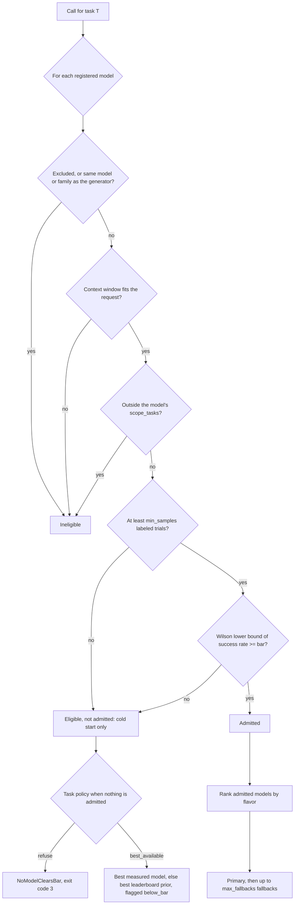

# ai-model-routing

Route every repeated kind of model call (ticket triage, field extraction, code generation, eval and judge calls) to the cheapest model that clears a quality bar you measured on that task, with fallback, monitoring and cost attribution. Or, if your team has decided spend does not matter, route to the best measured model with the exact same machinery.

- Python 3.10+, standard library only, about 8,000 lines you can read in an afternoon
- Works with any OpenAI-compatible endpoint (vendor APIs, gateways, local servers) or your own provider class
- Ships with a fully offline demo, so you can see the whole loop without an API key
- Tested on public data that already holds each model's answers, correctness and cost, so no API key is needed: see [Evidence](#evidence-held-out-results-on-public-data)
- Also decides whether an agent should do one piece of work itself or hand it to a sub-agent on the routed model (`model-routing delegate`), in both flavors

## Why route per task

- Most model spend in a product is a handful of call types repeated thousands of times: classify this ticket, pull these fields, write this test, grade this answer. Each one is a **task**: a repeated call with an **acceptance check** that says whether one output is right
- Send every call to the strongest model and you can pay 40x to 100x more per call than the cheapest tier (see the cost table below). Send them all to the cheapest and quality drops without a single error in the logs
- Public leaderboards do not settle it. They disagree with each other (one model ranks first on abstract reasoning and eighth on professional writing), and none of them is your task
- The number that tells you whether a model can do *your* task is its success rate on *your* acceptance check: agreement with gold labels, exact match on extracted fields, generated tests passing. This library makes that number the gate, per task. Nothing in the routing rules knows about a domain; a task is a name, a bar and the counts you measured

### Judge and eval calls, the first-class case

- In a team that evaluates seriously, judge calls are a large share of model spend: every candidate output, on every test case, on every rubric, gets graded, often more than once
- A cheap judge that is wrong does more damage than a cheap model on any other task, because it silently weakens the evals that every later decision trusts
- We found no public judge benchmark with a row for the current generation of models (see [research/judge-benchmarks.md](research/judge-benchmarks.md)). The nearest public evidence is a router benchmark that publishes each judge model's grade of each answer it graded: [AutoBench judges](#autobench-judges) chooses a judge on it by agreement with the other judges, not with a human label
- A judge must not grade its own family's output, so judge tasks turn on generator isolation (below)

## Two flavors, one pipeline

| | `cost_effective` | `cost_blind` |
|---|---|---|
| Who it is for | Teams paying per token | Teams that have decided token cost is not the constraint (credits, flat-rate contracts, quality-critical work) |
| Among models that clear the bar, pick | the cheapest expected cost per call; ties go to higher measured quality | the highest measured quality |
| Bar, sample minimum, generator isolation | same | same |
| Fallback chain, validation, monitoring | same | same |
| Cost in the log | list price | list price (the router ignores it; you still see it) |

The flavor changes exactly one value: the `routing_cost` used to rank passing candidates (list cost, or 0). Everything else is shared, so switching flavors is a one-word change and the spend report stays honest either way.

## How a model is chosen



The cost of a call is its list price. A model whose stats hold measured token counts for the task is priced at its own mean input and output tokens per call on that task, each rounded up; any other model is priced at the task's `expected_input_tokens` and `expected_output_tokens`. So a model that is cheap per token but writes several times as much as the others can lose the cheapest place. Each path of an inline-or-sub-agent decision is priced at the sizes of the model doing the work.

The context-window check reads three kinds of size differently:

- **Declared:** the task's `expected_input_tokens` and `expected_output_tokens` (1,000 and 200 when the task file gives none). The check reads the declared input when a call passes no size of its own, so set `expected_input_tokens` to the largest single request of the task, never the whole piece of work
- **Measured:** the stats' mean tokens per call. They set prices only, because a mean says nothing about the longest request
- **Per call:** `Router.select(..., prompt_tokens=N)` and `model-routing select --prompt-tokens N` check each model's window against N plus `expected_output_tokens` in place of the declared input, so the primary and every fallback can hold that request, and a request shorter than the declared size can reach a smaller-window model. Prices stay at the sizes above. `Executor.call` always passes a size: the `prompt_tokens` you give it, or else `estimate_prompt_tokens(messages)`, the characters of the text content divided by 4 and rounded up. That is a rough heuristic for English text that under-counts code and non-Latin scripts, so pass the real count when you have a tokenizer

The window limits one request. A provider rejects a request longer than the window, and an agent harness compacts its context between requests, never inside one. So for multi-call agent work, a model that compacts is judged by its measured success rate on whole runs, which already holds what compaction costs it, and is not ruled out by size.

Variants of one model, procedures, self-hosted rows, task scopes, prompt-cache prices and budgets change which routes a task has, what they cost or what a call may spend; each is explained in [Running it in production](#running-it-in-production).

### The quality bar is a confidence bound, not an average

A model is admitted for a task only when the lower end of a two-sided Wilson score interval on its measured success rate against the task's acceptance check is at or above the task's bar, and only after at least `min_samples` trials. At 95% confidence:

| Bar | Successes needed on 50 items | on 100 | on 200 | on 400 |
|---|---|---|---|---|
| 0.75 | 44/50 (88%) | 84/100 (84%) | 163/200 (81.5%) | 317/400 (79.25%) |
| 0.80 | 46/50 (92%) | 88/100 (88%) | 172/200 (86%) | 336/400 (84%) |
| 0.85 | 48/50 (96%) | 92/100 (92%) | 180/200 (90%) | 354/400 (88.5%) |

- A model that succeeds on 90% of 50 items does not clear an 85% bar (its lower bound is 0.786). It might be fine; you have not shown it yet
- More labeled items buy you a cheaper model: the same 90% clears 0.85 at 200 items
- This is deliberately conservative. A model below the bar lowers quality on every call of the task, and a wrong judge also corrupts every decision downstream of it, so the burden of proof is on the cheap model

### Rules that protect quality

- **Generator isolation, for tasks that check another model's output.** When a judge, reviewer or verifier call names the model that produced the output it checks (`generator_model`), the router excludes that model and its family while the task's `independent_of_generator` is on (the default). Self-preference in LLM judges is well documented (see [research/prior-art.md](research/prior-art.md)), so this is on by default. It has no effect when no generator is named, and the non-judge example tasks set `independent_of_generator` to `false` to say so
- **Priors never admit.** Leaderboard scores (`model_routing/data/priors.json`) only order candidates when nothing has been measured, and tell you which models to calibrate first. A leaderboard score is not a success rate on your task
- **Every decision explains itself.** Each candidate carries a reason code (`excluded_model`, `excluded_family`, `generator`, `generator_family`, `context_too_small`, `out_of_scope`, `insufficient_samples`, `below_bar`, `passes`), its measured counts and lower bound, and the decision says whether it rests on measurements or priors (`basis`) and whether it is below the bar
- **Fallbacks clear the bar too, unless a task opts out.** When some model clears the bar, the fallbacks are the next models that clear it, so a route can hold fewer than `max_fallbacks` of them. A task with `fallback_below_bar` set to `true` fills the places left with the measured models under the bar, highest lower bound first; the decision lists them in `below_bar_fallbacks` and `select` marks each `(below bar)`. Only your `validate` check (`DESIGN.md` 7) then vouches for their answers, which is why it is off by default. Replayed on LLMRouterBench with a check as good as the record's own score, so as an upper bound, at bar 0.8 with two fallbacks it adds 0.0042 of success for 1.029 (`cost_blind`) and 1.031 (`cost_effective`) times the cost ([research/below-bar-fallback.md](research/below-bar-fallback.md))

## Quickstart

```bash
git clone https://github.com/jeffma8888/ai-model-routing.git
cd ai-model-routing
python -m venv .venv && . .venv/bin/activate
pip install -e ".[dev]"
pytest -q
model-routing demo --out ./demo-run
```

To use the library from another project instead of a clone, install it from this repository pinned to a commit, with the full SHA of a commit you have checked in place of `<commit>`: `pip install "ai-model-routing @ git+https://github.com/jeffma8888/ai-model-routing.git@<commit>"`. On each push, CI builds a wheel, installs it into a fresh virtual environment and, from outside the checkout, runs the demo and checks that the data files and the `py.typed` marker came with it.

The demo routes one judge task with fictional `demo/` models and a synthetic 300-item labeled set (seeded, deterministic). It calibrates four judges, selects in both flavors, runs 200 judge calls per flavor with a simulated outage on the primary, then asks in each flavor whether an `atlas-max` parent 60,000 tokens into a session should do one more check itself or hand it to a sub-agent, and runs the hand-off it chose. It writes `calls.jsonl`, `stats.json`, `outcomes.jsonl` (the calibration set as an outcome matrix, used below), and its registry and task as `models.json` and `tasks.json`.

```text
$ model-routing demo --out ./demo-run
model-routing demo (fictional demo/ models, simulated outages)

cost_effective:
  primary:        demo/atlas-mid
  fallbacks:      demo/birch-pro, demo/atlas-max
  calls:          200
  fallback calls: 25
  list-price USD: 0.8650

cost_blind:
  primary:        demo/atlas-max
  fallbacks:      demo/atlas-mid, demo/birch-pro
  calls:          200
  fallback calls: 30
  list-price USD: 3.3794

cost_effective spent 26% of what cost_blind spent

inline or sub-agent, a demo/atlas-max parent at 60,000 context tokens:
  cost_effective: delegate to demo/atlas-mid (delegate_cheaper), inline 0.632000 vs delegate 0.029400 USD
  cost_blind:     inline on demo/atlas-max (inline_as_good), inline 0.632000 vs delegate 0.048600 USD
  hand-off calls: 1, list-price USD 0.0036
log: demo-run/calls.jsonl
```

What happened:

- Calibration on 300 synthetic items measured `atlas-max` 286/300, `atlas-mid` 274/300, `birch-pro` 273/300 and `birch-nano` 218/300. At a 0.85 bar the first three clear it (lower bounds 0.923, 0.876, 0.872) and `birch-nano` does not (0.674)
- `cost_effective` routes to `atlas-mid`, the cheapest admitted judge; `cost_blind` routes to `atlas-max`, the best measured one. Same bar, same fallback logic, about a quarter of the spend
- When the primary hit a simulated outage (about 15% of its calls), the call fell back to the next admitted judge, and every attempt landed in the log
- `atlas-mid` (true accuracy 0.91) edged out `birch-pro` (0.93) by one item on this sample. A gap that small is noise, which is why the bar is a lower bound and why the fallback order should not be read as a quality ranking
- Inline or sub-agent: in `cost_effective` the parent hands the check to `atlas-mid`, because re-reading its 60,000-token context would cost 0.632 USD and the hand-off 0.0294 USD with the bar still held; in `cost_blind` it keeps the check, because its best delegate is `atlas-max` itself. The hand-off ran through `Executor.call_delegated` as one more call in the log, tagged `delegated` and `parent`. That call cost 0.0036 USD on its simulated tokens, where the estimate priced it at the task's expected tokens plus the brief (0.0048 USD); the other 0.0246 USD of the estimate is the parent writing the brief and reading the result in its own calls, which the log does not see ([Inline or sub-agent](#inline-or-sub-agent) explains the arithmetic)

Then slice the log:

```text
$ model-routing report --log demo-run/calls.jsonl --by flavor
flavor          calls  attempts  errors  invalid  fallback_calls  fallback_rate  cost_usd  routing_cost_usd  p50_ms  p95_ms
--------------  -----  --------  ------  -------  --------------  -------------  --------  ----------------  ------  ------
cost_blind      200    230       30      0        30              0.150          3.379358  0.000000          1497.4  2368.0
cost_effective  201    226       25      0        25              0.124          0.868590  0.868590          1429.9  2376.7
```

`cost_blind` logs `routing_cost_usd` as 0 because the router ignored price, but `cost_usd` still shows what the calls cost at list price. `cost_effective` counts 201 calls: its 200 judge calls and the hand-off. The hand-off's tags split it out:

```text
$ model-routing report --log demo-run/calls.jsonl --by tag:delegated
tag:delegated  calls  attempts  errors  invalid  fallback_calls  fallback_rate  cost_usd  routing_cost_usd  p50_ms  p95_ms
-------------  -----  --------  ------  -------  --------------  -------------  --------  ----------------  ------  ------
(none)         400    455       55      0        55              0.138          4.244340  0.864982          1485.2  2376.7
true           1      1         0       0        0               0.000          0.003608  0.003608          1579.4  1579.4
```

### Check the choice on items the router never saw

`model-routing evaluate` takes an outcome matrix (one JSON object per task, item and model, with `correct` and either `cost_usd` or token counts; `DESIGN.md` 12.1), splits each task's items in half by a seeded hash of the item ID, calibrates on one half, routes each flavor (both by default) through the same `Router.select`, and scores the routed model on the other half next to simple baselines. It repeats this over 10 seeds by default. `--flavor` runs only the flavors given, so `--flavor cost_blind` serves a matrix that records no cost (DESIGN 12.4). The demo's `outcomes.jsonl` is a ready input:

```text
$ model-routing evaluate --outcomes demo-run/outcomes.jsonl --bar 0.85
bar 0.85, cost_effective
strategy               success  cost_usd  below_bar_rate  cleared_rate  bar_violation_rate
---------------------  -------  --------  --------------  ------------  ------------------
routed                 0.910    0.9620    0.000           1.000         0.000
oracle                 1.000    0.2063    0.000           -             -
best_on_calibration    0.954    3.0440    0.000           -             -
cheapest               0.732    0.0304    1.000           -             -
model:demo/atlas-max   0.954    3.0440    0.000           -             -
model:demo/atlas-mid   0.916    0.6088    0.000           -             -
model:demo/birch-nano  0.732    0.0304    1.000           -             -
model:demo/birch-pro   0.913    1.2176    0.000           -             -

bar 0.85, cost_blind
strategy               success  cost_usd  below_bar_rate  cleared_rate  bar_violation_rate
---------------------  -------  --------  --------------  ------------  ------------------
routed                 0.954    3.0440    0.000           1.000         0.000
oracle                 1.000    0.2063    0.000           -             -
best_on_calibration    0.954    3.0440    0.000           -             -
cheapest               0.732    0.0304    1.000           -             -
model:demo/atlas-max   0.954    3.0440    0.000           -             -
model:demo/atlas-mid   0.916    0.6088    0.000           -             -
model:demo/birch-nano  0.732    0.0304    1.000           -             -
model:demo/birch-pro   0.913    1.2176    0.000           -             -
```

Reading it:

- `routed` held the 0.85 bar on every held-out half in both flavors (`bar_violation_rate` 0.000 over 10 seeds, about 150 held-out items each). `cost_effective` spent about a third of what `cost_blind` spent (0.96 vs 3.04 USD) for 0.044 less held-out success (0.910 vs 0.954)
- `cost_effective` routed to `atlas-mid` on 7 seeds, `birch-pro` on 2 and `atlas-max` on 1, the split where neither cheaper judge's lower bound cleared the bar on its calibration half. `cost_blind` routed to `atlas-max` every time, which is also `best_on_calibration` here
- `cheapest` (`birch-nano`) is below the bar on every split. `oracle` is right whenever any judge is right and pays the cheapest right judge's price, so it is a bound that per-prompt routing could at most approach, not something task-level routing can reach
- The routed `cost_effective` success (0.910) is below both judges it mostly picks between (0.916 and 0.913). The two halves are complementary, so a judge that drew a lucky calibration half drew an unlucky held-out half, and the router picks the lucky one. That selection effect is why the bar is a lower bound and why `bar_violation_rate` should be read next to the held-out size, never against zero (`DESIGN.md` 12.3)
- `success` and `cost_usd` are means over seeds; `below_bar_rate` is the share of (task, seed) cells under the bar; `cleared_rate` and `bar_violation_rate` apply to `routed` only. `--json` prints the full result without per-cell rows, small enough to commit next to the data it came from
- `--cost-per-correct` adds a last column, `cost_per_correct_usd`: each strategy's held-out cost over the held-out items it got right (`-` when it got none right), so a model that is cheaper per call but fails more often shows what each right answer costs (`DESIGN.md` 12.3). A task whose failed calls are retried can set `"failure_policy": "retry_same"` in its tasks file, and `cost_effective` then ranks the models that clear the bar by expected cost per success, a call's cost over its Wilson lower bound (`DESIGN.md` 5.3)

### Inline or sub-agent

An agent that reaches a piece of work, one or more successive calls of a task (`--work-calls`, default 1), can do it itself (inline) or hand it to a fresh sub-agent on the model the router picks. `model-routing delegate` holds both paths to the task's bar and prices what each one adds to the parent's calls: the parent's context (`--context-tokens`), the brief it writes (`--brief-tokens`), the result it reads back (`--result-tokens`), and later parent calls that re-read them (`--carry-turns`, default 0). The demo's output is a ready input. Here an `atlas-max` parent 60,000 tokens into a session reaches one faithfulness check:

```text
$ model-routing delegate demo_faithfulness_judge --parent demo/atlas-max --context-tokens 60000 --brief-tokens 400 --result-tokens 60 --generator demo/cedar-writer --registry demo-run/models.json --tasks demo-run/tasks.json --stats demo-run/stats.json
mode:                delegate
model:               demo/atlas-mid
reason:              delegate_cheaper
below_bar:           false
inline_cost_usd:     0.632000
delegate_cost_usd:   0.029400
parent_quality_lb:   0.923
delegate_quality_lb: 0.876
```

The same check from an `atlas-mid` parent that would fold it into its next reply (`--fold-inline`):

```text
$ model-routing delegate demo_faithfulness_judge --parent demo/atlas-mid --context-tokens 60000 --brief-tokens 400 --result-tokens 60 --fold-inline --generator demo/cedar-writer --registry demo-run/models.json --tasks demo-run/tasks.json --stats demo-run/stats.json
mode:                inline
model:               demo/atlas-mid
reason:              inline_cheaper
below_bar:           false
inline_cost_usd:     0.004000
delegate_cost_usd:   0.009720
parent_quality_lb:   0.876
delegate_quality_lb: 0.876
```

The same folded check when it takes two calls, the second re-reading the first (`--work-calls 2`):

```text
$ model-routing delegate demo_faithfulness_judge --parent demo/atlas-mid --context-tokens 60000 --brief-tokens 400 --result-tokens 60 --fold-inline --work-calls 2 --generator demo/cedar-writer --registry demo-run/models.json --tasks demo-run/tasks.json --stats demo-run/stats.json
mode:                delegate
model:               demo/atlas-mid
reason:              delegate_cheaper
below_bar:           false
inline_cost_usd:     0.130400
delegate_cost_usd:   0.016920
parent_quality_lb:   0.876
delegate_quality_lb: 0.876
```

An `atlas-mid` parent 10,000 tokens into a session, doing the check in a call of its own, when its provider caches the prompt and a cached read costs a tenth of the list input price (`--cached-read-ratio 0.1`):

```text
$ model-routing delegate demo_faithfulness_judge --parent demo/atlas-mid --context-tokens 10000 --brief-tokens 400 --result-tokens 60 --cached-read-ratio 0.1 --generator demo/cedar-writer --registry demo-run/models.json --tasks demo-run/tasks.json --stats demo-run/stats.json
mode:                inline
model:               demo/atlas-mid
reason:              inline_cheaper
below_bar:           false
inline_cost_usd:     0.008400
delegate_cost_usd:   0.009720
parent_quality_lb:   0.876
delegate_quality_lb: 0.876
```

Reading it:

- Inline, `atlas-max` would re-read its 60,000-token context in a call of its own at 10 USD per 1M input tokens: 0.632 USD. Delegating pays for the 400-token brief, one `atlas-mid` call on the brief and the 1,000-token input, and the next parent call re-reading the brief and the 60-token result: 0.0294 USD, about 5% of inline. `atlas-mid` clears the 0.85 bar (lower bound 0.876), so the hand-off keeps the bar
- Folded into the next reply, inline work never re-reads the context, so it costs only the work's own tokens at the parent's price (0.0040 USD). Delegating, even to `atlas-mid` itself, adds the brief and the re-read (0.0097 USD), so the parent keeps the work: `inline_cheaper`
- With two calls, only the second folds into the next reply, so the first re-reads the 60,000-token context in a call of its own: 0.1304 USD inline. Delegated to `atlas-mid` itself, each call re-reads only the brief and the calls before it: 0.0169 USD. Each call re-reads everything before it on its path and nothing is summarised between calls (`DESIGN.md` 13.2)
- A cached read prices the parent's re-read of its context in the inline work at that fraction of its list input price, and nothing else: the work's own tokens, the brief, the result, the delegate and all output stay at list price. At 0.1 the 10,000-token re-read costs 0.002 USD instead of 0.02, so the `atlas-mid` parent keeps the check (0.0084 against 0.0097 USD); without the flag, at list price, it delegates (0.0264 against 0.0097). The `atlas-max` parent above still delegates at 0.1 (0.092 against 0.0294 USD) and even at 0 (0.032), since writing the brief (0.02 USD), the `atlas-mid` call (0.0048) and the next call's re-read of the 460-token brief and result (0.0046) still cost less than `atlas-max` doing the work (0.02) and re-reading its 1,200-token input and output (0.012). Cache writes, cache expiry and discounts on other re-reads are not modelled (`DESIGN.md` 13.2)
- `cost_blind` ignores price, so the first parent stays inline (`inline_as_good`): its best delegate is `atlas-max` itself, and equal-quality ties go inline because a brief can drop detail. A parent below the bar hands off to a delegate that clears it (`parent_below_bar`), whatever inline would cost, in either flavor: a `birch-nano` parent (lower bound 0.674) at 2,000 context tokens goes to `atlas-mid` in `cost_effective` although inline would cost 0.00052 USD against 0.0050 (`cost_blind` sends it to `atlas-max`). At 60,000 tokens the reason is `parent_context_full` instead, because the work no longer fits its 32,000-token window and that check comes first
- Inline is blocked outright when the task excludes the parent's family, when the parent is the generator or in its family on an `independent_of_generator` task, or when the work does not fit the parent's context. `--json` prints the full decision, including the delegate's route (`DESIGN.md` 13)

On public data, [Delegation on AutoBench](#delegation-on-autobench) scores this decision on held-out questions for each of 20 models as the parent.

In numbers, with C, B, R and T the `--context-tokens`, `--brief-tokens`, `--result-tokens` and `--carry-turns` values and `p_out / p_in` the parent's output price over its input price: for work in a call of its own (no `--fold-inline`), in one work call (`--work-calls 1`) with full-price reads of the context (no `--cached-read-ratio`) and the brief's output charged at its size (no `--brief-output-tokens`), from a parent with stats for the task that the router does not exclude as a delegate and with no `price_tiers` in `models.json`, `cost_effective` delegates whenever `C - B - (1 + T) * (B + R)` is above `B * p_out / p_in`, whatever the size of the work itself, since that call re-reads the parent's whole context. At a 500-token brief and result and `--carry-turns 1`, the condition holds for any `C > 2,500 + 500 * p_out / p_in`, and on the four committed delegation runs (LLMRouterBench, AutoBench 2026, tau2-bench per domain and tau2-bench pooled) all 60,000 `cost_effective` cells at such a point delegate ([research/where-delegation-pays.md](research/where-delegation-pays.md)).

## Calibrate your own task

1. **Define the task** in a tasks file. `model_routing/data/example_tasks.json` ships three judge tasks and five from other domains (`support_ticket_triage`, `invoice_field_extraction`, `unit_test_codegen`, `tool_calling_support_agent`, `math_final_answer`):

   ```json
   {"tasks": [{
     "name": "faithfulness_judge",
     "bar": 0.85,
     "min_samples": 50,
     "independent_of_generator": true,
     "expected_input_tokens": 3000,
     "expected_output_tokens": 150,
     "on_no_model": "refuse",
     "max_fallbacks": 2,
     "prior_category": "professional_writing"
   }]}
   ```

2. **Run each candidate model over a labeled set for the task** and write one JSON line per item. Either give the output and the label (compared with `==`), or say whether the output passed the task's acceptance check:

   ```json
   {"task": "faithfulness_judge", "model": "anthropic/claude-haiku-5.5", "prediction": "unfaithful", "gold": "unfaithful"}
   {"task": "unit_test_codegen", "model": "openai/gpt-6-luna", "correct": false}
   {"task": "support_ticket_triage", "model": "openai/gpt-6-luna", "correct": true, "input_tokens": 1240, "output_tokens": 35}
   ```

   For `unit_test_codegen`, `correct` means the generated tests ran and passed; for an extraction task it might mean every field matched exactly. For `tool_calling_support_agent` a line is one whole conversation: `correct` means the checks on its end state passed, and its token counts are the sums over the conversation's model calls. For `math_final_answer` a line can give the final answer as `prediction` and the key's answer as `gold`, both in one form (for example an integer), so the `==` comparison is the exact-answer check. The library only counts. A line may also record what the call read and wrote as `input_tokens` and `output_tokens` (both or neither); once a model has them on a task, the router prices it there at its own mean tokens per call instead of the task's expected tokens.

3. **Fold the results into the stats file** (counts and token totals accumulate across runs; a row with token counts also gets `input_tokens`, `output_tokens` and `token_trials`, the number of calls they were summed over):

   ```bash
   model-routing calibrate --results results.jsonl --stats stats.json
   ```

4. **Ask for a route.** For a task that checks another model's output, name that model so its family is excluded; other tasks need no `--generator`:

   ```bash
   model-routing select faithfulness_judge --flavor cost_effective --generator openai/gpt-6.1-sol --stats stats.json
   model-routing select faithfulness_judge --flavor cost_blind --generator openai/gpt-6.1-sol --stats stats.json --json
   model-routing select support_ticket_triage --flavor cost_effective --stats stats.json
   ```

   Exit codes: 0 routed, 2 bad input, 3 no model clears the bar (for a `refuse` task).

**How many labelled items per model?** Before step 2, ask `plan` how many items a model needs on the task before its Wilson lower bound can clear the bar, if its success rate there is what you expect (`items_needed` in code):

```text
$ model-routing plan --success 0.9 --bar 0.8
success:     0.9
bar:         0.8
confidence:  0.95
items:       74
successes:   66
lower_bound: 0.800912
```

The successes at a count are rounded down, and `items` is the count from which every larger one up to `--max-items` (default 10000) also clears at that rate: 68 items (61 right, bound 0.802) would clear here, but 73 (65 right, 0.798) would not. A rate at or below a bar above 0 never clears, and the closer the rate is to the bar the more items it takes (6338 at 0.81 against 0.8); with no count up to `--max-items`, `plan` exits 3. The count is per model on the task; the router also needs the task's `min_samples` measured trials, and for `evaluate` the count is the size of one calibration half, so the matrix needs about the count divided by `--calibration-fraction` items (twice the count at the default 0.5).

## Use it in code

```python
from model_routing import (
    DATA_DIR, Executor, Monitor, OpenAICompatibleProvider, Priors, Registry,
    Router, Stats, json_validator, load_tasks, report,
)

router = Router(
    Registry.load(DATA_DIR / "models.json"),
    load_tasks(DATA_DIR / "example_tasks.json"),
    Stats.load("stats.json"),
    Priors.load(DATA_DIR / "priors.json"),
)

provider = OpenAICompatibleProvider(
    "https://your-gateway.example/v1",
    api_key_env="GATEWAY_API_KEY",
    model_map={"anthropic/claude-haiku-5.5": "claude-haiku-5-5"},  # your gateway's IDs
)
monitor = Monitor("calls.jsonl")
executor = Executor(router, provider, monitor=monitor)

result = executor.call(
    "faithfulness_judge",
    messages=[{"role": "user", "content": "..."}],
    flavor="cost_effective",
    generator_model="openai/gpt-6.1-sol",
    tags={"team": "search-quality", "experiment": "exp-42"},
    validate=json_validator("verdict", "reason"),
)
print(result.model, result.text)
```

- For a task that checks nothing, leave out `generator_model`: `executor.call("invoice_field_extraction", messages=..., flavor="cost_blind")`
- The executor tries the primary, then each fallback in order
- It falls back on a `ProviderError` (timeout, rate limit, 5xx, unparseable response) or when `validate` rejects the output; any other exception is a bug and propagates
- Every attempt, including the failed ones, is logged; if all of them fail it raises `AllModelsFailed` with the attempts attached

To act on an [inline or sub-agent](#inline-or-sub-agent) decision, run the hand-off with `call_delegated`. It sends the brief to the route the decision was made with, falls back and validates as `call` does, and tags every attempt `delegated` and `parent`:

```python
decision = router.decide_delegation(
    "faithfulness_judge", "openai/gpt-6.1-sol", "cost_effective",
    context_tokens=60_000, brief_tokens=400, result_tokens=60,
    generator_model="openai/gpt-6.1-sol",
)
if decision.mode == "delegate":
    result = executor.call_delegated(
        decision, messages=[{"role": "user", "content": "..."}],
        tags={"team": "search-quality"},
    )
```

- Here the parent wrote the answer being checked, so on this `independent_of_generator` task (with stats that admit a judge from another family) inline is blocked (`parent_not_independent`) and the check goes to a judge from another family
- An inline decision raises `ValueError`, because the parent does that work in its own call; so does a caller tag named `delegated` or `parent`
- `model-routing report --log calls.jsonl --by tag:delegated` splits the spend between hand-offs (group `true`) and other calls (group `(none)`). The parent's share of a hand-off (writing the brief, reading the result) is spent in the parent's own calls, not in these records

## Split a task into slices

A task's measured success rate is an average over the mix of its calibration items. Say 80% of a support task's tickets are quick fixes and 20% are deep investigations across services. A model right on 99% of the quick ones and 64% of the deep ones averages 92%, so it clears a 0.85 bar while failing about a third of the deep tickets, and if the mix shifts toward deep tickets the bar stops holding with nothing in the stats to show it.

The fix is to split the task by something known before the call. A slice is a named part of a task, routed on its own counts. You assign each call to a slice by your own rule (the queue a ticket came from, the size of a change) or with a cheap classifier; the library never classifies.

1. **Give a slice its own values** in the tasks file if it needs them: a `bar`, `min_samples`, `expected_input_tokens` or `expected_output_tokens`. A slice the file does not name takes every value from its task:

   ```json
   {"tasks": [{"name": "support", "bar": 0.85, "slices": {"deep": {"bar": 0.9}}}]}
   ```

2. **Tag each calibration line with its slice**, for example `"slice": "deep"`. `calibrate` adds the trial to the task and to `support@deep`, so the task's own counts still cover every line.

3. **Name the slice on each call**: `Router.select(..., slice="deep")`, `Executor.call(..., slice="deep")` or `model-routing select --slice S`. A sliced call is admitted only on that slice's own counts, so a model measured only on the whole task is `insufficient_samples` on every slice, and the task's `on_no_model` applies until some model has `min_samples` trials on the slice and a lower bound that clears its bar. Each log record carries the call's `slice`.

4. **Check the split offline.** `model-routing evaluate --slice-by FIELD` reads each outcome row's slice from FIELD and, for each bar and flavor, sets `pooled` (the task's route, scored on each slice's held-out items) beside `sliced` (each slice routed on its own calibration items), with `slice_miss_rate`: of the seeds on which a route cleared and met the bar on the whole task, the share on which some slice fell below it.

What the public data shows, from the slice results of [AutoBench](evidence/autobench-2026/RESULTS.md#slices) and [LiveCodeBench](evidence/livecodebench/RESULTS.md#slices), which hold the commands that rebuild them:

- **The average hides a weak slice.** On LiveCodeBench the task's route scores 0.902 on held-out problems, but 0.986 on `1-easy`, 0.940 on `2-medium` and 0.748 on `3-hard`. On AutoBench, of the seeds on which the `cost_effective` route cleared and met bar 0.6 on the whole task, some difficulty level fell below it on 0.540
- **Slicing finds the weak slice, but it raised no held-out success on LiveCodeBench and found no cheaper way to the best single model's quality on AutoBench.** The sliced LiveCodeBench route scores 0.900 against the pooled 0.902 (that dataset records no cost, so it is `cost_blind` only), and on AutoBench no sliced row beats always calling `openai/gpt-5.6-luna` (0.872 at 0.3092 USD) on success and cost together
- **Small slices are the trade-off.** AutoBench's five difficulty levels hold 30 to 50 of its 203 questions each, so a calibration half holds about half that, under the default `min_samples = 30`: with `cost_effective`, a level clears bar 0.6 on its own counts in 0.032 of the (level, seed) pairs. At `--min-samples 10` it clears in 0.956 of them, but the check gets looser: at bar 0.8 the share of cleared pairs that fall below the bar on held-out questions rises from 0.000 to 0.127

A slice needs labelled items of its own: even a model that is right every time needs 16 of them before its lower bound clears 0.8:

```text
$ model-routing plan --success 1.0 --bar 0.8
success:     1.0
bar:         0.8
confidence:  0.95
items:       16
successes:   16
lower_bound: 0.806392
```

So a split pays where each slice can get enough labelled items to clear its own bar. Until then a sliced call routes by `on_no_model`, or, with a lower `min_samples`, on a looser check: that is the price of no longer hiding the slice inside the task's average.

## Start cheap, escalate on a signal

Some items of a task are easy for a cheap model and some are not, and often you can tell which only after the cheap model has tried: its code failed a test, it asked for a human, or it is still making tool calls long after an easy case would have ended. A cascade starts the call on a cheap model and hands it up to a strong one when such a signal fires on the cheap model's result. To the router a cascade is one more candidate with calibration of its own, so it clears a bar only by its own measured successes, never by the strong model's, and it is priced as the cheap model's call plus, for its measured share of hand-ups, a strong-model call that reads the input and the cheap model's answer as uncached input.

1. **Name the cascade on its task** in the tasks file. Its ID is `cheap>strong@signal`, and the signal is a name you choose:

   ```json
   {"tasks": [{"name": "support", "bar": 0.85, "cascades": [{"cheap": "anthropic/claude-haiku-5.5", "strong": "anthropic/claude-opus-5.5", "signal": "needs-human"}]}]}
   ```

2. **Calibrate the cascade as one model.** Run each labelled item through the whole cascade and write one line with the cascade's ID as `model`, whether its final answer passed and whether it was handed up: `{"task": "support", "model": "anthropic/claude-haiku-5.5>anthropic/claude-opus-5.5@needs-human", "correct": true, "escalated": false}`. `calibrate` keeps the cascade's successes and hand-ups under its ID. A cascade line carries no token counts, since its two models' tokens would mix.

3. **Pass the signals on each call**: `Executor.call(..., signals={"needs-human": needs_human})`, where `needs_human` is your function of the cheap model's text that returns true to hand up. With `signals` the router weighs the task's cascades beside its models (`Router.select(..., cascades=True)`); without it no route names one. A cascade entry keeps the cheap model's answer when the signal is false; when it is true, or the cheap call fails, the strong model starts fresh on the same messages, and `validate` checks whichever answer the entry keeps. Each log record names the model it called, and the records of a cascade entry's attempts also carry `cascade` and `escalated`.

4. **Check it offline.** In an outcome matrix a cascade's row names its ID as `model`, gives the whole cascade's `cost_usd` and a true or false `escalated`; `model-routing evaluate` scores it as one more candidate and adds `escalation_share`: of the held-out items in the cells routed to a cascade, the share the cheap model handed up.

What the public data shows, first from the [tau2-bench cascade results](evidence/tau2-bench/RESULTS.md#cascades), which hold the commands that rebuild them. The replay pairs the 4 agents into 42 cascades, the cheap agent of each pair the one at the lower input list price, on 7 signals read from the cheap run's own calls: more than N agent calls for N of 10, 15 and 20, each also in a form that needs no write among the first N calls, and the agent's call to transfer to a human agent. Cost is the agents' recorded spend on the held-out conversations, averaged over the 50 seeds; on a handed-up conversation it adds the conversation so far, read once more as the strong agent's uncached input at its input list price:

- **A fixed cascade can beat the best single agent on both counts.** Always calling `anthropic/claude-3-7-sonnet-20250219` scores 0.612 at 63.2133 USD, and 3 of the 42 cascades beat it on success and cost together. The cheapest of them, `openai/o4-mini-2025-04-16>anthropic/claude-3-7-sonnet-20250219@calls-over-10-no-write`, scores 0.618 at 0.538 of its cost, handing up 0.396 of the conversations
- **Routing with cascades paid at the lowest bar only.** At bar 0.3 the `cost_effective` route with the cascades as candidates scores 0.553 at 7.5116 USD, against 0.547 at 9.1340 USD without them; at bars 0.4 to 0.8 it scores higher but costs more. `cost_blind` scores 0.602 at 43.1779 USD at every bar, against 0.589 at 40.3751 USD, and no routed row, with cascades or without, beats a single agent on both counts
- **Where it pays depends on the domain.** At bar 0.3 the `cost_effective` route sends `airline` to a cascade on 32 of the 50 seeds, `telecom` on 18 and `retail` on 0
- **On code, a failed public test can be the signal.** In the [LiveCodeBench cascade results](evidence/livecodebench/RESULTS.md#cascades), which record no cost, the replay makes 22 cascades, 11 pairs of one model at two reasoning settings, the lower setting the cheap model, each on 2 signals: hand up when the cheap model's first sample fails a public test case (`public-test-failed`), and also when a failed sample's record holds no test (`public-test-failed-or-no-test`). With them as candidates the route holds 0.909 held-out success at every bar, against 0.902 without them, the same 0.909 as the best single model, `openai/o4-mini-high`, though at bar 0.9 it clears the bar on calibration on only 0.280 of the seeds. 1 of the 22 cascades holds more: `openai/o4-mini-medium>openai/o4-mini-high@public-test-failed-or-no-test`, 0.915, handing up 0.077 of the held-out problems, but only because a failed sample whose record holds no test counts as handed up, the upper end of what the data can tell; on `public-test-failed`, which keeps such a sample, the same pair holds 0.908

The limits: this is a replay of recorded runs, not a live one. A signal measured on a benchmark may not exist in your product, so measure yours on your own labelled items. The strong run in the data is a fresh conversation, so the replay restarts the conversation at the hand-up, as the executor does. And `calls-over-N` and `transfer` may hand up a run in which the cheap agent already wrote (changed a booking or an order), which the replay assumes undone; only the `-no-write` signals never hand such a run up, so where a write cannot be undone, prefer them; but in telecom the user's own device actions change state too, and no signal counts them. On LiveCodeBench no cost is recorded, so its bullet claims no saving; the strong row is the strong model's own first sample, so the replay starts the problem over at the hand-up; and a wrong answer that only a private test case finds stays on the cheap model.

So try a cascade where a cheap check on the cheap model's result can tell the hard items apart, and let the cascade's own calibration, not the strong model's, decide whether it clears your bar.

## Monitoring and cost attribution

Each attempt is one JSON line with the task, flavor, model, family, attempt index, outcome, latency, tokens, list-price `cost_usd`, `routing_cost_usd` (0 in `cost_blind`), `below_bar`, `basis` and your tags; an attempt on a fallback under the bar (a task with `fallback_below_bar`, above) also carries `below_bar_fallback: true`. An `Executor.call` attempt ends with `prompt_tokens` and `prompt_tokens_estimated`: the request size the context-window check read (above), and whether the executor estimated it. Roll it up any way you need:

```bash
model-routing report --log calls.jsonl --by model
model-routing report --log calls.jsonl --by flavor
model-routing report --log calls.jsonl --by tag:experiment --json
```

```python
for row in report(monitor.records, by="tag:team"):
    print(row["group"], row["calls"], row["fallback_rate"], row["cost_usd"], row["p95_latency_ms"])
```

- Costs and token counts are summed per attempt, so a failed attempt that still burned tokens is charged to the model that burned them
- Call counts, failures and the fallback rate are attributed by each call's final attempt. A call is a fallback call when that attempt belongs to another route entry than its first, so a cascade that handed up to its strong model, or a procedure whose model calls came before its closing record, is no fallback when it was the call's first choice
- `below_bar_calls` counts the calls a model under the bar answered: those whose final attempt is `ok` and has `below_bar: true` (no model cleared, so the route was the best available) or `below_bar_fallback: true`. The text table shows that column only when some group has one
- Latency percentiles are nearest-rank over successful attempts
- `--audits audits.jsonl`, one `{"call_id": ..., "correct": true}` line per audited call, adds `audited_calls`, `correct_calls`, `cost_per_success_usd` (every attempt of the group's calls, fallbacks included, over the calls an audit marked correct) and `successes_per_100k_tokens`; both are `n/a` until every call of the group is audited, and an `ok` with no audit never counts as a success

Under a [budget](#running-it-in-production) the executor logs each warn crossing and each refusal as well, and `budget_report` reads each budget's spend back from the log:

```python
from model_routing import Budget, BudgetExceeded, BudgetLedger, budget_report

ledger = BudgetLedger([
    Budget("search-quality", 0.001, "warn", window="month", tags={"team": "search-quality"}),
    Budget("judge", 0.0009, "refuse", window="day", task="faithfulness_judge"),
])
budget_log = Monitor()
capped = Executor(router, provider, monitor=budget_log, ledger=ledger)
for _ in range(3):
    try:
        capped.call("faithfulness_judge", messages=[{"role": "user", "content": "..."}],
                    generator_model="openai/gpt-6.1-sol", tags={"team": "search-quality"},
                    prompt_tokens=3_000)
    except BudgetExceeded as refused:
        print("refused by", refused.budget.name, refused.window)
for row in budget_report(budget_log.records, ledger.budgets):
    print(row["budget"], row["window"], row["budget_used_pct"], row["warn_records"], row["refused_records"])
```

- With `anthropic/claude-haiku-5.5` as the judge, each call is held at 0.000375 USD, 3,000 input tokens and the task's 150 expected output tokens at list price. A call that reads 3,000 tokens and writes 20 costs 0.00031 USD, so two calls run, the second takes the team's spend to 62% of its limit and writes one `warn` record, and the third is refused before it is sent: 0.00062 spent and 0.000375 held come to 0.000995, over the judge's 0.0009
- `budget_report` gives one row per budget and window, its `spent_usd` and `budget_used_pct` read from the attempt records and its `warn_records` and `refused_records` counted from the budget records; `report` reads the same log as before, since it skips budget records

## Running it in production

These options sit on top of the selection rule of [How a model is chosen](#how-a-model-is-chosen): each changes which routes a task has, what they cost or what a call may spend.

From a first call to steady state, in order, each step with one lesson from [production lessons](research/production-lessons.md) and its detail in the paragraphs below:

1. Define each task in `tasks.json` with its `bar` and `min_samples`, and give `Executor.call(..., validate=...)` a check, so a wrong answer is an `invalid` attempt and the call moves to its fallback: Uber [benchmarks the real work](research/production-lessons.md#benchmark-the-real-work-then-take-the-cheapest-setup-that-holds-quality).
2. Size the labelled sample with `model-routing plan --success P --bar B`, then run `model-routing calibrate --results FILE --stats FILE`; a new route starts cold, `insufficient_samples` until its own trials clear the bar, as [a stand-in model must clear the same bar](research/production-lessons.md#a-catalogue-of-models-does-not-pick-one-and-a-stand-in-model-must-clear-the-same-bar).
3. Give each setup a route, a `variants` entry per effort or harness, and compare held-out cost per correct item with `model-routing evaluate --outcomes FILE --cost-per-correct`: for Harvey [effort and harness are part of the measured setup](research/production-lessons.md#effort-harness-and-batch-size-are-part-of-the-measured-setup).
4. Script recurring tool work as a `Procedure` passed in `procedures=[...]`, so it competes with the agent on its own measured runs: Uber [keeps tool schemas and polling out of the model's context](research/production-lessons.md#keep-tool-schemas-and-polling-out-of-the-models-context).
5. Register a model you serve at its real price, `"pricing_basis": "self_hosted"` from its hour, kept to its tasks by `"scope_tasks"`: for Harvey [your own model is a candidate, kept to the tasks it was measured on](research/production-lessons.md#your-own-trained-model-is-a-candidate-kept-to-the-tasks-it-was-measured-on).
6. Record the cache reads your provider reports as `cached_input_tokens`, watch `model-routing report --log PATH --cache`, and [keep the prompt prefix the same, byte for byte](research/production-lessons.md#keep-the-prompt-prefix-the-same-byte-for-byte).
7. Start a `Budget(name, limit_usd, "warn")`, which notes 50, 80 and 100 percent of its limit, before `refuse` or `downgrade`, which never moves a call below the bar: Uber uses [spend tiers and nudges, not strict caps](research/production-lessons.md#spend-tiers-and-nudges-not-strict-caps).
8. Shadow a share of calls with a task's `shadow_rate`, write the pairs with `model-routing pairs --log PATH --out FILE`, and switch only when `model-routing promote` prints `promote` on the same items: Harvey [switches models only on locked data and a significant result](research/production-lessons.md#switch-models-only-on-locked-data-and-a-significant-result).
9. On a schedule, refresh `models.json` prices (`select` warns once a row's `price_valid_until` has passed), calibrate again on new labels and alert on `model-routing drift --log PATH --audits PATH --json` flags, as [the price of a given score falls fast and unevenly](research/production-lessons.md#the-price-of-a-given-score-falls-fast-and-unevenly-date-the-prices-and-re-run-the-choice).
10. Leave to your own code and scheduler a cache life set by how the traffic pauses, priced with `price_cache_write`, tool payloads loaded only when needed and precomputing offline what can wait: Uber [sets the cache's life by how the work pauses](research/production-lessons.md#price-cache-writes-and-set-the-caches-life-by-how-the-work-pauses).

One model run two ways can be two routes. A `models.json` row may name variants of its model, for example `"variants": {"lean": {"harness": "lean-agent 2.0", "reasoning_effort": "low"}}`, and each is a route of its own, `vendor/model@lean`. Calibration lines and stats name the route, so a variant's success rate and mean tokens are its own, while it keeps its base's family, list prices and context window. A variant whose calls each handle several items, a judge grading four answers in one call for example, sets `"items_per_call": 4`, so once measured with token counts the route is priced per item and `select` shows an `items` column. The library keeps the effort, harness and compaction settings as labels that your harness applies, and calls the provider with the route ID, so map each route in `OpenAICompatibleProvider(model_map=...)` when your endpoint names the model otherwise (`DESIGN.md` 4.1 and 5.2). A variant's `provider_options`, for example `{"reasoning_effort": "high"}`, are sent on each call of that route, and `OpenAICompatibleProvider` adds them to the request body after `model` and `messages` (`DESIGN.md` 6 and 7). On public data, [LiveCodeBench's runs](evidence/livecodebench-variants/RESULTS.md) of 5 models at two or three reasoning settings, routed as 13 variants, put one model's settings up to 0.088 apart in held-out success (`anthropic/claude-sonnet-4`), and `openai/o3-mini-2025-01-31` does best at `@medium`, not `@high`; no cost is recorded there.

Recurring tool work can be a route of its own. A `Procedure(name, version, fn, max_model_calls=..., max_tool_calls=..., model=...)` is your code for a job's fixed steps, with a declared bound on the model calls and tool calls one run makes, and its route ID is `proc:<name>@<version>+<model>`. Passed as `select(..., procedures=[...])` or `Executor.call(..., procedures=[...])`, it is a candidate beside the models: admitted only on its own measured runs against the task's bar, priced at its measured mean cost per run. In the executor a run that raises or fails `validate` falls back to the next route, and its records carry `procedure`, `procedure_version`, `model_calls`, `tool_calls` and `tool_cost_usd` (`DESIGN.md` 4.5, 5.2, 7 and 11). `model_routing.demo.run_procedure_demo()` runs a submit, poll and fetch job both ways on fictional models, by model turns and in code. A version that fetches too early stays under the bar and is never routed, and the fixed version is the primary once its own runs clear it. Uber runs such work as scripts, "the loop runs in a subprocess, and only the summary comes back.", and reports that this cut tokens by more than 50% on small SQL results and by more than 90% on bulk work ([production lessons](research/production-lessons.md#keep-tool-schemas-and-polling-out-of-the-models-context)): its own token counts, with no quality figure for the scripts, not a measurement of this library.

A model you train or serve yourself is a row priced from its hour. A `models.json` row with `"pricing_basis": "self_hosted"` gives `usd_per_hour`, `tokens_per_hour_in`, `tokens_per_hour_out`, `utilization` and `input_cost_share`. The loader derives its prices per million tokens from them, so it is routed like any model. Its throughputs describe one workload, and its split of the hour between input and output is an approximation you choose. A fine-tune names its base with `"base_model"` and has its base's family, so with generator isolation on it never judges its base's output, and `"deployment"`, `api` or `self_hosted`, records where a model runs. Decisions, attempt records and the `select` table name a self-hosted model's `pricing_basis`, and `report --by pricing_basis` splits a log's spend into that part and the rest (`DESIGN.md` 4.1, 5.1, 8.1, 8.3, 10 and 11). `model_routing.demo.run_self_hosted_demo()` routes a fictional fine-tune served at 2 USD an hour against a list-priced model: once its own runs clear the bar it is the primary at a twelfth of the list model's cost a call. Harvey reports that its Firm Knowledge model "completes tasks competitively with leading frontier models while reducing cost per query by 90%." ([production lessons](research/production-lessons.md#your-own-trained-model-is-a-candidate-kept-to-the-tasks-it-was-measured-on)): its own number, with no hourly cost given, not a measurement of this library.

A model built for some tasks can be kept to them. A `models.json` row's `"scope_tasks"`, a list of task names or glob patterns such as `["review_*"]`, makes the model a candidate only on a task one of them matches; on a sliced call a pattern with `@` is matched against the call's `<task>@<slice>` key. On a task none of them matches, its candidate is `out_of_scope` and not eligible, so it gets no calls there. On a task in its scope it is admitted only by its own measured success there. A cascade or a procedure that names it follows its scope (`DESIGN.md` 4.1 and 5.2). Harvey builds its trained models for single jobs: "These capabilities are each trained separately and can be deployed as tools and sub-agents that our model can route to in order to tackle specific tasks." ([production lessons](research/production-lessons.md#your-own-trained-model-is-a-candidate-kept-to-the-tasks-it-was-measured-on))

A prompt cache changes what a call costs, so a route is priced at the cache hits it measured. A `models.json` row may give `price_cached_in` and `price_cache_write`, USD per 1M input tokens its provider reads from and writes to the prompt cache, except a row with `price_tiers` or a self-hosted one, which may hold neither; an absent one is the input price, and a candidate that priced a measured count that way names the absent field in `cache_price_unknown`. A results line may carry `cached_input_tokens` and `cache_write_tokens` beside its `input_tokens` and `output_tokens`, counted inside its `input_tokens`, and once a model has them on a task it is priced there at their means, the four parts in its candidate's `cost_breakdown`. Only reported counts are priced as hits, never a repeated prompt. The inline-or-sub-agent decision reads only `--cached-read-ratio`. In the executor, `OpenAICompatibleProvider` maps `usage.prompt_tokens_details.cached_tokens` and `report --cache` gives each group's `cache_hit_rate`. An adapter for another API keeps `input_tokens` inclusive: Anthropic's Messages API counts cache reads and writes outside its `usage.input_tokens`, so its adapter returns the sum of `input_tokens`, `cache_read_input_tokens` and `cache_creation_input_tokens` as the input (`DESIGN.md` 4.1, 4.3, 5.1, 5.2, 6, 7, 8.3 and 10). Manus: "If I had to choose just one metric, I'd argue that the KV-cache hit rate is the single most important metric for a production-stage AI agent." ([production lessons](research/production-lessons.md#the-cache-hit-rate-is-a-cost-number))

A budget tracks what the executor spends and can warn, refuse or move a call. A `Budget(name, limit_usd, mode, window="total", task=None, tags={})` takes the calls of its `task`, the calls whose tags hold every pair of its `tags`, the calls that match both, or every call when it names neither, so the calls of one run share a budget when you tag each with the run's ID. Its `window` is the ledger's whole life (`total`), a UTC `day` or a UTC `month`, and `load_budgets(path)` reads a list of them from a JSON file. Pass them as `Executor(..., ledger=BudgetLedger(budgets))`: before each provider call the executor holds the call's list-price estimate on every budget that applies, its input from `prompt_tokens` or the messages and its output the slice's or the task's `expected_output_tokens`, and after the call it settles the measured cost, 0.0 for a call that failed with a provider error. A `warn` budget notes the first time its spend reaches 50, 80 and 100 percent of its limit in a window; a `refuse` budget raises `BudgetExceeded` before the call whose hold would pass its limit; a `downgrade` budget moves that call on along its route to the next entry that clears the bar and fits, and refuses when none does, so no call goes below the bar to fit a budget.

The estimate is no bound: a call that reads or writes more than its estimate costs more than its hold, so a `refuse` budget can end past its limit by the overrun of the calls in flight. A `strict=True` budget holds each call's `billing_bound` instead, the most it can cost given a `max_tokens`, `max_completion_tokens` or `max_output_tokens` in its route's `provider_options` and its model's context window, and refuses a call it cannot bound; it charges that bound for a call that raised anything but a provider error, so its spend stays under its limit while providers bill within the bound. With a monitor the executor writes each warn crossing and each refusal to the log as a budget record, which `report` skips, and `budget_report(records, budgets)` gives each budget's `budget_used_pct`, as the example at the end of [Monitoring and cost attribution](#monitoring-and-cost-attribution) shows; `model-routing demo --budgets FILE` runs the demo under a file of budgets and exits 4 when a call is refused (`DESIGN.md` 4.6, 7, 8.1, 8.3, 10 and 11). Uber describes one spend tier across its interactive tools: "To avoid imposing strict caps, we implemented real-time spend tracking and automated nudges", with "Alerts at 50/80/100% of expected spend so engineers have time to plan." ([production lessons](research/production-lessons.md#spend-tiers-and-nudges-not-strict-caps)): its policy, for which it gives no saving, not a measurement of this library.

Judge a challenger route against the current one only on the items both were graded on. `calibrate --outcomes FILE` appends each labeled row's outcome, with the sha256 of the results file, to FILE, and `model-routing promote --task T --challenger ROUTE --margin M --outcomes FILE` pairs the challenger's outcomes with those of `select`'s primary on that one hash. It requires the bar to admit the challenger first and exits 3 when it does not. Then it prints `promote` on an exact McNemar result in the challenger's favor at `--alpha` (default 0.05) or, for a challenger cheaper per item at list prices, on a paired lower bound above `-M` ([Bonett and Price, 2012](https://doi.org/10.3102/1076998611411915)); `hold` otherwise; and `insufficient_overlap` under the task's `min_samples` pairs. It is advisory and changes no route or file (`DESIGN.md` 4.7, with the pairs a margin needs, and 10). Declare M before the run, and check each later challenger against the first route, since a chain of k non-inferiority promotions can lose up to k times M: call `pair_outcomes` with the first route as `current` and pass its two maps to `paired_promotion`. Under `cost_effective` the primary is already the cheapest passing route, so a cheaper challenger arises under `cost_blind`, or on a `retry_same` task; to check k challengers on one file pass `--alpha` 0.05 divided by k. Harvey compares models on fixed sets: "once a collection of evaluation samples is “published,” it becomes locked, ensuring that iterative experiments have a fixed baseline for comparing new features, models, or methods." ([production lessons](research/production-lessons.md#switch-models-only-on-locked-data-and-a-significant-result))

The demo's `outcomes.jsonl` has one line per judge and item with `task`, `model`, `item` and `correct`, so it is a results file too. After `model-routing demo --out ./demo-run` these two commands check `demo/atlas-max` against the current `demo/atlas-mid`, calibrating into a stats file of their own so that the demo's `stats.json` does not count the set twice:

```text
$ model-routing calibrate --results demo-run/outcomes.jsonl --stats demo-run/paired-stats.json --outcomes demo-run/paired.jsonl
task                     model            successes  trials  lower_bound_95
-----------------------  ---------------  ---------  ------  --------------
demo_faithfulness_judge  demo/atlas-max   286        300     0.9232
demo_faithfulness_judge  demo/atlas-mid   274        300     0.8760
demo_faithfulness_judge  demo/birch-nano  218        300     0.6736
demo_faithfulness_judge  demo/birch-pro   273        300     0.8722

wrote demo-run/paired-stats.json
appended 1200 outcomes to demo-run/paired.jsonl, dataset_sha256 5490bfdc336c30558f21dfd2e047fc5af923399ed9239f33ac10b9105c6918ec
```

```text
$ model-routing promote --task demo_faithfulness_judge --challenger demo/atlas-max --margin 0.02 --outcomes demo-run/paired.jsonl --registry demo-run/models.json --tasks demo-run/tasks.json --stats demo-run/paired-stats.json
task:                 demo_faithfulness_judge
flavor:               cost_effective
current:              demo/atlas-mid
challenger:           demo/atlas-max
dataset_sha256:       5490bfdc336c30558f21dfd2e047fc5af923399ed9239f33ac10b9105c6918ec
current_list_cost:    0.004000
challenger_list_cost: 0.020000
decision:             hold
basis:                n/a
pairs:                300
unpaired:             0
current_only:         12
challenger_only:      24
current_rate:         0.913333
challenger_rate:      0.953333
difference:           0.040000
p_value:              0.065245
lower_bound:          -0.000020
margin:               0.02
cheaper:              false
alpha:                0.05
min_pairs:            50
```

`demo/atlas-max` clears the bar and measures 0.953 against 0.913 on the same 300 items, yet it is right on 24 items where `demo/atlas-mid` is wrong and wrong on 12 where it is right, and p 0.065 is over 0.05, so `promote` holds. This hold is the point of the example: a gap of 0.040 on 300 items, at five times the list cost per item, is not yet evidence that `demo/atlas-max` is better, and `promote` changed no route or file.

A share of routed calls can also go to a reference route, so a quality loss nobody labelled shows up in pairs to label. A task's `shadow_rate`, 0 by default, is the share of its calls the executor shadows, and `shadow_route` names the route, by default the registry model that clears the bar with the highest lower bound; a named one need not clear the bar. Once the routed call has returned, a shadowed call sends the same messages to the shadow route once, and the caller gets only the routed result: a shadow's provider error, invalid output or budget refusal never fails the call. The draw comes from `Executor(..., random=...)`, so a test can fix it. A call answered by the shadow route's own model sends no shadow, while a procedure whose `model` is the shadow route is still shadowed. Each shadow is one more provider call at the shadow route's price, so at a `shadow_rate` of 0.05 about one call in twenty is paid twice; it is held and settled under the call's tags plus `shadow: "true"`, so a budget with `tags={"shadow": "true"}` caps the shadows' spend on its own. The default `report` counts a shadow as a call of its own, while `report --shadow` keeps shadows out of the routed columns and adds `shadow_calls`, `shadow_failed_calls` and `shadow_cost_usd`. With no `shadow_runner` the shadow runs before `.call` returns. `Executor(..., shadow_runner=pool.submit)`, with `pool` a `ThreadPoolExecutor`, runs it on another thread; a job not yet run has no shadow record and gives no pair, so call `pool.shutdown(wait=True)` before you read the log or end the process (`DESIGN.md` 4.2, 7, 8.1 and 8.3).

Every record of a shadowed call carries `pair_id`, the routed call's ID, `shadow`, and `checked`, whether `.call` was given an acceptance check. `model-routing pairs --log PATH --out FILE` writes the log's pairs, one per shadow that ran, each side labelled by that check with `--checked` or by an audits file with `--audits PATH`; with neither a pair waits for an audit of both call IDs. `--results RESULTS` also writes the labelled pairs as results rows, each with its side's `cost_usd` from the log, so `calibrate --outcomes` and then `promote` with the shadow route as `--challenger` compare the two routes on the same production calls, naming the rows file's hash with `--dataset-sha256` once the outcomes file holds the two routes' outcomes from another file too, and with `--routes ROUTED SHADOW` `evaluate --outcomes` reads them as a complete outcome matrix; a cascade's rows carry `escalated` and its whole spend, which `calibrate` reads, while `evaluate` refuses them (`DESIGN.md` 8.3 and 10). GitHub tries a new model on its own staff before a switch: "We also conduct live internal evaluations, similar to canary testing, where we switch a number of Hubbers to use a new model." ([production lessons](research/production-lessons.md#test-a-model-before-the-switch-and-re-run-the-tests-on-the-models-in-production-every-day)): there the staff get the new model's answers, while a shadow's answer reaches no one, and the post gives no count of what its checks caught.

One `Executor`, with its `Monitor` and `BudgetLedger`, can serve every request thread of a process: the ledger and the monitor each work under a lock, so a budget counts the calls in flight on all threads and each record is one whole line of the log, while your provider, any `id_factory`, `random`, `now` or `clock` you pass and any change to the stats while calls run are yours to guard, and each process needs a log of its own, which `report` and `pairs` read together when given `--log PATH` once per log (rotated files oldest first), refusing a record found in two of them.

A tenant's rules hold whatever a route costs. A `Policy(allowed_routes=None, allowed_families=None, region=None, require_zdr=False, name=None)`, passed as `policy=` to `select`, `Executor.call` or `decide_delegation`, or as a JSON object of those keys in a file to `select --policy FILE` or `delegate --policy FILE`, rules out before cost every route outside the allowed route IDs or families, every model whose `models.json` row does not list `region` in its `regions`, and, with `require_zdr`, every model whose row does not state `"zero_data_retention": true`, so the primary, each fallback, a shadow call and a delegate stay inside the allowed set, and a parent the policy rules out does not work inline. The candidate table names each ruled-out model's reason, `policy_excluded`, `region_unavailable` or `zdr_required`. A row's `regions` and `zero_data_retention` are what the registry's owner states, not a certification: the library checks only that the row states them. On one shared `Executor` each call may carry its own tenant's policy, and its records name it as `policy`, its `name` or else a digest of its rules, so `report --by policy` gives each tenant's spend a row; `call_delegated` names none.

A task can also hold its routes to a time. A `tasks.json` row's `"max_p95_ms"` rules out a route whose 95th-percentile time on the task is above it, reason `too_slow`, before the success bar, and a cascade or a procedure is held to it on its own times. A route's time is known once it has as many timed trials on the task as the task's `min_samples`; until then the bar lets it through, or, with `"latency_unknown": "deny"`, rules it out as `latency_unknown`. The p95 is by nearest rank, the time at index `ceil(0.95 * n) - 1` of the `n` sorted times. A trial's time, from your call to the route's answer, is a results row's `latency_ms`, which `model-routing calibrate` keeps in the stats file, or one passed to `Stats.add(..., latencies_ms=[...])`, while a monitor record's `latency_ms` is one attempt's. To read a bar off a log, use `report(records, shadow=True)` or `model-routing report --shadow`, whose p50 and p95 leave shadow calls out, or drop the records whose `shadow` is JSON `true`: by default `report` puts a shadow attempt's time in its group's percentiles. Under a bar `select --json` and `delegate --json` print it as `max_p95_ms` and each candidate's time as `p95_latency_ms`, `null` when unknown; a parent whose own time on the task is above the bar, or unknown under `deny`, may not work inline, and `delegate` names `parent_too_slow` or `parent_latency_unknown`. A task with no bar routes as before.

A route's success can drift while its all-time counts still admit it, since a provider can change the model behind an ID. `model-routing drift --log PATH --audits PATH [--window 30d]` reads a monitor log's audited calls, by the audits file `report --audits` reads, and judges each (task, route) against the task's bar twice: on the audited calls of the last N UTC days and on all of them, or on the stats file you route on when you pass it as `--stats FILE`. A call's final `ok` answer counts by its audit and each answer the task's check rejected as a failure. Each row gives both sides' counts and Wilson bounds, the bar, `min_samples` and a flag: `fell_below` when the all-time side clears the bar and a window of at least `min_samples` trials does not, `rose_above` when the window clears it and the all-time side does not. The command changes no route or file and exits 0 whatever it flags, so a scheduled job reads its `--json` and alerts on a flag; to route on the window alone, `select --window 30d --log PATH --audits PATH` reads the window's stats in place of `--stats`. Over many routes some flags come by chance, so a flag is a reason to audit more calls, not proof of a change (`DESIGN.md` 8.3 and 10). On a task with `max_p95_ms`, `select --window` holds each route to the bar on the window's times, and each `drift` row also gives both sides' p95 and a `latency_flag`, `went_over` or `came_under`. GitHub runs its tests on the models it serves: "We also run these tests against our production models every day. If we see degradation, we do some auditing to find out why the models aren’t performing as well as they used to." ([production lessons](research/production-lessons.md#test-a-model-before-the-switch-and-re-run-the-tests-on-the-models-in-production-every-day)): a fixed test set run again, where `drift` reads audited calls of your own traffic, and the post gives no count of the drops it found.

A call can also pin its route. `Executor.call(..., pin_route=ROUTE, pinned_by=TAG)` runs ROUTE, a registry model, a cascade of the task (with `signals`) or one of the call's `procedures`, and `select(..., pin_route=ROUTE)` returns it as the decision's only entry, with `basis` `pinned`. A pin keeps the hard checks, rules 1 to 5f of `DESIGN.md` 5.2, so it raises `NoModelClearsBar`, whatever `allow_below_bar` says, when it is excluded, the generator or of its family, out of scope, ruled out by the policy's allowed routes or families, its `region` or its `require_zdr`, too slow or of unknown time under `deny`, when its context window is too small for the call, or when it is a cascade or procedure whose model is unknown. One under the bar or with too few trials is refused too unless `allow_below_bar=True`, and then runs with `below_bar` `true` on its decision and records. A pinned call runs its route alone, with no fallback and no shadow, so a failed or rejected answer ends it in `AllModelsFailed` and a `downgrade` budget refuses it instead of moving it on. `.call` needs `pinned_by` with a pin and refuses it without one: a tag that names who or what pinned the call, a contract or a ticket for example, which each attempt record carries beside `basis` `pinned`. `report --by basis` puts the pinned calls' spend in a row beside the routed `measured` and `prior` rows, and `report --by pinned_by` gives one row per tag beside `(none)` (`DESIGN.md` 5.2, 7, 8.1, 8.3 and 10). Next to the first bullet of [Limitations](#limitations-and-non-goals-v1), a pin is a choice the caller makes for one call before it runs, not one the router makes from the prompt, and it gives up the fallback that bullet names, while a cascade pin keeps its hand-up.

A log also shows where a cheaper route, such as a procedure or a model of your own, would save most: `model-routing report --log PATH --opportunities` gives each task its calls per day, share of spend and cost per call; `--target-cost-per-call USD` ranks the tasks by what each would save a day if a route at that cost served all its calls and cleared the bar; `--stats FILE` adds the route `select` admits under `cost_effective` and its list cost and, with `--audits PATH` and a target, the labelled items that a route at the target, at the task's audited success rate, needs to be admitted; each saving is hypothetical, no return on what training, hosting or building that route costs (`DESIGN.md` 8.3 and 10).

A monitor that runs for a service's life need not hold every record in memory: `Monitor(path, keep_records=False)` writes each record to the log at `path` as the default does but keeps none in `.records`, so `report` reads the log (`load_records(path)` or `--log PATH`), and without a path it raises `ValueError`, as it would keep no record anywhere (`DESIGN.md` 8.2).

A service built on an asyncio event loop calls the executor from a coroutine with `await asyncio.to_thread(executor.call, task_name, messages, ...)`, so each call blocks only the worker thread that runs it and the rules for request threads above hold there, while an await that times out or is cancelled stops waiting but not a call that has started, which still runs to its end, writes its records and settles its budget hold (`DESIGN.md` 7).

A store that loads the log (a warehouse table or a dashboard) builds its schema from the record format: two tables list every key an attempt record or a budget record may hold, in the order a record holds them, with its JSON type, the records that carry it and the version that added it, and a record holds no other key (`DESIGN.md` 8.1).

## Evidence: held-out results on public data

Each dataset here already holds every model's answer to every item, a label for whether it was good enough (right or wrong on RouterBench, a Delta-Hit from a judge committee's scores on AutoBench, agreement with the other judges' grades for a judge model's grade in AutoBench judges, whether an agent's conversation passed the run's program checks on tau2-bench, whether a model's first sample passed the problem's test cases on LiveCodeBench, whether the record scored 1 on LLMRouterBench, whether the response scored 1 on the LLM Routing Response Bank, and whether the release marked it right on the registry pair) and the cost of each call (of each whole conversation on tau2-bench) or the token counts to estimate it at list prices (LiveCodeBench records neither, so it is `cost_blind` evidence only), so the router is tested offline with no API key: for each task and seed, calibrate on one half of the items, route at a bar, and score the routed model on the other half, next to fixed baselines (`model-routing evaluate`, `DESIGN.md` 12). The test suite rebuilds every number in these tables from that dataset's committed results file, so they cannot drift from it. On GitHub, the `evidence` workflow ([.github/workflows/evidence.yml](.github/workflows/evidence.yml)) reruns the regenerate commands of the AutoBench, AutoBench judges, tau2-bench, LiveCodeBench, LLMRouterBench, LLM Routing Response Bank, registry pair and delegation subsections and of the ledger hand-off results below, downloading the pinned files, and fails if one of the 14 results files those commands write changes by a byte; RouterBench is left out of it, since its source is a 99,567,659-byte pickle that needs pandas and its evaluate step takes about 70 seconds.

Results at a glance, each number from the committed results of the subsection it links:

- [RouterBench](#routerbench): at bar 0.6, `cost_effective` routing reaches held-out success 0.735 at 0.341 of the cost of the best single model, `openai/gpt-4-1106-preview`; no routed row at any bar reaches that model's held-out success
- [AutoBench](#autobench): no routed row beats always calling `openai/gpt-5.6-luna` on held-out success and cost together (0.872 at 0.3092 USD)
- [AutoBench judges](#autobench-judges): choosing a judge, scored by agreement with the other judges and not a human label, at bar 0.6, `cost_effective` routing reaches held-out success 0.816 at 0.518 of the cost of the best single judge, `tencent/hy3`; no routed row at any bar reaches that judge's held-out success
- [tau2-bench](#tau2-bench): on trial 0, no routed row beats any of the 4 single agents on held-out success and cost together, and at bar 0.3 `cost_effective` routing costs 9.1340 USD against 3.6044 for always calling the cheapest agent, `openai/gpt-4.1-mini-2025-04-14`, for no more held-out success
- [LiveCodeBench](#livecodebench): the dataset records no cost, so only `cost_blind` routing is run; it reaches held-out success 0.902 at every bar, below the 0.909 of always calling the best single model, `openai/o4-mini-high`
- [LLMRouterBench](#llmrouterbench): `cost_blind` routing reaches held-out success 0.615 at every bar, above the 0.592 of always calling the best single model, `google/gemini-2.5-pro`, at less than half its cost; at bar 0.1 `cost_effective` routing costs less still and falls below that model's held-out success
- [LLM Routing Response Bank](#llm-routing-response-bank): at bar 0.8, `cost_effective` routing reaches held-out success 0.847 at 0.201 of the cost of the best single model, `deepseek/deepseek-v4-pro`, and costs less than always calling the cheapest model, `z-ai/glm-5.3-flash`, for more held-out success; `cost_blind` routing passes the best single model's held-out success at every bar in the mean over 50 seeds, and on most of them ([seed by seed](research/response-bank-seeds.md)), but at more than twice its cost in the mean
- [Registry pair](#registry-pair): on the registry's own two models at its prices, at bar 0.6, `cost_effective` routing reaches held-out success 0.885 at 0.114 of the cost of the best single model, `openai/gpt-6.1-sol`, but costs more than always calling the cheaper model, `openai/gpt-6-luna`; no routed row at any bar reaches the best model's held-out success
- [Delegation on AutoBench](#delegation-on-autobench): at bar 0.8, with the brief assumed to carry the whole question and inline work in a parent call of its own, the `cost_effective` decision delegates on every seed for each of the 20 parents, so it scores and costs the same as always delegating; its mean held-out success over the parents is 0.855 against 0.670 for always inline, and it costs more than always inline at 8,000 context tokens but less at 64,000 and 200,000
- [Delegation on tau2-bench](#delegation-on-tau2-bench): on trial 0, the `cost_effective` decision delegates on every seed for each of the 3 parents at every bar and point; at bar 0.3 and 8,000 context tokens, with inline work in a parent call of its own, its mean cost over the parents is 19.8422 USD against 67.1856 for always inline, for less held-out success
- [Delegation on LLMRouterBench](#delegation-on-llmrouterbench): at bar 0.1 and 8,000 context tokens, with inline work in a parent call of its own, the `cost_effective` decision delegates on every seed for each of the 8 parents; its mean cost over the parents is 69.5970 USD against 133.3194 for always inline, for no less held-out success, but it costs more than always inline for 3 of the 8 parents
- [Delegation on the LLM Routing Response Bank](#delegation-on-the-llm-routing-response-bank): at bar 0.8 and 8,000 context tokens, with inline work in a parent call of its own, the `cost_effective` decision delegates on every seed for each of the 5 parents and costs less than always inline for each; its mean cost over the parents is 20.7429 USD against 101.6277 for always inline, for less held-out success

Why routing costs less than the best single model on some of the eight datasets in the list above, never reaches its held-out success on six of them and passes it on LLMRouterBench and the LLM Routing Response Bank: [research/where-routing-pays.md](research/where-routing-pays.md) sets each dataset's tasks, calibration halves and picks beside the best single model, read from the same files

Whether choosing per task between inline work and a sub-agent beats a fixed policy, on the datasets of the four delegation bullets above: [research/where-delegation-pays.md](research/where-delegation-pays.md) finds the `cost_effective` decision equal to always delegating on 441 of their 472 (bar, point, parent) rows and better than both fixed policies on 2, each a `cost_effective` row at always delegating's held-out success for less cost than either, and [research/per-item-delegation.md](research/per-item-delegation.md) finds that taking each held-out item's cheaper path only on the cells where the decision chose by cost cuts a bar's summed cost by at most 5.7%, at no lower mean success

Whether work survives a hand-off to a fresh context, measured with `openai/gpt-oss-20b` in every role and not priced: [evidence/ledger-handoff/RESULTS.md](evidence/ledger-handoff/RESULTS.md) sets a chain of fresh contexts linked by notes, a surrogate for a sub-agent hand-off and not that hand-off, against one context holding the whole history, on 100 ledger items at each depth. The chain solves 64, 18 and 10 against 49, 4 and 0 at depths of 20, 50 and 100 steps, but loses 18, 3 and 0 of the items the one context solves. In its probe of 100 items 12 steps in, continuing 5 steps from a note of budget 100, 300 or 900 tokens keeps every continued step `inc_ok` on 79, 77 and 80 items against 73 with the history, yet loses 9, 11 and 7 of the items the history keeps and gains 15, 15 and 14

### RouterBench

- Dataset: [withmartian/routerbench](https://huggingface.co/datasets/withmartian/routerbench) on Hugging Face, pinned at revision [`7840214`](https://huggingface.co/datasets/withmartian/routerbench/tree/784021482c3f320c6619ed4b3bb3b41a21424fcb), file `routerbench_0shot.pkl`, checked by size and sha256 before it is loaded
- Licence: the [RouterBench code](https://github.com/withmartian/routerbench) is MIT licensed; the dataset card states no licence for the data. This repo commits no part of the dataset, only numbers derived from it
- What was run: 11 models, 65 evals (57 of them MMLU subjects), 28,281 prompts, 50 seeds; each eval is one task, split in half per seed and routed at bars 0.6 to 0.9 in both flavors
- Full results with per-eval rows: [RESULTS.md](evidence/routerbench/RESULTS.md) and [results.json](evidence/routerbench/results.json); source, safety checks and what the converter drops: [evidence/routerbench/README.md](evidence/routerbench/README.md)

Held-out success is the share of held-out prompts answered correctly over all evals, and cost is the recorded cost of answering them, both averaged over the seeds. The two ratios divide that cost by the cost of the best single model and of the cheapest model in the baseline table. Cleared rate is the share of (eval, seed) cells where some model cleared the bar on the calibration half; bar-violation rate is the share of cleared cells whose held-out success fell below the bar.

| Bar | Flavor | Held-out success | Cost (USD) | Cost / best single model | Cost / cheapest model | Cleared rate | Bar-violation rate |
|---|---|---|---|---|---|---|---|
| 0.6 | `cost_effective` | 0.735 | 8.9478 | 0.341 | 19.2 | 0.804 | 0.013 |
| 0.6 | `cost_blind` | 0.819 | 25.2675 | 0.963 | 54.2 | 0.804 | 0.004 |
| 0.7 | `cost_effective` | 0.761 | 11.7482 | 0.448 | 25.2 | 0.616 | 0.032 |
| 0.7 | `cost_blind` | 0.819 | 25.2675 | 0.963 | 54.2 | 0.616 | 0.010 |
| 0.8 | `cost_effective` | 0.808 | 23.2560 | 0.886 | 49.9 | 0.371 | 0.031 |
| 0.8 | `cost_blind` | 0.819 | 25.2675 | 0.963 | 54.2 | 0.371 | 0.016 |
| 0.9 | `cost_effective` | 0.819 | 24.9963 | 0.953 | 53.6 | 0.111 | 0.022 |
| 0.9 | `cost_blind` | 0.819 | 25.2675 | 0.963 | 54.2 | 0.111 | 0.022 |

| Baseline | Held-out success | Cost (USD) |
|---|---|---|
| Per-prompt oracle: on each prompt, the cheapest model that got it right, or the cheapest model, counted wrong, when none did | 0.959 | 1.9634 |
| Best single model (`openai/gpt-4-1106-preview`) | 0.821 | 26.2358 |
| Best model on the calibration half, per eval | 0.819 | 25.0029 |
| Cheapest model on the calibration half, per eval | 0.276 | 0.4662 |

Reading it:

- `cost_effective` buys the cheapest model that clears the bar on each eval, not the best answer. At the lower bars it gives up held-out success for a large cut in cost; as the bar rises, fewer evals clear it, the router falls back to the best available model on the rest, and its cost approaches that of the best single model
- `cost_blind` routes each eval to the model with the highest lower bound, and at every bar it reaches held-out success 0.819 at 25.2675 USD against 0.819 at 25.0029 USD for the best model on the calibration half: the same success to three decimals at 1.1% more cost

Limits:

- The models date from 2023, and the costs are the ones the dataset recorded at that time's prices, not today's list prices

The other limits are in [RESULTS.md](evidence/routerbench/RESULTS.md#caveats) `## Caveats` (routing per task, the MMLU share, what the converter drops) and its `## Sensitivity: graded evals` (the graded evals at a pass score), and the other Reading it bullets in its `## Reading it` (the bar-violation rate, the per-prompt oracle).

Regenerate (about 70 seconds for the evaluate step on one laptop core; the dataset downloads into a cache folder outside the repo):

```bash
python -m pip install -e ".[evidence]"
python evidence/routerbench/convert.py --out routerbench-matrix.jsonl
model-routing evaluate --outcomes routerbench-matrix.jsonl --bar 0.6 0.7 0.8 0.9 --seeds 50 --json > routerbench-evaluate.json
python evidence/routerbench/results.py --evaluate routerbench-evaluate.json --out evidence/routerbench/results.json
python evidence/routerbench/results.py --table evidence/routerbench/results.json
```

### AutoBench

- Dataset: [AutoBench/router-benchmark-2026-10](https://huggingface.co/datasets/AutoBench/router-benchmark-2026-10) on Hugging Face, pinned at revision [`4375518`](https://huggingface.co/datasets/AutoBench/router-benchmark-2026-10/tree/43755180be7d8097068982d7a3f37fc04cd15379); the four files the converter reads are checked by size and sha256 before they are read, with the dataset's own `SHA256SUMS` as a second check
- Licence: [CC-BY-4.0](https://creativecommons.org/licenses/by/4.0/), as the dataset card states. Attribution: Autobench, Autobench Router Benchmark 2026; the citation the card asks for is in the evidence README. This repo commits no part of the dataset, only numbers derived from it
- What was run: 20 models, 203 of the 252 questions in one pooled task (`--task-by all`), 50 seeds; the task is split in half per seed and routed at bars 0.6 to 0.9 in both flavors. A success is the dataset's own Delta-Hit at the converter's default width, the dataset's `delta_signal` of 0.2007: an answer whose judge score is at least the mean of the three best pool scores on that question minus the width
- Full results, with how many seeds were routed to each model and two sensitivity runs: [RESULTS.md](evidence/autobench-2026/RESULTS.md) and [results.json](evidence/autobench-2026/results.json); source, pinned files and what the converter drops: [evidence/autobench-2026/README.md](evidence/autobench-2026/README.md)

Held-out success is the share of held-out questions with a Delta-Hit, and cost is the billed cost of answering them, both averaged over the seeds; the ratios and rates read as in the RouterBench table. With one task, the cleared rate is the share of seeds where some model cleared the bar on the calibration half, and a `-` means that no seed cleared, so there is no bar-violation rate.

| Bar | Flavor | Held-out success | Cost (USD) | Cost / best single model | Cost / cheapest model | Cleared rate | Bar-violation rate |
|---|---|---|---|---|---|---|---|
| 0.6 | `cost_effective` | 0.720 | 0.1976 | 0.036 | 10.3 | 1.000 | 0.000 |
| 0.6 | `cost_blind` | 0.857 | 3.6917 | 0.664 | 193.2 | 1.000 | 0.000 |
| 0.7 | `cost_effective` | 0.854 | 0.3110 | 0.056 | 16.3 | 1.000 | 0.020 |
| 0.7 | `cost_blind` | 0.857 | 3.6917 | 0.664 | 193.2 | 1.000 | 0.000 |
| 0.8 | `cost_effective` | 0.855 | 2.9694 | 0.534 | 155.4 | 0.660 | 0.030 |
| 0.8 | `cost_blind` | 0.857 | 3.6917 | 0.664 | 193.2 | 0.660 | 0.000 |
| 0.9 | `cost_effective` | 0.858 | 3.6535 | 0.657 | 191.1 | 0.000 | - |
| 0.9 | `cost_blind` | 0.857 | 3.6917 | 0.664 | 193.2 | 0.000 | - |

| Baseline | Held-out success | Cost (USD) |
|---|---|---|
| Per-question oracle: on each question, the cheapest model with a Delta-Hit on it (some model has one on every question) | 1.000 | 0.0836 |
| Best single model (`openai/gpt-5.6-sol`) | 0.882 | 5.5616 |
| The model the dataset card's headline names (`openai/gpt-5.6-luna`) | 0.872 | 0.3092 |
| Best model on the calibration half | 0.858 | 3.6535 |
| Cheapest model on the calibration half | 0.453 | 0.0191 |

Reading it:

- The dataset card's headline, at the pinned revision: "no commercial pass beats always calling GPT-5.6 Luna on quality and cost together". On the same matrix no routed row beats it on both counts: always calling `openai/gpt-5.6-luna` reaches held-out success 0.872 at 0.3092 USD, and every routed row in the table has lower held-out success or a higher cost. RESULTS.md shows how close `cost_effective` at bar 0.7 comes, and why
- The bar-violation rate reads as in the RouterBench table, with one task: each rate counts seeds, not evals

The limits are in [RESULTS.md](evidence/autobench-2026/RESULTS.md#caveats) `## Caveats` (the 2026 models and billed costs frozen on 2026-08-29, the relative Delta-Hit label, the sample size, what the converter drops) and its `## Sensitivity` (the per-domain run), and the other Reading it bullets in its `## Reading it` (`cost_effective` at each bar, `cost_blind`, the per-question oracle).

Regenerate (the evaluate step takes under a second; the dataset downloads into a cache folder outside the repo):

```bash
python -m pip install -e .
python evidence/autobench-2026/convert.py --out autobench-matrix.jsonl --task-by all
model-routing evaluate --outcomes autobench-matrix.jsonl --bar 0.6 0.7 0.8 0.9 --seeds 50 --json > autobench-evaluate.json
python evidence/routerbench/results.py --evaluate autobench-evaluate.json --out evidence/autobench-2026/results.json
python evidence/routerbench/results.py --table evidence/autobench-2026/results.json
```

### AutoBench judges

- Dataset: the same [AutoBench/router-benchmark-2026-10](https://huggingface.co/datasets/AutoBench/router-benchmark-2026-10) files, pinned at revision [`4375518`](https://huggingface.co/datasets/AutoBench/router-benchmark-2026-10/tree/43755180be7d8097068982d7a3f37fc04cd15379), read for the grade each judge model gave each answer (`judges_json` in `matrix.csv`)
- Licence: [CC-BY-4.0](https://creativecommons.org/licenses/by/4.0/), as the dataset card states. Attribution: Autobench, Autobench Router Benchmark 2026. This repo commits no part of the dataset, only numbers derived from it
- What was run: 756 graded answers in one pooled task, 5 candidate judges, 50 seeds; the answers are split in half per seed and routed at bars 0.6 to 0.9 in both flavors. A success is a judge's grade within 0.5 of the mean of the other judges' grades on that answer, leaving out the judge itself and the model that wrote the answer
- Full results, with how many seeds were routed to each judge and two sensitivity runs: [RESULTS.md](evidence/autobench-judges/RESULTS.md) and [results.json](evidence/autobench-judges/results.json); how the grades become a judge outcome matrix, every assumption with its option, and what is dropped: [the judge section of the evidence README](evidence/autobench-2026/README.md#judge-evidence-one-item-per-graded-answer)

Held-out success is the share of held-out answers on which the routed judge agrees with the committee, and cost is the list-price estimate of judging them, both averaged over the seeds. The two ratios divide that cost by the cost of the best single judge and of the cheapest judge on the calibration half in the baseline table; the cleared and bar-violation rates read as in the AutoBench table, with one task, and a `-` means that no seed cleared.

| Bar | Flavor | Held-out success | Cost (USD) | Cost / best single judge | Cost / cheapest judge | Cleared rate | Bar-violation rate |
|---|---|---|---|---|---|---|---|
| 0.6 | `cost_effective` | 0.816 | 0.0617 | 0.518 | 1.0 | 1.000 | 0.000 |
| 0.6 | `cost_blind` | 0.831 | 0.1146 | 0.962 | 1.9 | 1.000 | 0.000 |
| 0.7 | `cost_effective` | 0.816 | 0.0617 | 0.518 | 1.0 | 1.000 | 0.000 |
| 0.7 | `cost_blind` | 0.831 | 0.1146 | 0.962 | 1.9 | 1.000 | 0.000 |
| 0.8 | `cost_effective` | 0.831 | 0.1135 | 0.953 | 1.8 | 0.560 | 0.071 |
| 0.8 | `cost_blind` | 0.831 | 0.1146 | 0.962 | 1.9 | 0.560 | 0.036 |
| 0.9 | `cost_effective` | 0.831 | 0.1146 | 0.962 | 1.9 | 0.000 | - |
| 0.9 | `cost_blind` | 0.831 | 0.1146 | 0.962 | 1.9 | 0.000 | - |

| Baseline | Held-out success | Cost (USD) |
|---|---|---|
| Per-answer oracle: on each answer, the cheapest judge that agrees with the committee, or the cheapest judge, counted wrong, when none does | 0.957 | 0.0832 |
| Best single judge (`tencent/hy3`) | 0.835 | 0.1192 |
| Best judge on the calibration half | 0.831 | 0.1146 |
| Cheapest judge on the calibration half | 0.816 | 0.0617 |

Reading it:

- At bars 0.6 and 0.7 every seed clears and `cost_effective` routes all 50 seeds to `deepseek/deepseek-v4-flash-0731`, the cheapest candidate: held-out success 0.816 at 0.518 of the cost of the best single judge, `tencent/hy3` (0.835 at 0.1192 USD)
- There is one task, so each rate counts seeds: `cost_effective` at bar 0.8, 0.071, is 2 of the 28 seeds that cleared; `cost_blind` at bar 0.8, 0.036, is 1 of the 28 seeds that cleared. Read them next to a nominal one-sided 0.025 for a 95% Wilson bound on one judge, as a resampling estimate for this matrix and never as a guarantee (DESIGN 12.3)

The limits are in [RESULTS.md](evidence/autobench-judges/RESULTS.md#caveats) `## Caveats` (the committee label, the list-price cost estimate, the candidates with the kept and dropped answer counts, answers to one question), and the other Reading it bullets in its `## Reading it` (the bars where some seeds or none clear, `cost_blind`, the per-answer oracle, the price).

Regenerate (the dataset downloads into a cache folder outside the repo; the sensitivity commands are in RESULTS.md):

```bash
python -m pip install -e .
python evidence/autobench-2026/judges.py --out autobench-judges.jsonl --registry autobench-models.json
model-routing evaluate --outcomes autobench-judges.jsonl --registry autobench-models.json --bar 0.6 0.7 0.8 0.9 --seeds 50 --json > autobench-judges-evaluate.json
python evidence/routerbench/results.py --evaluate autobench-judges-evaluate.json --out evidence/autobench-judges/results.json
python evidence/routerbench/results.py --table evidence/autobench-judges/results.json
```

### tau2-bench

- Dataset: the paper results of [sierra-research/tau2-bench](https://github.com/sierra-research/tau2-bench), pinned at revision [`033bf08`](https://github.com/sierra-research/tau2-bench/tree/033bf082f48e4a3c6a1256208e93cf2ce9c3bb6f)
- Licence: MIT, as its LICENSE file states, with the line "Copyright (c) 2025 Sierra Research". This repo commits only derived numbers
- What was run: 4 agents, one routing task per domain (airline 50 tasks, retail 114, telecom 114), trial 0 of 4, 50 seeds, routed at bars 0.3 to 0.8 in both flavors, chosen after a first run at 0.6 to 0.9. A success is a conversation that passed the run's program checks (`reward_info.reward` of 1), the cost the agent's recorded `agent_cost`, never the simulated user's `user_cost`
- Full results: [RESULTS.md](evidence/tau2-bench/RESULTS.md) and [results.json](evidence/tau2-bench/results.json); source: [evidence/tau2-bench/README.md](evidence/tau2-bench/README.md)

Held-out success is the share of held-out tasks whose conversation passed the program checks, pooled over the three domains, and cost is the recorded agent cost of those conversations, both averaged over the seeds. The two ratios divide that cost by the cost of always calling the best single agent and by the cost of the last baseline row, the cheapest agent on the calibration half, per domain, one value for both flavors. The cleared rate is the share of the 150 (domain, seed) cells where some agent cleared the bar on the calibration half, and a `-` means that no cell cleared, so there is no bar-violation rate.

| Bar | Flavor | Held-out success | Cost (USD) | Cost / best single agent | Cost / cheapest agent | Cleared rate | Bar-violation rate |
|---|---|---|---|---|---|---|---|
| 0.3 | `cost_effective` | 0.547 | 9.1340 | 0.144 | 2.5 | 0.667 | 0.000 |
| 0.3 | `cost_blind` | 0.589 | 40.3751 | 0.639 | 11.2 | 0.667 | 0.000 |
| 0.4 | `cost_effective` | 0.544 | 15.6738 | 0.248 | 4.3 | 0.400 | 0.033 |
| 0.4 | `cost_blind` | 0.589 | 40.3751 | 0.639 | 11.2 | 0.400 | 0.033 |
| 0.5 | `cost_effective` | 0.545 | 16.4831 | 0.261 | 4.6 | 0.333 | 0.000 |
| 0.5 | `cost_blind` | 0.589 | 40.3751 | 0.639 | 11.2 | 0.333 | 0.000 |
| 0.6 | `cost_effective` | 0.559 | 24.2031 | 0.383 | 6.7 | 0.327 | 0.061 |
| 0.6 | `cost_blind` | 0.589 | 40.3751 | 0.639 | 11.2 | 0.327 | 0.000 |
| 0.7 | `cost_effective` | 0.578 | 30.7979 | 0.487 | 8.5 | 0.080 | 0.083 |
| 0.7 | `cost_blind` | 0.589 | 40.3751 | 0.639 | 11.2 | 0.080 | 0.000 |
| 0.8 | `cost_effective` | 0.578 | 31.0962 | 0.492 | 8.6 | 0.000 | - |
| 0.8 | `cost_blind` | 0.589 | 40.3751 | 0.639 | 11.2 | 0.000 | - |

| Baseline | Held-out success | Cost (USD) |
|---|---|---|
| Per-item oracle: on each task, the cheapest agent that succeeded on it, or the cheapest agent, counted wrong, when none did | 0.801 | 7.6369 |
| Always `anthropic/claude-3-7-sonnet-20250219` (best single agent) | 0.612 | 63.2133 |
| Always `openai/gpt-4.1-2025-04-14` | 0.562 | 11.3983 |
| Always `openai/gpt-4.1-mini-2025-04-14` (cheapest single agent) | 0.548 | 3.6044 |
| Always `openai/o4-mini-2025-04-16` | 0.571 | 10.2499 |
| Best agent on the calibration half, per domain | 0.578 | 31.0962 |
| Cheapest agent on the calibration half, per domain | 0.548 | 3.6044 |

No routed row beats any of the 4 single agents on both counts: against each of them, every routed row in the table has lower held-out success or a higher cost.

Reading it:

- `cost_blind` reaches 0.589 at 0.639 of the best single agent's cost at every bar, against `best_on_calibration`'s 0.578 at 0.492

The `cost_effective` reading and the other Reading it bullets and limits, the agents' date and costs among them, are in [RESULTS.md](evidence/tau2-bench/RESULTS.md#reading-it) `## Reading it`, and the pooled run and trials 1 to 3, where the sentence under the tables holds on trials 1 and 3 but not on trial 2, in its [Sensitivity](evidence/tau2-bench/RESULTS.md#sensitivity) part.

Regenerate (the converter downloads the 12 pinned files, about 296 MB, into a cache folder outside the repo; the evaluate step takes well under a second; the sensitivity commands are in RESULTS.md):

```bash
python -m pip install -e .
python evidence/tau2-bench/convert.py --out tau2-matrix.jsonl
model-routing evaluate --outcomes tau2-matrix.jsonl --bar 0.3 0.4 0.5 0.6 0.7 0.8 --seeds 50 --cost-per-correct --json > tau2-evaluate.json
python evidence/routerbench/results.py --evaluate tau2-evaluate.json --out evidence/tau2-bench/results.json
python evidence/routerbench/results.py --table evidence/tau2-bench/results.json
```

### LiveCodeBench

- Dataset: the public submissions of [LiveCodeBench/submissions](https://github.com/LiveCodeBench/submissions), pinned at revision [`6ca212e`](https://github.com/LiveCodeBench/submissions/tree/6ca212e9c2039373f6e5069d37ffa9db66e23736); the 67 files the converter reads are checked by size and sha256
- Licence: MIT, as the repo's LICENSE file states, with the line "Copyright (c) 2025 LiveCodeBench". This repo commits no part of the dataset, only numbers derived from it
- What was run: 67 models, one routing task, `code_generation`, of 713 problems, 50 seeds; the problems are split in half per seed and routed at bars 0.1 to 0.9, `cost_blind` only. Each problem is a dated contest problem, and a success is the model's first sample passing the problem's test cases (`graded_list[0]`). The submissions record no cost, no token counts and no list price, so `cost_effective` is not run: with every cost 0 its routing sorts reduce to `cost_blind`'s (DESIGN 5.3), so its rows would only repeat the `cost_blind` rows
- Full results: [RESULTS.md](evidence/livecodebench/RESULTS.md) and [results.json](evidence/livecodebench/results.json); source, the 67 pinned files, the 6 dropped ones and the model ID rule: [evidence/livecodebench/README.md](evidence/livecodebench/README.md)

Held-out success is the share of held-out problems the routed model's first sample solved, averaged over the 50 seeds. Every cost in the results file is 0, so the tables have no cost column. The cleared rate is the share of the 50 seeds on which some model cleared the bar on the calibration half, and the bar-violation rate is the share of cleared seeds whose held-out success fell below the bar.

| Bar | Flavor | Held-out success | Cleared rate | Bar-violation rate |
|---|---|---|---|---|
| 0.1 | `cost_blind` | 0.902 | 1.000 | 0.000 |
| 0.2 | `cost_blind` | 0.902 | 1.000 | 0.000 |
| 0.3 | `cost_blind` | 0.902 | 1.000 | 0.000 |
| 0.4 | `cost_blind` | 0.902 | 1.000 | 0.000 |
| 0.5 | `cost_blind` | 0.902 | 1.000 | 0.000 |
| 0.6 | `cost_blind` | 0.902 | 1.000 | 0.000 |
| 0.7 | `cost_blind` | 0.902 | 1.000 | 0.000 |
| 0.8 | `cost_blind` | 0.902 | 1.000 | 0.000 |
| 0.9 | `cost_blind` | 0.902 | 0.180 | 1.000 |

| Baseline | Held-out success |
|---|---|
| Per-item oracle: on each problem, a model whose first sample solved it, or a model counted wrong when none did | 0.972 |
| Always `openai/o4-mini-high` (best single model) | 0.909 |
| Always `deepseek/deepseek-r1-0528` | 0.904 |
| Best model on the calibration half | 0.902 |

The table leaves out one baseline: with every cost 0, the `cheapest` baseline is the model with the lowest ID, `agentica/deepcoder-14b-preview` (`DESIGN.md` 12.3 breaks a cost tie by model ID), so it is no cost baseline: its 0.766 is that model's success.

Reading it:

- `cost_blind` reaches a held-out success of 0.902 at every bar, the same as `best_on_calibration`: with no cost the router takes the model with the highest Wilson lower bound on the calibration half, and with the same number of calibration problems for every model that is the model with the highest calibration success, so the two pick the same model on every seed. It routes 29 of the 50 seeds to `openai/o4-mini-high` and 21 to `deepseek/deepseek-r1-0528`, at every bar
- Against single models: always calling `openai/o4-mini-high` reaches 0.909 and always calling `deepseek/deepseek-r1-0528` 0.904; the other 65 of the 67 single models reach less than the routed 0.902. Choosing on half of the problems gives up a little held-out success to the best model in hindsight, which no router knows in advance

The other Reading it bullets and limits are in [RESULTS.md](evidence/livecodebench/RESULTS.md#reading-it) `## Reading it`: where the bar holds, the bar violations, the per-item oracle, the contamination of old problems, the samples the runs drew, the problem sources, what a matrix with no cost says and the one routing task.

Regenerate (the converter downloads the 67 pinned files, about 1.23 GB, into a cache folder outside the repo; the evaluate step took about 5.5 seconds on one laptop):

```bash
python -m pip install -e .
python evidence/livecodebench/convert.py --out livecodebench-matrix.jsonl
model-routing evaluate --outcomes livecodebench-matrix.jsonl --bar 0.1 0.2 0.3 0.4 0.5 0.6 0.7 0.8 0.9 --seeds 50 --flavor cost_blind --json > livecodebench-evaluate.json
python evidence/routerbench/results.py --evaluate livecodebench-evaluate.json --out evidence/livecodebench/results.json
python evidence/routerbench/results.py --table evidence/livecodebench/results.json
```

### LLMRouterBench

- Dataset: [NPULH/LLMRouterBench](https://huggingface.co/datasets/NPULH/LLMRouterBench), revision [`b95870f`](https://huggingface.co/datasets/NPULH/LLMRouterBench/tree/b95870f9e60c589e82f7972c91ffa8de9ca89f85), `bench-release.tar.gz` of 1,283,503,080 bytes
- Licence: MIT, with the line "Copyright (c) 2025-2026 LLMRouterBench contributors"
- What was run: 13 models, 9 benchmarks, each one routing task (`aime` 60 items, `arc-agi` 400, `arenahard` 749, `gpqa` 198, `hle` 2,157, `livecodebench` 1,055, `livemathbench` 121, `mmlupro` 3,000 and `simpleqa` 4,326, 12,066 in all), 50 seeds, routed at bars 0.1 to 0.8
- Full results: [RESULTS.md](evidence/llmrouterbench/RESULTS.md) and [results.json](evidence/llmrouterbench/results.json); source: [evidence/llmrouterbench/README.md](evidence/llmrouterbench/README.md)

Held-out success is the share of held-out items whose record scored 1, pooled over the 9 tasks, and cost is the recorded cost of answering them, both averaged over the seeds; the ratio divides that cost by the cost of the best single model. The cleared rate is the share of the 450 (task, seed) cells where some model cleared the bar on the calibration half, and the bar-violation rate is the share of cleared cells whose held-out success fell below the bar.

| Bar | Flavor | Held-out success | Cost (USD) | Cost / best single model | Cleared rate | Bar-violation rate |
|---|---|---|---|---|---|---|
| 0.1 | `cost_effective` | 0.553 | 39.4802 | 0.108 | 0.944 | 0.000 |
| 0.1 | `cost_blind` | 0.615 | 173.4190 | 0.473 | 0.944 | 0.000 |
| 0.2 | `cost_effective` | 0.576 | 86.9437 | 0.237 | 0.944 | 0.000 |
| 0.2 | `cost_blind` | 0.615 | 173.4190 | 0.473 | 0.944 | 0.000 |
| 0.3 | `cost_effective` | 0.580 | 97.9296 | 0.267 | 0.833 | 0.000 |
| 0.3 | `cost_blind` | 0.615 | 173.4190 | 0.473 | 0.833 | 0.000 |
| 0.4 | `cost_effective` | 0.580 | 97.9296 | 0.267 | 0.831 | 0.000 |
| 0.4 | `cost_blind` | 0.615 | 173.4190 | 0.473 | 0.831 | 0.000 |
| 0.5 | `cost_effective` | 0.581 | 97.9935 | 0.267 | 0.722 | 0.000 |
| 0.5 | `cost_blind` | 0.615 | 173.4190 | 0.473 | 0.722 | 0.000 |
| 0.6 | `cost_effective` | 0.586 | 113.9149 | 0.311 | 0.598 | 0.026 |
| 0.6 | `cost_blind` | 0.615 | 173.4190 | 0.473 | 0.598 | 0.000 |
| 0.7 | `cost_effective` | 0.598 | 129.3241 | 0.353 | 0.433 | 0.067 |
| 0.7 | `cost_blind` | 0.615 | 173.4190 | 0.473 | 0.433 | 0.021 |
| 0.8 | `cost_effective` | 0.606 | 154.0269 | 0.420 | 0.256 | 0.078 |
| 0.8 | `cost_blind` | 0.615 | 173.4190 | 0.473 | 0.256 | 0.078 |

| Baseline | Held-out success | Cost (USD) |
|---|---|---|
| Per-item oracle: on each item, the cheapest model that scored 1, or the cheapest model, counted wrong, when none did | 0.821 | 33.6900 |
| Best single model (`google/gemini-2.5-pro`) | 0.592 | 366.3999 |
| Always `openai/gpt-5`, which `cost_blind` takes on every seed of 4 tasks at bar 0.1 | 0.591 | 191.4699 |
| Cheapest single model (`deepseek/deepseek-v3-0324`) | 0.409 | 4.1138 |
| Best model on the calibration half, per task | 0.615 | 171.3368 |
| Cheapest model on the calibration half, per task | 0.530 | 3.3909 |

The `cost_effective` and `cost_blind` readings, the in-sample gain, bar violations, half scores, dropped benchmarks and the models' date and costs are in [RESULTS.md](evidence/llmrouterbench/RESULTS.md#reading-it) `## Reading it`.

Regenerate (the converter downloads the pinned file, about 1.28 GB, into a cache folder outside the repo, and verifying, reading and converting it takes about 13 seconds once it is cached; the `evidence` workflow reruns these commands on GitHub and fails if `results.json` changes by a byte, while the test suite rebuilds `results.json` from them only where the pinned file is cached):

```bash
python -m pip install -e .
python evidence/llmrouterbench/convert.py --out llmrouterbench-matrix.jsonl
model-routing evaluate --outcomes llmrouterbench-matrix.jsonl --bar 0.1 0.2 0.3 0.4 0.5 0.6 0.7 0.8 --seeds 50 --json > llmrouterbench-evaluate.json
python evidence/routerbench/results.py --evaluate llmrouterbench-evaluate.json --out evidence/llmrouterbench/results.json
python evidence/routerbench/results.py --table evidence/llmrouterbench/results.json
```

### LLM Routing Response Bank

- Dataset: [Lurume/llm-routing-response-bank](https://huggingface.co/datasets/Lurume/llm-routing-response-bank), revision [`547beb3`](https://huggingface.co/datasets/Lurume/llm-routing-response-bank/tree/547beb31ecd8f12b116b87eb4f56feee73edda6c), four files of 1,018,191,580 bytes in all
- Licence: the dataset card names no standard licence; its LICENSE file says: "Planned license: Open Data Commons Attribution License v4.0 (ODC-BY-4.0, https://opendatacommons.org/licenses/by/4-0/). Final licensing wording will be attached at the formal publication of the associated study; until then, you may use, redistribute, and build on this data under ODC-BY-4.0 terms with attribution to this dataset repository." Its per-family terms are quoted in [RESULTS.md](evidence/response-bank/RESULTS.md)
- Attribution, as those terms ask: the data behind these results is the LLM Routing Response Bank, from the dataset repository https://huggingface.co/datasets/Lurume/llm-routing-response-bank
- What was run: 5 models, 4 benchmark families, each one routing task (`aime` 30 items, `gpqa_diamond` 198, `livecodebench` 1,055 and `mmlu_pro` 12,032, 13,315 in all), 50 seeds, routed at bars 0.8 and 0.9
- Full results: [RESULTS.md](evidence/response-bank/RESULTS.md) and [results.json](evidence/response-bank/results.json); source: [evidence/response-bank/README.md](evidence/response-bank/README.md)

Held-out success is the share of held-out items whose response scored 1, pooled over the 4 tasks, and cost is the billed cost of answering them, both averaged over the seeds; the ratio divides that cost by the cost of the best single model. The cleared rate is the share of the 200 (task, seed) cells where some model cleared the bar on the calibration half, and the bar-violation rate is the share of cleared cells whose held-out success fell below the bar.

| Bar | Flavor | Held-out success | Cost (USD) | Cost / best single model | Cleared rate | Bar-violation rate |
|---|---|---|---|---|---|---|
| 0.8 | `cost_effective` | 0.847 | 5.4902 | 0.201 | 0.735 | 0.000 |
| 0.8 | `cost_blind` | 0.874 | 57.4404 | 2.104 | 0.735 | 0.000 |
| 0.9 | `cost_effective` | 0.874 | 57.4387 | 2.104 | 0.005 | 1.000 |
| 0.9 | `cost_blind` | 0.874 | 57.4404 | 2.104 | 0.005 | 1.000 |

| Baseline | Held-out success | Cost (USD) |
|---|---|---|
| Per-item oracle: on each item, the cheapest model that scored 1, or the cheapest model, counted wrong, when none did | 0.938 | 8.0211 |
| Always `deepseek/deepseek-v4-flash` | 0.861 | 23.2204 |
| Always `deepseek/deepseek-v4-pro`, the best single model | 0.872 | 27.2956 |
| Always `moonshotai/kimi-k2.7-code` | 0.871 | 71.0675 |
| Always `z-ai/glm-5.3` | 0.855 | 69.0601 |
| Always `z-ai/glm-5.3-flash`, the cheapest single model | 0.845 | 6.2289 |
| Best model on the calibration half, per task | 0.874 | 57.4387 |
| Cheapest model on the calibration half, per task | 0.847 | 5.4364 |

The `cost_effective` and `cost_blind` readings, the highest bar, bar violations, per-item oracle, billed costs, `mmlu_pro` share, `missing` cells, length finishes and joined splits are in [RESULTS.md](evidence/response-bank/RESULTS.md#reading-it) `## Reading it`.

Regenerate (the converter downloads the four pinned files, about 1.02 GB, into a cache folder outside the repo, and verifying, reading and converting them takes about 3 seconds once they are cached; the `evidence` workflow reruns these commands on GitHub and fails if `results.json` changes by a byte, while the test suite rebuilds `results.json` from them only where the four pinned files are cached):

```bash
python -m pip install -e .
python evidence/response-bank/convert.py --out response-bank-matrix.jsonl
model-routing evaluate --outcomes response-bank-matrix.jsonl --bar 0.8 0.9 --seeds 50 --json > response-bank-evaluate.json
python evidence/routerbench/results.py --evaluate response-bank-evaluate.json --out evidence/response-bank/results.json
python evidence/routerbench/results.py --table evidence/response-bank/results.json
```

### Registry pair

- Dataset: [superlinked/train-a-router-reasoning](https://huggingface.co/datasets/superlinked/train-a-router-reasoning), pinned at revision [`63336f2`](https://huggingface.co/datasets/superlinked/train-a-router-reasoning/tree/63336f25fc54597a8e161a7245613f91bd60177e), three files of 7,522,421 bytes in all, each checked by size and sha256
- Licence: `license: other` and `license_name: mixed-mit-and-apache-2.0` on the card, which says: "This is a collection with multiple upstream licenses, not a relicensing of its components. Preserve the included notices when redistributing them." Its component licences and citation request are quoted in [RESULTS.md](evidence/registry-pair/RESULTS.md). This repo commits only derived numbers
- What was run: the registry's own 2 models at its prices, `openai/gpt-6-luna` and `openai/gpt-6.1-sol`, on 31 routing tasks, one per (dataset, task) of MMLU-Pro, BIG-Bench Hard and KOR-Bench (14 `bbh`, 3 `korbench` and 14 `mmlupro`, 6,099 items in all), 50 seeds, bars 0.6 to 0.9, both flavors. A success is the release's strict declared-label match, the cost its estimate from token counts at those prices
- Full results: [RESULTS.md](evidence/registry-pair/RESULTS.md) and [results.json](evidence/registry-pair/results.json); source, prices, release splits and row keys: [evidence/registry-pair/README.md](evidence/registry-pair/README.md)

Held-out success is the share of held-out items whose answer the release marks right, pooled over the 31 tasks, and cost is the estimated cost of answering them, both averaged over the seeds; the ratio divides that cost by the cost of the best single model. The cleared rate is the share of the 1,550 (task, seed) cells where some model cleared the bar on the calibration half, and the bar-violation rate is the share of cleared cells whose held-out success fell below the bar.

| Bar | Flavor | Held-out success | Cost (USD) | Cost / best single model | Cleared rate | Bar-violation rate |
|---|---|---|---|---|---|---|
| 0.6 | `cost_effective` | 0.885 | 0.4882 | 0.114 | 0.967 | 0.000 |
| 0.6 | `cost_blind` | 0.918 | 3.8351 | 0.897 | 0.967 | 0.000 |
| 0.7 | `cost_effective` | 0.892 | 0.9864 | 0.231 | 0.957 | 0.001 |
| 0.7 | `cost_blind` | 0.918 | 3.8351 | 0.897 | 0.957 | 0.000 |
| 0.8 | `cost_effective` | 0.906 | 2.2621 | 0.529 | 0.840 | 0.014 |
| 0.8 | `cost_blind` | 0.918 | 3.8351 | 0.897 | 0.840 | 0.002 |
| 0.9 | `cost_effective` | 0.917 | 3.5815 | 0.838 | 0.493 | 0.007 |
| 0.9 | `cost_blind` | 0.918 | 3.8351 | 0.897 | 0.493 | 0.004 |

| Baseline | Held-out success | Cost (USD) |
|---|---|---|
| Per-item oracle: on each item, the cheapest model marked right, or the cheapest model, counted wrong, when neither was | 0.933 | 0.8420 |
| Always `openai/gpt-6-luna`, the cheapest single model | 0.884 | 0.4632 |
| Always `openai/gpt-6.1-sol`, the best single model | 0.921 | 4.2761 |
| Best model on the calibration half, per task | 0.918 | 3.8351 |
| Cheapest model on the calibration half, per task | 0.884 | 0.4632 |

No routed row beats any of the 2 single models on both counts: against each of them, every routed row in the table has lower held-out success or a higher cost.

Reading it:

- `cost_effective`: at bar 0.6 a model clears on 1,499 of the 1,550 (task, seed) cells, and the router spends 0.114 of the cost of the best single model, `openai/gpt-6.1-sol`, for a held-out success of 0.885, against 0.921 for that model. Always calling the cheapest model, `openai/gpt-6-luna`, reaches 0.884 at 0.4632 USD, so at bar 0.6 the router pays 1.054 of that cost for more held-out success
- `cost_blind` reaches 0.918 at 0.897 of the best single model's cost at every bar, the held-out success and cost of `best_on_calibration`, 0.0027 below that model's held-out success; at bar 0.6 it routes every seed of 6 of the 31 tasks to `openai/gpt-6-luna`

The higher bars, bar violations, oracle, `korbench/logic` fallback, costs, one vendor, `mmlupro` share and size are in [RESULTS.md](evidence/registry-pair/RESULTS.md#reading-it) `## Reading it`, and the release's own split in [`## Family-held check`](evidence/registry-pair/RESULTS.md#family-held-check).

Regenerate (the converter downloads the three pinned files, about 7.5 MB, into a cache folder outside the repo and converts them in under a second once they are cached; the `evidence` workflow reruns these commands on GitHub and fails if `results.json` changes by a byte, while the test suite rebuilds it only where the files are cached):

```bash
python -m pip install -e .
python evidence/registry-pair/convert.py --out registry-pair-matrix.jsonl
model-routing evaluate --outcomes registry-pair-matrix.jsonl --bar 0.6 0.7 0.8 0.9 --seeds 50 --json > registry-pair-evaluate.json
python evidence/routerbench/results.py --evaluate registry-pair-evaluate.json --out evidence/registry-pair/results.json
python evidence/routerbench/results.py --table evidence/registry-pair/results.json
```

### Delegation on AutoBench

The [AutoBench matrix](https://huggingface.co/datasets/AutoBench/router-benchmark-2026-10) at revision [4375518](https://huggingface.co/datasets/AutoBench/router-benchmark-2026-10/tree/43755180be7d8097068982d7a3f37fc04cd15379) (licence CC-BY-4.0) scores the [inline or sub-agent](#inline-or-sub-agent) decision on held-out questions with each of the 20 pool models as parent ([RESULTS.md](evidence/delegation/RESULTS.md), [results.json](evidence/delegation/results.json)); tau2-bench's results are in [evidence/tau2-bench-delegation/RESULTS.md](evidence/tau2-bench-delegation/RESULTS.md) ([research/delegation-datasets.md](research/delegation-datasets.md)). No public dataset we found records enough real hand-offs with a success label and the same work inline ([research/hand-off-data.md](research/hand-off-data.md)), so the sizes are a grid: 8,000, 64,000 and 200,000 context tokens with inline work in a parent call of its own (`inline_separate_call` True), and 8,000 with it folded into the next call (`inline_separate_call` False), each with a brief of 500 tokens, a 500-token result and one later parent call. In the public TRAIL traces (licence MIT), 60 sub-agent runs in 47 of 117 GAIA traces make 3 to 31 model calls each (median 15, the `work_calls` of variant point 2 in [RESULTS.md](evidence/delegation/RESULTS.md#variant-points)), with no success label ([evidence/trail/RESULTS.md](evidence/trail/RESULTS.md)). Costs are list-price estimates; a lossy brief is not measured. Means over the 20 parents (`dec_` the decision, `inl_` always inline, `del_` always delegating; cost in USD; `delegated` the share of 50 seeds that delegate; `separate` the point's `inline_separate_call`):

```text
$ python evidence/delegation/results.py --table evidence/delegation/results.json
bar  flavor          context  separate  dec_success  dec_cost  inl_success  inl_cost  del_success  del_cost  delegated
---  --------------  -------  --------  -----------  --------  -----------  --------  -----------  --------  ---------
0.7  cost_effective  8000     True      0.869        0.6282    0.670        1.6931    0.869        0.6282    1.000
0.7  cost_effective  64000    True      0.869        0.6282    0.670        6.1849    0.869        0.6282    1.000
0.7  cost_effective  200000   True      0.869        0.6282    0.670        17.0936   0.869        0.6282    1.000
0.7  cost_effective  8000     False     0.867        0.6237    0.670        0.8602    0.869        0.6282    0.936
0.7  cost_blind      8000     True      0.857        2.5582    0.670        1.6931    0.857        2.4768    0.944
0.7  cost_blind      64000    True      0.857        3.0624    0.670        6.1849    0.857        2.4768    0.944
0.7  cost_blind      200000   True      0.857        4.2869    0.670        17.0936   0.857        2.4768    0.944
0.7  cost_blind      8000     False     0.857        2.4601    0.670        0.8602    0.857        2.4768    0.944
0.8  cost_effective  8000     True      0.855        2.1372    0.670        1.6931    0.855        2.1372    1.000
0.8  cost_effective  64000    True      0.855        2.1372    0.670        6.1849    0.855        2.1372    1.000
0.8  cost_effective  200000   True      0.855        2.1372    0.670        17.0936   0.855        2.1372    1.000
0.8  cost_effective  8000     False     0.856        2.1215    0.670        0.8602    0.855        2.1372    0.947
0.8  cost_blind      8000     True      0.857        2.5582    0.670        1.6931    0.857        2.4768    0.944
0.8  cost_blind      64000    True      0.857        3.0624    0.670        6.1849    0.857        2.4768    0.944
0.8  cost_blind      200000   True      0.857        4.2869    0.670        17.0936   0.857        2.4768    0.944
0.8  cost_blind      8000     False     0.857        2.4601    0.670        0.8602    0.857        2.4768    0.944
```

- At bar 0.8, at the three points where inline work takes a parent call of its own, `cost_effective` delegates on every seed for every parent, so it scores and costs the same as always delegating: a mean held-out success over the 20 parents of 0.855 at each of them, against 0.670 for always inline
- At bar 0.8, with inline work in a parent call of its own, the `cost_effective` decision costs more than always inline at 8,000 context tokens (2.1372 against 1.6931 USD) and far less at 200,000 (2.1372 against 17.0936), where that call re-reads the whole context

The other Reading it bullets are in [RESULTS.md](evidence/delegation/RESULTS.md#reading-it), and the variant points, from a second file, [variants.json](evidence/delegation/variants.json), are in its [Variant points](evidence/delegation/RESULTS.md#variant-points) part.

Regenerate (a few seconds after the download):

```bash
python -m pip install -e .
python evidence/autobench-2026/convert.py --out autobench-tokens.jsonl --task-by all --tokens --registry autobench-pool.json
python evidence/delegation/results.py --matrix autobench-tokens.jsonl --registry autobench-pool.json --out evidence/delegation/results.json
python evidence/delegation/results.py --table evidence/delegation/results.json
python evidence/delegation/results.py --table evidence/delegation/results.json --bar 0.8 --point 1
python evidence/delegation/results.py --matrix autobench-tokens.jsonl --registry autobench-pool.json --grid variants --out evidence/delegation/variants.json
python evidence/delegation/results.py --table evidence/delegation/variants.json
```

### Delegation on tau2-bench

The [tau2-bench](https://github.com/sierra-research/tau2-bench) paper results at revision [033bf08](https://github.com/sierra-research/tau2-bench/tree/033bf082f48e4a3c6a1256208e93cf2ce9c3bb6f) (licence MIT, "Copyright (c) 2025 Sierra Research"), the runs the [tau2-bench](#tau2-bench) routing results above read, score the [inline or sub-agent](#inline-or-sub-agent) decision on held-out conversations, next to always working inline and always delegating ([RESULTS.md](evidence/tau2-bench-delegation/RESULTS.md), [results.json](evidence/tau2-bench-delegation/results.json), `DESIGN.md` 13.9 and 13.12). Each item is one agent conversation at trial 0, one task per domain (airline 50, retail 114 and telecom 114 conversations), with each of the 3 agents (`anthropic/claude-3-7-sonnet-20250219`, `openai/gpt-4.1-2025-04-14` and `openai/gpt-4.1-mini-2025-04-14`) as the parent, over 50 seeds. The rows come from the tau2-bench converter run with `--calls` ([evidence/tau2-bench/README.md](evidence/tau2-bench/README.md)): one row per agent and conversation, with its success label and each of its agent calls' new input and output tokens, so each path is priced on the calls of the model doing the work. The agents' list prices and context windows are in [registry.json](evidence/tau2-bench-delegation/registry.json), with the vendor pages and checks behind them in [research/delegation-datasets.md](research/delegation-datasets.md), so every cost is a list-price estimate, never a billed cost. The grid is the four base points of [Delegation on AutoBench](#delegation-on-autobench): 8,000, 64,000 and 200,000 context tokens with inline work in parent calls of its own, and 8,000 with the work folded into the parent's next call, each with a brief of 500 tokens, a 500-token result and one later parent call.

One row per (flavor, parent) at bar 0.3 and point 0, columns as in [Delegation on AutoBench](#delegation-on-autobench):

```text
$ python evidence/delegation/results.py --table evidence/tau2-bench-delegation/results.json --bar 0.3 --point 0
flavor          parent                                delegated  dec_success  dec_cost  inl_success  inl_cost  del_success  del_cost
--------------  ------------------------------------  ---------  -----------  --------  -----------  --------  -----------  --------
cost_effective  anthropic/claude-3-7-sonnet-20250219  1.000      0.550        20.6437   0.612        124.3004  0.550        20.6437
cost_effective  openai/gpt-4.1-2025-04-14             1.000      0.550        19.8837   0.562        59.6628   0.550        19.8837
cost_effective  openai/gpt-4.1-mini-2025-04-14        1.000      0.550        18.9993   0.548        17.5937   0.550        18.9993
cost_blind      anthropic/claude-3-7-sonnet-20250219  0.380      0.591        86.8263   0.612        124.3004  0.591        49.7725
cost_blind      openai/gpt-4.1-2025-04-14             0.673      0.588        51.0936   0.562        59.6628   0.591        49.0125
cost_blind      openai/gpt-4.1-mini-2025-04-14        0.793      0.590        49.1346   0.548        17.5937   0.591        48.1281
```

- In `cost_effective` the decision delegates on every seed for every parent at every bar and point (`delegate_rate` 1.0 on all 72 decision rows).
- At bar 0.3 and point 0 (8,000 context tokens), averaged over the 3 parents, the `cost_effective` decision costs 19.8422 USD on a held-out half against 67.1856 for always inline (3.39 times as much), with held-out success 0.550 against 0.574.

Limits, as RESULTS.md states them:

- The lossless brief of `DESIGN.md` 13.9: the delegate is credited with its own whole conversation, as if a brief of B tokens carried what it needs, and the parent with its own as if C more tokens of context did not change it

The other limits are in [RESULTS.md](evidence/tau2-bench-delegation/RESULTS.md#assumed) `## Assumed`, and the means over the parents at every bar and point, the reason counts, the pooled run and the cached point in the rest of that file.

Regenerate (a few seconds after the download):

```bash
python -m pip install -e .
python evidence/tau2-bench/convert.py --out tau2-calls.jsonl --calls
python evidence/tau2-bench-delegation/results.py --matrix tau2-calls.jsonl --registry evidence/tau2-bench-delegation/registry.json --out evidence/tau2-bench-delegation/results.json
python evidence/delegation/results.py --table evidence/tau2-bench-delegation/results.json
python evidence/delegation/results.py --table evidence/tau2-bench-delegation/results.json --bar 0.3 --point 0
```

The pooled run:

```bash
python evidence/tau2-bench/convert.py --out tau2-calls-all.jsonl --calls --task-by all
python evidence/tau2-bench-delegation/results.py --matrix tau2-calls-all.jsonl --registry evidence/tau2-bench-delegation/registry.json --out evidence/tau2-bench-delegation/pooled.json
python evidence/delegation/results.py --table evidence/tau2-bench-delegation/pooled.json
```

### Delegation on LLMRouterBench

The [LLMRouterBench](https://huggingface.co/datasets/NPULH/LLMRouterBench) records at revision [`b95870f`](https://huggingface.co/datasets/NPULH/LLMRouterBench/tree/b95870f9e60c589e82f7972c91ffa8de9ca89f85) (licence MIT, "Copyright (c) 2025-2026 LLMRouterBench contributors") score the [inline or sub-agent](#inline-or-sub-agent) decision on held-out items ([RESULTS.md](evidence/llmrouterbench-delegation/RESULTS.md), [results.json](evidence/llmrouterbench-delegation/results.json)): one task per benchmark (`aime` 60, `arc-agi` 400, `arenahard` 749, `gpqa` 198, `hle` 2,152, `livecodebench` 1,055, `livemathbench` 121, `mmlupro` 3,000 and `simpleqa` 4,321 items, 12,056 in all), each item one question with one recorded call per model, with each of the 8 priced models as parent, over 50 seeds. The rows are the [LLMRouterBench](#llmrouterbench) converter's default output ([evidence/llmrouterbench/README.md](evidence/llmrouterbench/README.md)) on the 8 models [registry.json](evidence/llmrouterbench-delegation/registry.json) prices, 4 at a list price, 4 at the pair their recorded costs give ([research/delegation-datasets.md](research/delegation-datasets.md)), so every cost is a list-price estimate. The grid is the four base points of [Delegation on AutoBench](#delegation-on-autobench): 8,000, 64,000 and 200,000 context tokens, and 8,000 with the work folded into the next call.

One row per (flavor, parent) at bar 0.1 and point 0, columns as in [Delegation on AutoBench](#delegation-on-autobench):

```text
$ python evidence/delegation/results.py --table evidence/llmrouterbench-delegation/results.json --bar 0.1 --point 0
flavor          parent                           delegated  dec_success  dec_cost  inl_success  inl_cost  del_success  del_cost
--------------  -------------------------------  ---------  -----------  --------  -----------  --------  -----------  --------
cost_effective  anthropic/claude-sonnet-4        1.000      0.450        124.2506  0.374        226.1756  0.450        124.2506
cost_effective  deepseek/deepseek-r1-0528        1.000      0.450        55.3636   0.473        146.2874  0.450        55.3636
cost_effective  deepseek/deepseek-v3-0324        1.000      0.450        48.5201   0.409        19.1648   0.450        48.5201
cost_effective  deepseek/deepseek-v3.1-terminus  1.000      0.450        49.1231   0.432        22.1792   0.450        49.1231
cost_effective  internlm/intern-s1               1.000      0.450        46.6510   0.370        38.3437   0.450        46.6510
cost_effective  openai/gpt-5                     1.000      0.450        88.0736   0.592        328.5498  0.450        88.0736
cost_effective  openai/gpt-5-chat                1.000      0.450        88.0736   0.471        98.7323   0.450        88.0736
cost_effective  z-ai/glm-4.6                     1.000      0.450        56.7202   0.439        187.1223  0.450        56.7202
cost_blind      anthropic/claude-sonnet-4        1.000      0.591        294.3461  0.374        226.1756  0.591        294.3461
cost_blind      deepseek/deepseek-r1-0528        0.902      0.591        226.2996  0.473        146.2874  0.591        225.4591
cost_blind      deepseek/deepseek-v3-0324        1.000      0.591        218.6156  0.409        19.1648   0.591        218.6156
cost_blind      deepseek/deepseek-v3.1-terminus  0.991      0.591        219.1998  0.432        22.1792   0.591        219.2186
cost_blind      internlm/intern-s1               1.000      0.591        216.7465  0.370        38.3437   0.591        216.7465
cost_blind      openai/gpt-5                     0.064      0.591        326.2266  0.592        328.5498  0.591        258.1691
cost_blind      openai/gpt-5-chat                1.000      0.591        258.1691  0.471        98.7323   0.591        258.1691
cost_blind      z-ai/glm-4.6                     0.991      0.591        226.9178  0.439        187.1223  0.591        226.8157
```

- In `cost_effective` the decision delegates on every seed for every parent at points 0 to 2 at every bar (`delegate_rate` 1.0 on all 96 of their decision rows); at point 3, the work folded into the parent's next call, its rate averaged over the 8 parents is 0.718, 0.780, 0.814 and 0.910 at bars 0.1, 0.3, 0.5 and 0.8.
- At bar 0.1 and point 0 (8,000 context tokens), averaged over the 8 parents, the `cost_effective` decision costs 69.5970 USD on a held-out half against 133.3194 for always inline (1.92 times as much), with held-out success 0.450 against 0.445.

The limits are in [RESULTS.md](evidence/llmrouterbench-delegation/RESULTS.md#assumed) `## Assumed`, and the means over the parents at every bar and point, the bar 0.8 cost, why `google/gemini-2.5-pro` is left out, the short `aime` halves, the window blocks and reason counts in the rest of it.

Regenerate (the converter's download is the one of [LLMRouterBench](#llmrouterbench), kept in its cache folder after the first run):

```bash
python -m pip install -e .
python evidence/llmrouterbench/convert.py --out llmrouterbench-matrix.jsonl
python evidence/llmrouterbench-delegation/results.py --matrix llmrouterbench-matrix.jsonl --registry evidence/llmrouterbench-delegation/registry.json --out evidence/llmrouterbench-delegation/results.json
python evidence/delegation/results.py --table evidence/llmrouterbench-delegation/results.json
python evidence/delegation/results.py --table evidence/llmrouterbench-delegation/results.json --bar 0.1 --point 0
```

### Delegation on the LLM Routing Response Bank

The [LLM Routing Response Bank](https://huggingface.co/datasets/Lurume/llm-routing-response-bank) at revision [`547beb3`](https://huggingface.co/datasets/Lurume/llm-routing-response-bank/tree/547beb31ecd8f12b116b87eb4f56feee73edda6c) scores the [inline or sub-agent](#inline-or-sub-agent) decision on held-out items ([RESULTS.md](evidence/response-bank-delegation/RESULTS.md), [results.json](evidence/response-bank-delegation/results.json)). Licence: its LICENSE file calls ODC-BY-4.0 its planned licence, for use "with attribution to this dataset repository"; attribution: these results derive from the LLM Routing Response Bank, from the dataset repository https://huggingface.co/datasets/Lurume/llm-routing-response-bank. One task per benchmark family (`aime` 30, `gpqa_diamond` 198, `livecodebench` 1,055 and `mmlu_pro` 12,028 items, 13,311 in all), each item one question with one recorded call per model, with each of the 5 models as parent, over 50 seeds. The rows are the [LLM Routing Response Bank](#llm-routing-response-bank) converter's default output ([evidence/response-bank/README.md](evidence/response-bank/README.md)) without the 4 `mmlu_pro` items that lack a response from some model, and [registry.json](evidence/response-bank-delegation/registry.json) prices each model at the input and output pair its bills give with no cache read ([research/delegation-datasets.md](research/delegation-datasets.md)), so every cost is a list-price estimate. The grid is the four base points of [Delegation on AutoBench](#delegation-on-autobench): 8,000, 64,000 and 200,000 context tokens, and 8,000 with work folded into the next call. Means over the 5 parents, columns as in [Delegation on AutoBench](#delegation-on-autobench):

```text
$ python evidence/delegation/results.py --table evidence/response-bank-delegation/results.json
bar  flavor          context  separate  dec_success  dec_cost  inl_success  inl_cost  del_success  del_cost  delegated
---  --------------  -------  --------  -----------  --------  -----------  --------  -----------  --------  ---------
0.8  cost_effective  8000     True      0.847        20.7429   0.861        101.6277  0.847        20.7429   1.000
0.8  cost_effective  64000    True      0.847        20.7429   0.861        330.6613  0.847        20.7429   1.000
0.8  cost_effective  200000   True      0.847        20.7429   0.861        886.8857  0.847        20.7429   1.000
0.8  cost_effective  8000     False     0.847        20.2117   0.861        53.9250   0.847        20.7429   0.950
0.8  cost_blind      8000     True      0.874        87.0202   0.861        101.6277  0.874        75.1274   0.743
0.8  cost_blind      64000    True      0.874        151.1970  0.861        330.6613  0.874        75.1274   0.743
0.8  cost_blind      200000   True      0.874        307.0548  0.861        886.8857  0.874        75.1274   0.743
0.8  cost_blind      8000     False     0.874        73.9500   0.861        53.9250   0.874        75.1274   0.743
0.9  cost_effective  8000     True      0.874        75.1256   0.861        101.6277  0.874        75.1256   1.000
0.9  cost_effective  64000    True      0.874        75.1256   0.861        330.6613  0.874        75.1256   1.000
0.9  cost_effective  200000   True      0.874        75.1256   0.861        886.8857  0.874        75.1256   1.000
0.9  cost_effective  8000     False     0.874        73.0889   0.861        53.9250   0.874        75.1256   0.954
0.9  cost_blind      8000     True      0.874        87.0202   0.861        101.6277  0.874        75.1274   0.743
0.9  cost_blind      64000    True      0.874        151.1970  0.861        330.6613  0.874        75.1274   0.743
0.9  cost_blind      200000   True      0.874        307.0548  0.861        886.8857  0.874        75.1274   0.743
0.9  cost_blind      8000     False     0.874        73.9500   0.861        53.9250   0.874        75.1274   0.743
```

- In `cost_effective` the decision delegates on every seed for every parent at points 0 to 2 at every bar (`delegate_rate` 1.0 on all 30 of their decision rows); at point 3, the work folded into the parent's next call, its rate averaged over the 5 parents is 0.950 and 0.954 at bars 0.8 and 0.9.
- At bar 0.8 and point 0 (8,000 context tokens), averaged over the 5 parents, the `cost_effective` decision costs 20.7429 USD on a held-out half against 101.6277 for always inline (4.90 times as much), with held-out success 0.847 against 0.861.

The limits are in [RESULTS.md](evidence/response-bank-delegation/RESULTS.md#assumed) `## Assumed`, and the per-parent rows at bar 0.8 and point 0, the bar 0.9 cost, the pool, the short `aime` halves, the `none_clear` cells outside `aime`, why inline is blocked on no cell and reason counts in the rest of it.

Regenerate (the converter's download is the one of [LLM Routing Response Bank](#llm-routing-response-bank), kept in its cache folder after the first run):

```bash
python -m pip install -e .
python evidence/response-bank/convert.py --out response-bank-matrix.jsonl
python evidence/response-bank-delegation/results.py --matrix response-bank-matrix.jsonl --registry evidence/response-bank-delegation/registry.json --out evidence/response-bank-delegation/results.json
python evidence/delegation/results.py --table evidence/response-bank-delegation/results.json
python evidence/delegation/results.py --table evidence/response-bank-delegation/results.json --bar 0.8 --point 0
```

## What the public evidence says (October 2026)

Expected list cost per call for the `faithfulness_judge` example task (3,000 input and 150 output tokens), from `model_routing/data/models.json` (vendor list prices, 2026-10-29):

| Model | USD per call | USD per 10,000 calls |
|---|---|---|
| anthropic/claude-haiku-5.5 | 0.000375 | 3.75 |
| openai/gpt-6-luna | 0.000375 | 3.75 |
| openai/gpt-5.6-luna | 0.000780 | 7.80 |
| xai/grok-4.7 | 0.006900 | 69.00 |
| anthropic/claude-sonnet-5.5, openai/gpt-6.1-sol, openai/gpt-6-sol | 0.007500 | 75.00 |
| openai/gpt-5.6-terra | 0.007800 | 78.00 |
| anthropic/claude-opus-5.5, openai/gpt-5.6-sol | 0.015000 | 150.00 |
| anthropic/claude-fable-5.1, openai/gpt-6-astra | 0.037500 | 375.00 |

### Default capability table

What ships in `model_routing/data/`: vendor list prices and context windows from `models.json` (2026-10-29), and the three public leaderboards in `priors.json` that order candidates at cold start. Ranks are within each leaderboard; "not listed" means the model has no row there. None of these columns can admit a model for a task; only your calibration counts can.


| Model | Family | USD per 1M in / out | Context | Terminal-Bench 4.0 (`code`) | GDPval-AA Elo (`professional_writing`) | ARC-AGI-3 (`abstract_reasoning`) |
|---|---|---|---|---|---|---|
| anthropic/claude-opus-5.5 | anthropic | 4 / 20 | 1M | 65.15 (#1 of 12) | 1866 (#1 of 12) | not listed |
| anthropic/claude-sonnet-5.5 | anthropic | 2 / 10 | 1M | 64.14 (#2 of 12) | 1838 (#2 of 12) | 24.3 (#3 of 10) |
| anthropic/claude-haiku-5.5 | anthropic | 0.1 / 0.5 | 1M | 36.36 (#8 of 12) | 1628 (#5 of 12) | 0.5 (#8 of 10) |
| anthropic/claude-fable-5.1 | anthropic | 10 / 50 | 1M | 58.08 (#4 of 12) | 1764 (#3 of 12) | not listed |
| openai/gpt-6.1-sol | openai | 2 / 10 | 1.05M | 55.05 (#5 of 12) | 1608 (#7 of 12) | 52.7 (#2 of 10) |
| openai/gpt-6-sol | openai | 2 / 10 | 1.05M | 44.44 (#6 of 12) | 1517 (#9 of 12) | 4.6 (#5 of 10) |
| openai/gpt-6-astra | openai | 10 / 50 | 1.05M | 59.6 (#3 of 12) | 1584 (#8 of 12) | 62.7 (#1 of 10) |
| openai/gpt-6-luna | openai | 0.1 / 0.5 | 1.05M | 13.64 (#11 of 12) | 1445 (#12 of 12) | 0.1 (#10 of 10) |
| openai/gpt-5.6-terra | openai | 2 / 12 | 1.05M | 22.73 (#10 of 12) | 1462 (#11 of 12) | 0.8 (#7 of 10) |
| openai/gpt-5.6-sol | openai | 4 / 20 | 1.05M | 37.88 (#7 of 12) | 1618 (#6 of 12) | 7.8 (#4 of 10) |
| openai/gpt-5.6-luna | openai | 0.2 / 1.2 | 1.05M | 11.62 (#12 of 12) | 1469 (#10 of 12) | 0.2 (#9 of 10) |
| xai/grok-4.7 | xai | 2 / 6 | 500K | 28.79 (#9 of 12) | 1722 (#4 of 12) | 1.8 (#6 of 10) |

Sources: [Terminal-Bench 4.0 on Vals](https://www.vals.ai/benchmarks/terminal-bench-4) (2026-10-27, one harness for every model), [GDPval-AA](https://artificialanalysis.ai/evaluations/gdpval-aa) (2026-10-28), [ARC-AGI-3 via BenchLM](https://benchlm.ai/benchmarks/arcagi3) (2026-10-29). Each price row in `models.json` cites its vendor page.


Pricing notes (a row's `price_tiers` in `models.json` prices a long-prompt tier whose page gives its rates; see Limitations):


- claude-haiku-5.5: short-prompt tier, prompts up to 100K tokens; longer prompts cost 0.50 in and 2.50 out, and its `models.json` row prices them as a tier over 100,000 input tokens

- gpt-6-astra: prompts over 272K input tokens are billed at 2x input and 1.5x output, and its `models.json` row prices them as a tier over 272,000 input tokens at 20 in and 75 out

- gpt-5.6-sol: promotional price, stated through at least 2026-11-21; its `models.json` row sets `price_valid_until`, so from 2026-11-22, until the row is refreshed, a `select` or `delegate` that can use its price, or an `evaluate` that prices its token counts, prints a warning on stderr

- grok-4.7: price for context up to 200K tokens; longer prompts cost 4.00 in and 12.00 out, rates its page gives in its embedded price data but not in its text, and its `models.json` row prices them as a tier over 200,000 input tokens

What this does and does not tell you:

- The spread in cost is large (100x between the cheapest and most expensive judge), so measuring whether the cheap tier clears your bar pays for itself quickly
- Rankings flip by category: gpt-6-astra is first on ARC-AGI-3 and eighth of twelve on GDPval-AA. There is no single best model, for judging or anything else
- Some gaps are too small to act on: on Terminal-Bench 4.0, Opus 5.5 and Sonnet 5.5 are about one point apart, and one leaderboard cannot tell them apart. That is why priors may order candidates but never admit them
- None of these are judge benchmarks. The judge results in this repo, [AutoBench judges](#autobench-judges), measure agreement with other model judges, not with experts. Public judge evidence for current models is thin, and what exists argues for measuring rather than trusting: frontier judges still miss deliberately planted errors at maximum reasoning effort, a rubric judge in one study passed its own failed outputs up to about 20x more often than other models' failures, and rubric edits that raised judge-to-judge agreement left agreement with experts flat. Details and sources: [research/judge-benchmarks.md](research/judge-benchmarks.md)

## Prior art, and what is actually new here

Routing on cost and quality, fallbacks and spend attribution are standard. FrugalGPT and RouteLLM route per prompt, gateways such as LiteLLM, Portkey and OpenRouter handle fallback and per-tag spend, and excluding the generator from judging follows directly from the self-preference literature. What this library adds is small and specific:

- **A per-task admission rule.** A candidate must clear the task's bar on success rate with a Wilson lower bound over at least `min_samples` labeled trials before it can be chosen, and leaderboard numbers can only order candidates, never admit them. The surveyed routers optimize an expected tradeoff or a per-prompt prediction; none of the ones opened gate on a conservative bound with a minimum sample count per task
- **Repeated task types as the unit, in any domain,** with judge and eval calls (and generator isolation) as the first-class case, rather than individual end-user prompts
- **Two flavors on one pipeline,** so a team that chooses quality over cost still sees what it spends

Full survey with sources and dates: [research/prior-art.md](research/prior-art.md).

What public write-ups from teams that run language models in production found about cutting model cost at equal or better quality, Harvey's, Uber's and eleven by others, on prompt caching, routing, panels, a distilled model, gateways, model evaluation and price drift, and what this library does or plans for each lesson: [research/production-lessons.md](research/production-lessons.md).

## Limitations and non-goals (v1)

- Routes per task, or per slice a call names, not per prompt: the router picks each task's first model, on a slice's own counts when the call names one ([Split a task into slices](#split-a-task-into-slices)), with no difficulty prediction. What reacts per call is the executor's fallback, which moves to the next model of the route when the caller's `validate` check fails (`DESIGN.md` 7), and, when the caller passes `signals` and the route names a cascade, the cascade's hand-up from its cheap model to its strong one when the caller's signal fires on the cheap model's answer or its call fails ([Start cheap, escalate on a signal](#start-cheap-escalate-on-a-signal)). Replayed on LLMRouterBench with a check as good as the record's own score, so as upper bounds, two fallbacks recover 0.476 to 0.678 of the gap between routed and per-item oracle success, at 2.009 to 3.522 times the cost, and the router's whole sorted list, which at a high bar holds only the models that clear it, 0.927 to 0.960, at 2.454 to 8.772 times. A check at call time can only do worse, and on every task but `arenahard` the score is made against an answer key a caller does not hold, in part on `livecodebench`, whose public test cases a caller may hold ([research/check-fallback.md](research/check-fallback.md))
- Routing per task pays in held-out success only where tasks differ in their best model and each task's calibration half can tell the models apart. Of the eight routing datasets above, two have a routed row above the best single model's held-out success, LLMRouterBench at less than half that model's cost and the LLM Routing Response Bank at more than twice it; on the other six, routing pays at most in cost, at a bar below that success ([research/where-routing-pays.md](research/where-routing-pays.md)). The `cost_blind` gain of each is a mean over 50 seeds: on LLMRouterBench it holds on all 50, on the LLM Routing Response Bank on 42, so there routing passes that model on most splits of its items, not on every one ([research/llmrouterbench-seeds.md](research/llmrouterbench-seeds.md), [research/response-bank-seeds.md](research/response-bank-seeds.md))
- The success rate is measured as is. Position and verbosity bias in a judge's calibration set flow into the measured rate; the library does not debias the judge
- Drift is checked on the calls you audit, when you ask: `model-routing drift` compares each route's audited calls of a recent window with its all-time counts and flags one that fell below its task's bar or rose above it ([Running it in production](#running-it-in-production)), but it runs only when you run it, alerts no one and changes no route unless you route with `select --window`. Which calls to audit, and when to re-calibrate, stay yours: re-calibrate on a schedule, and when a provider ships a new model version
- Budgets hold inside one process, and a `warn` budget writes a log record, not an alert: a limit shared by many processes needs a gateway or the provider's own ([Running it in production](#running-it-in-production)). No async execution or streaming. A coroutine can still await `.call` on a worker thread with `asyncio.to_thread` ([Running it in production](#running-it-in-production)). The OpenAI-compatible adapter covers gateways; there are no native vendor SDK adapters
- Prices are a dated snapshot. Refresh `models.json` yourself, and check that the model your gateway actually serves matches the ID you calibrated. A wrong price moves `cost_effective` routing most at a low bar: on LLMRouterBench ([research/price-sensitivity.md](research/price-sensitivity.md)), one model's price halved or doubled, one model at a time, changed up to 177 of the 450 picks, one per task and seed (39.3%), at the lowest committed bar, 0.1, moving held-out success by -0.0236 to +0.0182 and the cost up to 1.829 times, and up to 48 (10.7%) at the highest, 0.8, by -0.0030 to +0.0001 and up to 1.002 times, so refresh a price whenever its vendor changes it, most of all for a task with a low bar (the note measures what a wrong price does, not how often prices change, so it sets no fixed interval). A wrong price also moves `cost_effective` delegation decisions, by an amount that depends on the dataset: on the four delegation datasets ([research/delegation-price-sensitivity.md](research/delegation-price-sensitivity.md)), one model's prices halved or doubled, one model at a time, changed at most 0.5% of a bar's `cost_effective` cells on the LLM Routing Response Bank, all on one task, 19.3% on tau2-bench, 45.9% on LLMRouterBench and 53.7% on AutoBench 2026, and no `cost_blind` cell, since that flavor compares no costs; a small effect on one dataset bounds none on another. A row whose vendor states an end date for the price can carry it as `price_valid_until` (`YYYY-MM-DD`, the last valid day); after that day `select`, `delegate` and `evaluate` print one `warning:` line on stderr per such model whose price the run can use (an eligible candidate, the `delegate` parent, a model of a token-form `evaluate` row; DESIGN 10), and stdout does not change
- The inline-or-delegate cost is a list-price approximation. Work of several calls is costed (`--work-calls`) as if each call re-read everything before it on its path, with nothing summarised between calls. For a model whose history keeps each reply and drops its reasoning, that over-states the re-reads, increasingly as more calls come before each one: on the ledger runs ([research/ledger-cost-model.md](research/ledger-cost-model.md)) measured prompt tokens over those the rule predicts are a median 0.923, 0.903 and 0.859 on the whole-history path at depths 20, 50 and 100 and 0.954, 0.953 and 0.952 on the chain. `output_reread_share` (`--output-reread-share`, default 1.0, each output re-read whole) sets the share of each output that later calls re-read. `brief_output_tokens` (`--brief-output-tokens`, default the brief's size) sets the output tokens of the call that writes the brief, which the brief's size under-states when that call reasons before it writes: on the ledger runs the call that wrote a note produced a median 281.0 to 320.0 completion tokens for notes of 163.0 to 176.0, at depths 20 to 100. The committed delegation results keep both defaults, and re-deciding every cell of them at a re-read share of 0 and 0.5 and at twice the brief's size for that call's output, each with the other input at its default ([research/reread-sensitivity.md](research/reread-sensitivity.md)), changes at most 0.7% of the cells of an AutoBench 2026 file, flavor and bar, 2.6% of LLMRouterBench's, 3.9% of the LLM Routing Response Bank's and none of tau2-bench's, none in `cost_blind`, which compares no costs, and moves the cost over all of a file, flavor and bar's cells by a factor of 0.996 to 1.003. Prompt caching is costed only as one ratio of the list input price on the parent's re-reads of its context in inline work (`--cached-read-ratio`, default 1.0, the list price); cache writes, cache expiry, discounts on other re-reads and the wall-clock gain of running sub-agents side by side are not modelled, and the bar is held per call, not for the calls together (`DESIGN.md` 13.2 and 13.8). The committed evidence has two multi-call points, variant points 0 and 2 in [variants.json](evidence/delegation/variants.json): two and 15 folded calls at 64,000 context tokens, and one cached point, variant point 1 in the same file: point 2's 200,000 context tokens with the parent's reads of them at an assumed 0.1 of the list input price
- The delegation evidence reads four datasets: the AutoBench 2026 matrix, LLMRouterBench on the 8 of its 13 pool models that a list price or the exact price pair of their recorded costs prices ([evidence/llmrouterbench-delegation/RESULTS.md](evidence/llmrouterbench-delegation/RESULTS.md)), which leaves out its best single model, `google/gemini-2.5-pro`, the LLM Routing Response Bank on all 5 of its models ([evidence/response-bank-delegation/RESULTS.md](evidence/response-bank-delegation/RESULTS.md)), and tau2-bench ([evidence/tau2-bench-delegation/RESULTS.md](evidence/tau2-bench-delegation/RESULTS.md)), whose items are conversations of 2 to 100 model calls. The `DESIGN.md` 13.9 harness prices such an item on its own calls only from rows that list each call's input and output tokens (`call_input_tokens`, `call_output_tokens`), which the tau2-bench converter writes with `--calls`; fed a conversation's summed counts instead, it would mis-price both paths, by amounts that grow with the number of calls. Its list prices also leave out the prompt-cache discount that the recorded costs of the three OpenAI agents imply on about three quarters of their prompt tokens ([research/delegation-datasets.md](research/delegation-datasets.md)). The cached point of the bullet above, applied to these rows with the ratio at 0.1, 0.25 or 0, moves no decision: each keeps the mode, model and reason it has at list price ([RESULTS.md](evidence/tau2-bench-delegation/RESULTS.md#reading-it), `DESIGN.md` 13.12)
- On the five delegation results files of AutoBench 2026, tau2-bench, LLMRouterBench and the LLM Routing Response Bank the per-task decision is close to a fixed policy. The `cost_effective` decision equals always delegating on 441 of their 472 (bar, point, parent) rows, every row at a point where inline work takes a parent call of its own among them, while in `cost_blind` a fixed policy, always inline or always delegate, has more held-out success at no more cost on 126 of 472, and the decision is better than both fixed policies on 2 rows, each a `cost_effective` row of the response bank at always delegating's held-out success for less cost than either. So the evidence shows how the decision prices the two paths at the stated sizes, not a gain from choosing per task; such a gain needs work whose cheaper path differs from item to item, as where it folds into the parent's next call ([research/where-delegation-pays.md](research/where-delegation-pays.md))
- Choosing the path per item instead would add little on three of the four datasets. In `cost_effective` a held-out item's cheaper path, by list price at its own sizes, is not the one the per-task decision took on up to 40% of the held-out items at a bar, but taking it only where the decision chose by cost (`DESIGN.md` 13.5 row 3) cuts a bar's summed cost by at most 1.4% on LLMRouterBench, 1.1% on AutoBench 2026, 0.05% on tau2-bench and 5.7% on the LLM Routing Response Bank, at no lower mean success, while taking it on every item cuts up to 43% at a mean success up to 11 points lower. Each is the largest cut that a rule choosing between the two paths item by item could make on those items, since every item takes its cheaper path ([research/per-item-delegation.md](research/per-item-delegation.md))
- The ledger runs ([evidence/ledger-handoff/RESULTS.md](evidence/ledger-handoff/RESULTS.md)) measure work handed to a fresh context, not a delegation decision, and have three limits. First, a synthetic ledger task with one open model, `openai/gpt-oss-20b`, in every role (one run per item at temperature 0.7), so the delegate is never cheaper per token than the parent and none is chosen from a pool, and on the probe's 100 items the note arms' all-`inc_ok` and all-`abs_ok` counts differ by at most 3, which ranks no note budget above another. Second, the hand-off is serial: on 100 items at each of depths 20, 50 and 100 and in the probe, a successor takes over from a note and no parent reads a result back. Third, no price, since `models.json` has no row for that model. So they show what a note carries forward and at how many prompt and completion tokens, but not the cost or the success of a delegate whose result a parent reads, and no `Router.decide_delegation` decision is set beside them (`DESIGN.md` 13.15)
- When neither path clears the bar, a task whose `on_no_model` is `best_available` still decides (`DESIGN.md` 13.5 row 7, reason `none_clear`, `below_bar` true), by the calibration bounds and not by cost, while the default, `refuse`, raises `NoModelClearsBar`. On the committed tau2-bench delegation runs row 7 decides most `cost_effective` cells, and the path it takes has a held-out success below the bar on most of them; [research/no-path-clears.md](research/no-path-clears.md) measures it on the five committed delegation runs of four datasets, AutoBench, tau2-bench, LLMRouterBench and the LLM Routing Response Bank, and recommends keeping the rule
- When no model clears the bar, a task whose `on_no_model` is `best_available` takes the measured model with the highest calibration bound (`DESIGN.md` 5.3) in both flavors, whatever its price. On the committed tau2-bench evidence that agent costs several times the cheapest one at the lower bars for no more held-out success, while on RouterBench and AutoBench the cheapest model would lose most of the success; [research/no-model-clears.md](research/no-model-clears.md) measures it on the seven routing datasets that record a cost, RouterBench, AutoBench, the AutoBench judges, tau2-bench, LLMRouterBench, the LLM Routing Response Bank and the registry pair, and recommends keeping the rule
- A long-prompt tier is costed per call where `models.json` gives its rates (`price_tiers`, `DESIGN.md` 4.1): a call whose input is over the tier's threshold pays the tier's prices on all of its input and output tokens, as the claude-haiku-5.5 and gpt-6-astra pages state, and the inline-or-delegate cost and the held-out costs of the delegation evidence price each work call and each later parent call at its own tier (`DESIGN.md` 13.2, 13.9). The grok-4.7 tier, 4 in and 12 out over 200,000 input tokens, is read from the price data its page embeds, since its text says only that requests which exceed the 200K context window are charged different rates; that the 200K counts input tokens and that the whole request pays the tier are readings of that sentence and of the data, not stated (`DESIGN.md` 9). The parent's own output in a later call, its next step after the work, is charged on neither path, since no input gives it a size, so where a path's additions take that call over a threshold the higher price of that output is left out. A task whose line is a whole conversation, such as `tool_calling_support_agent`, is costed as one call of the conversation's summed sizes, so a tiered model can be costed at its higher price although each of its calls is shorter

## Layout

```
model_routing/
  __init__.py   the public names (__all__) and DATA_DIR
  __main__.py   python -m model_routing runs the CLI
  registry.py   models, list prices, context windows
  tasks.py      task definitions (bar, min_samples, isolation, fallbacks)
  stats.py      Wilson lower bound, items a bar needs, calibration counts and token totals
  priors.py     leaderboard priors (order only, never admit)
  procedures.py a job's fixed steps as code, its calls bounded
  budget.py     in-process spend limits per task or tag: warn, refuse or downgrade
  promotion.py  a challenger route against the current one on the same items (advisory)
  router.py     the routing rules and both flavors
  providers.py  provider protocol, fake provider, OpenAI-compatible HTTP provider
  executor.py   fallback execution and output validation
  monitor.py    JSONL attempt log and cost reports
  demo.py       offline end-to-end demo
  evaluate.py   offline evaluation on an outcome matrix, held-out split, baselines
  delegation.py inline or sub-agent for one piece of work, in both flavors
  delegation_eval.py  offline evidence for that choice on an outcome matrix with token counts
  cli.py        model-routing select | calibrate | report | demo | evaluate | delegate | plan | promote | pairs | drift
  py.typed      empty PEP 561 marker: type checkers read the package's annotations
  data/         models.json, priors.json, example_tasks.json
research/       public evidence behind the defaults
evidence/       public datasets turned into outcome matrices, with committed results
                (RouterBench: evidence/routerbench/RESULTS.md)
                (AutoBench 2026: evidence/autobench-2026/RESULTS.md)
                (AutoBench judges: evidence/autobench-judges/RESULTS.md)
                (tau2-bench: evidence/tau2-bench/RESULTS.md)
                (LiveCodeBench: evidence/livecodebench/RESULTS.md)
                (LLMRouterBench: evidence/llmrouterbench/RESULTS.md)
                (LLM Routing Response Bank: evidence/response-bank/RESULTS.md)
                (Registry pair: evidence/registry-pair/RESULTS.md)
                (Longtail-SWE: evidence/longtail-swe/RESULTS.md)
                (LiveCodeBench variants: evidence/livecodebench-variants/RESULTS.md)
                (delegation on AutoBench: evidence/delegation/RESULTS.md)
                (TRAIL sub-agent sizes: evidence/trail/RESULTS.md)
                (ledger hand-off runs: evidence/ledger-handoff/RESULTS.md)
                (delegation on tau2-bench: evidence/tau2-bench-delegation/RESULTS.md)
                (delegation on LLMRouterBench: evidence/llmrouterbench-delegation/RESULTS.md)
                (delegation on the LLM Routing Response Bank: evidence/response-bank-delegation/RESULTS.md)
                (delegation on the registry pair: evidence/registry-pair-delegation/RESULTS.md)
                (delegation on Longtail-SWE: evidence/longtail-swe-delegation/RESULTS.md)
DESIGN.md       the spec the tests were written from
```

## Development

- Tests come first. The suite was written from `DESIGN.md` by a separate model before any implementation existed (in `git log`, the test commit comes before the implementation commit), and each review-driven change since then landed as a spec clause plus failing tests before the fix (see `DESIGN.md` section 15)
- Run `pytest -q`. CI runs the suite and the demo on Python 3.10 to 3.14

## License

MIT
